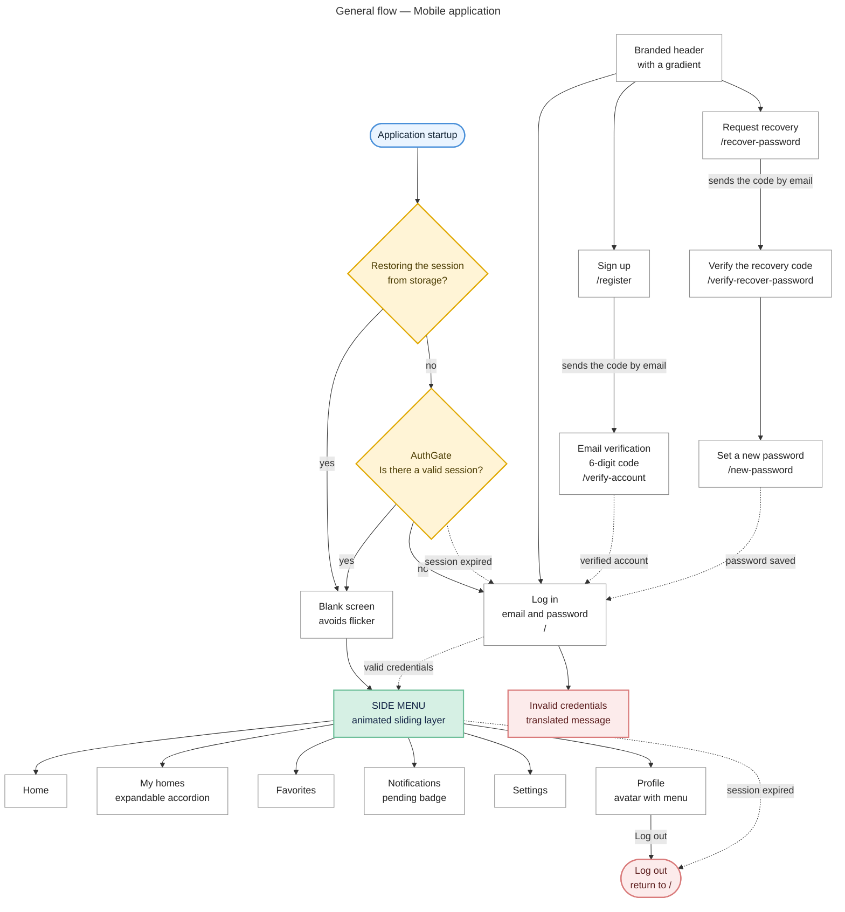
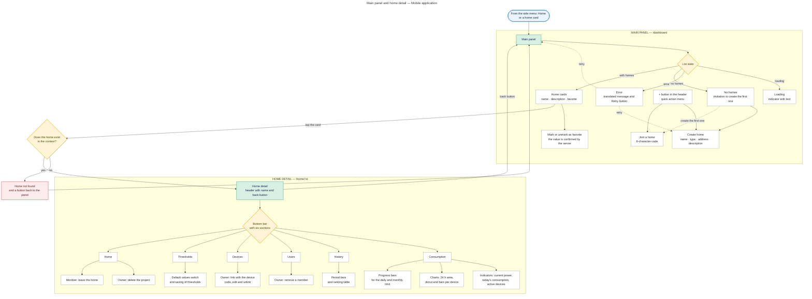
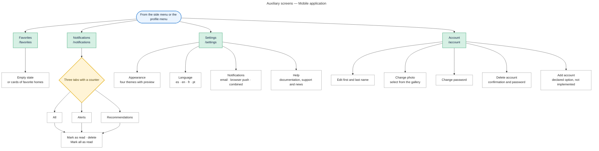

# Navigation map — Mobile application

**Project:** Electricity Consumption Monitor — EnergyMonitor
**Record:** 3145556 — Software Analysis and Development (ADSO), SENA CIES Regional Huila
**Version:** 1.0

---

## 1. Map 1 — General flow

Walks through the application from startup to log out, showing session restoration, the authentication guard and the side menu destinations.

**Figure 1.** [Download PNG image](mobile-navigation-map-1.png)

## 2. Map 2 — Main panel and home detail

Details the main screen and the six sections of a home detail, with the actions that the role allows.

**Figure 2.** [Download PNG image](mobile-navigation-map-2.png)

## 3. Map 3 — Auxiliary screens

Details the favorites, notifications, settings and account screens.

**Figure 3.** [Download PNG image](mobile-navigation-map-3.png)

## 4. How to read the maps

| **Symbol** | **Meaning** |
|---|---|
| Rounded blue node | Entry point |
| Green node | Module or main area of the application |
| White node | Screen, section or specific action |
| Amber node | Navigation guard or state decision |
| Red node | End of flow or access error |
| Solid arrow | Direct navigation |
| Dotted arrow | Return, retry or log out |

## 5. Navigation control points

| **Control point** | **Behavior** |
|---|---|
| `AuthGate` | Wraps the whole stack. Defines six public routes; any other one requires a session |
| Session restoration | While reading the session from storage it renders nothing, to avoid flicker |
| Expired session | The HTTP client **does not** navigate: it warns the guard, which returns to the log in screen |
| Detail back button | If the stack has a previous screen, it goes back; if the entry was through a direct link, it returns to the panel |
| `OWNER` or `MEMBER` role | The detail receives the role and shows or hides the management actions |
| Parameters between screens | The email travels in the URL (`?email=`); the recovery code travels in memory, not in the URL |

## 6. Routes

| **Zone** | **Route** | **Screen** |
|---|---|---|
| Public | `/` | Log in |
| Public | `/register` | Sign up |
| Public | `/verify-account` | Email verification |
| Public | `/recover-password` | Request recovery |
| Public | `/verify-recover-password` | Verify the recovery code |
| Public | `/new-password` | Set a new password |
| Private | `/dashboard` | Main panel |
| Private | `/homes` | Auxiliary list, with no access from the menu |
| Private | `/home/[id]` | Home detail |
| Private | `/favorites` | Favorites |
| Private | `/notifications` | Notifications |
| Private | `/settings` | Settings |
| Private | `/account` | Account |

**Total: 13 routes · 12 functional screens.**

## 7. Side menu structure

Order of the items, from top to bottom:

| **Position** | **Item** | **Destination** |
|---|---|---|
| Header | Logo and application name | — |
| 1 | **Home** | `/dashboard` |
| 2 | **My homes** — accordion with the list of the user's homes | `/home/:id` |
| 3 | **Favorites** | `/favorites` |
| 4 | **Notifications** — with a pending badge | `/notifications` |
| 5 | **Settings** | `/settings` |
| Footer | **Profile** — avatar, name and menu button | Menu: My account · Add account · Log out |

The layer opens with a fixed button in the top left corner and closes when the darkened backdrop is tapped, with a 300 millisecond animation.

## 8. Differences with the web navigation

| **Aspect** | **Web** | **Mobile** |
|---|---|---|
| Welcome page | Yes (`/home`) | No: it opens at the log in screen |
| Password recovery | 2 routes | 3 routes |
| Account screen | Modal over the current screen | Dedicated screen (`/account`) |
| Side menu | Fixed or collapsible | Sliding layer with a 300 ms animation |
| Detail sections | Top horizontal tabs | Bottom bar with icons |
| Device registration | Bluetooth from the browser | Code written by hand |
| Total routes | 14 | 13 |

## 9. Related artifacts

| **Artifact** | **Location** |
|---|---|
| Web navigation map | `web-navigation-map.md` |
| Navigation guard | `Energy-Monitor-Mobile/src/components/layout/AuthGate/AuthGate.tsx` |
| Side menu | `Energy-Monitor-Mobile/src/components/layout/Sidebar/Sidebar.tsx` |
| Bottom bar | `Energy-Monitor-Mobile/src/components/layout/BottomTabBar/BottomTabBar.tsx` |
| Interface design | `05-diseno-software/ES/05.5-interfaces-graficas.md`, section 5 |