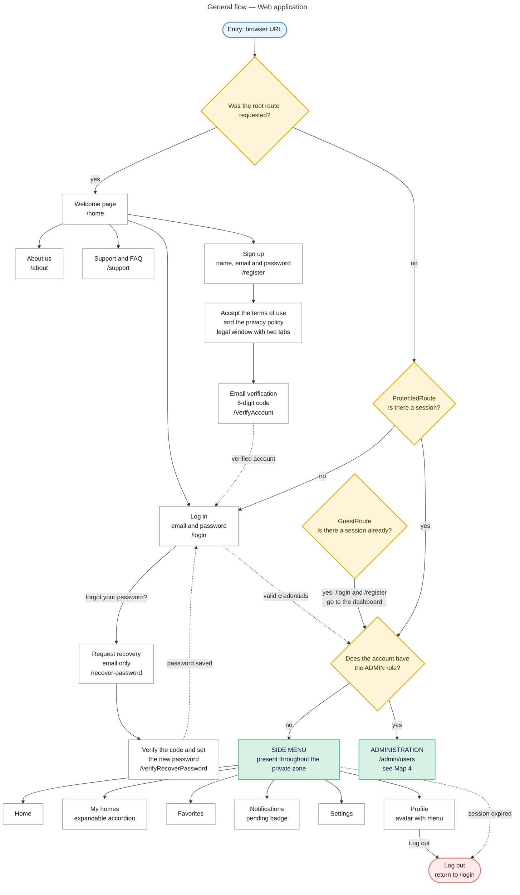
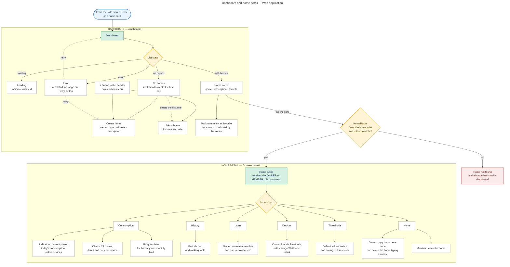
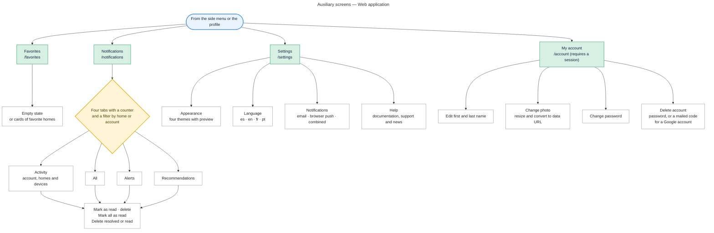
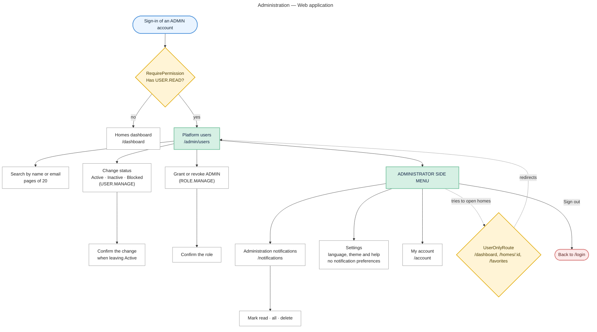

# Navigation map — Web application

**Project:** Electricity Consumption Monitor — EnergyMonitor
**Record:** 3145556 — Software Analysis and Development (ADSO), SENA CIES Regional Huila
**Version:** 1.1 (October 27, 2026: administrator role, guest, permission and user-only guards, activity notifications, legal window and account inside the protected zone)

---

## 1. Map 1 — General flow

Walks through the application from entry to exit, showing the public zone, the authentication guard and the side menu destinations.

**Figure 1.** [Download PNG image](web-navigation-map-1.png)

## 2. Map 2 — Dashboard and home detail

Details the main screen and the six sections of a home detail, with the actions that the role allows.

**Figure 2.** [Download PNG image](web-navigation-map-2.png)

## 3. Map 3 — Auxiliary screens

Details the favorites, notifications, settings and account screens, the latter opening as a modal.

**Figure 3.** [Download PNG image](web-navigation-map-3.png)

> The PNG Figures 1 to 3 predate version 1.1 (`[TO BE UPDATED]`): export them again from the Mermaid code of this file.

## 3.1 Map 4 — Administration (ADMIN role)

An account with the global `ADMIN` role only sees the administration, its notifications, the settings and its account. `UserOnlyRoute` sends it back to `/admin/users` when it tries to open the home screens, and `RequirePermission` sends to the dashboard whoever lacks `USER.READ`.

**Figure 4.** PNG image pending: `web-navigation-map-4.png` (export this diagram).

## 4. How to read the maps

| **Symbol** | **Meaning** |
|---|---|
| Rounded blue node | Entry point |
| Green node | Module or main area of the application |
| White node | Screen, section or specific action |
| Amber node | Navigation guard or state decision |
| Red node | End of flow |
| Solid arrow | Direct navigation |
| Dotted arrow | Return, retry or log out |

## 5. Navigation control points

| **Control point** | **Behavior** |
|---|---|
| Redirection of `/` | The root route sends to `/home`; there is no intermediate screen |
| `GuestRoute` | With an active session, `/login` and `/register` go straight to the dashboard |
| `ProtectedRoute` | Without a session, every private route (including `/account`) redirects to `/login` |
| `UserOnlyRoute` | An ADMIN account opening `/dashboard`, `/homes/:homeId` or `/favorites` goes back to `/admin/users` |
| `RequirePermission` | Without the `USER.READ` permission, `/admin/users` redirects to `/dashboard` (the API answers 403 anyway) |
| `HomeRoute` | If the home in the URL does not exist or is not accessible, it shows «Home not found» with a back button |
| `OWNER` or `MEMBER` role | The detail receives the role through the route context and shows or hides the management actions |
| Expired session | The HTTP client clears the session and sends the browser to `/login` a single time |
| Favorite | The value returned by the server is applied, not a local toggle |

## 6. Zones and routes

| **Zone** | **Routes** | **Screens** |
|---|---|---|
| Public | `/home`, `/about`, `/support`, `/login`, `/register`, `/VerifyAccount`, `/recover-password`, `/verifyRecoverPassword` | 8 |
| Private (user) | `/dashboard`, `/homes/:homeId`, `/favorites` | 3 |
| Private (user and administrator) | `/notifications`, `/settings`, `/account` | 3 |
| Administration | `/admin/users` | 1 |
| Any other route | `*` | Not found page |
| **Total** | | **15 + `*`** |

**Note:** `/account` is now **inside** `ProtectedRoute`: without a session it redirects to `/login`.

## 7. Private screen layout

The private screens share the same layout:

- **Left column — side menu:** Home · My homes · Favorites · Notifications · Settings
- **Lower left column — profile:** avatar with My account and Sign out (ADMIN account side menu: Administration · Notifications · Settings)
- **Right column — header:** breadcrumbs and the screen action button
- **Right column — body:** the screen content, with its own scrolling

At 1024 px or less, the side menu becomes a sliding layer with a darkened backdrop and a fixed menu button.

## 8. Related artifacts

| **Artifact** | **Location** |
|---|---|
| Mobile navigation map | `mobile-navigation-map.md` |
| Route definition | `Energy-Monitor-application/src/routes/AppRoutes.jsx` |
| Side menu | `Energy-Monitor-application/src/components/layout/MainLayout/Sidebar/Sidebar.jsx` |
| Interface design | `05-diseno-software/ES/05.5-interfaces-graficas.md`, section 4 |