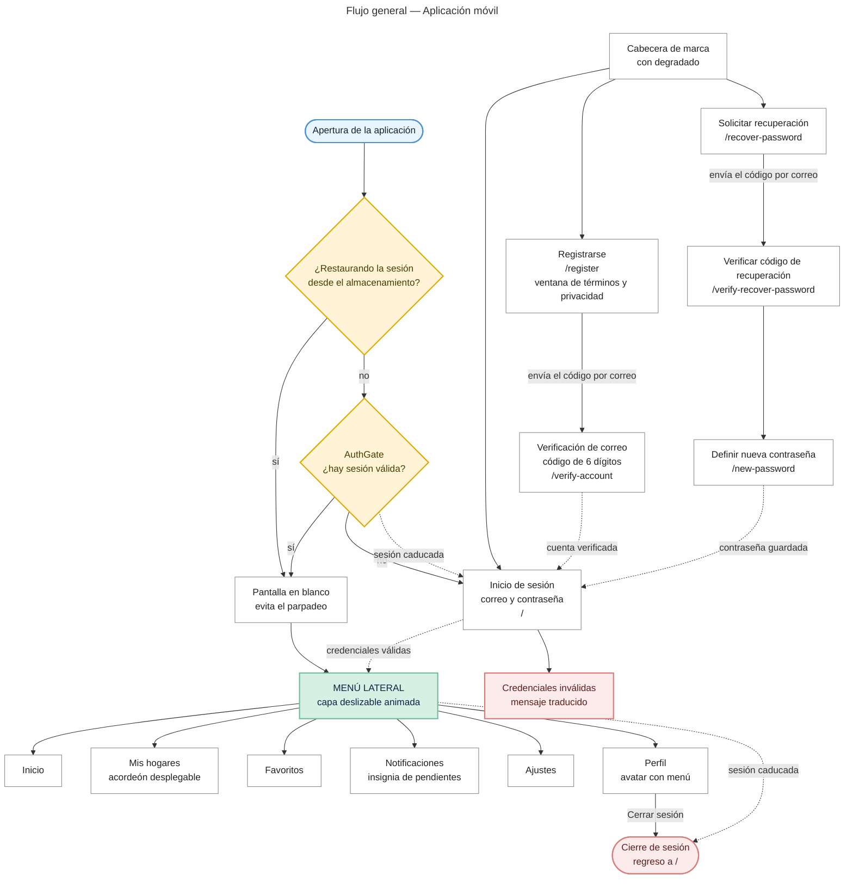
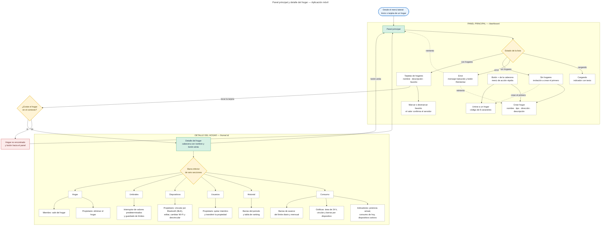
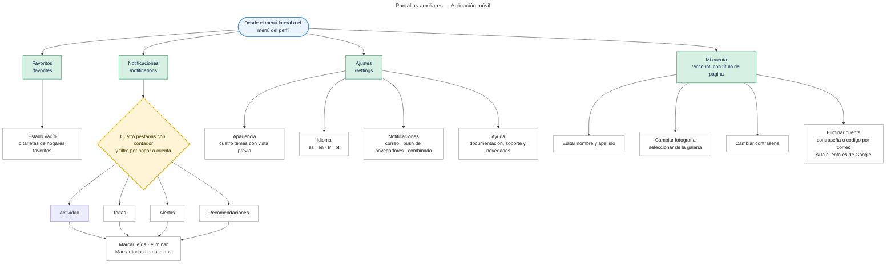

# Mapa de navegación — Aplicación móvil

**Proyecto:** Monitor de Consumo Eléctrico — EnergyMonitor
**Ficha:** 3145556 — Análisis y Desarrollo de Software (ADSO), SENA CIES Regional Huila
**Versión:** 1.1 (27 de octubre de 2026: ventana legal en el registro, vinculación por Bluetooth, transferencia y eliminación del hogar, pestaña Actividad, `/homes` redirige al panel; la app no tiene administración)

---

## 1. Mapa 1 — Flujo general

Recorre la aplicación desde la apertura hasta el cierre de sesión, mostrando la restauración de la sesión, la guarda de autenticación y los destinos del menú lateral.

**Figura 1.** [Descargar imagen en PNG](mapa-navegacion-movil-1.png)

## 2. Mapa 2 — Panel principal y detalle del hogar

Detalla la pantalla principal y las seis secciones del detalle de un hogar, con las acciones que el rol permite.

**Figura 2.** [Descargar imagen en PNG](mapa-navegacion-movil-2.png)

## 3. Mapa 3 — Pantallas auxiliares

Detalla las pantallas de favoritos, notificaciones, configuración y de cuenta.

**Figura 3.** [Descargar imagen en PNG](mapa-navegacion-movil-3.png)

## 4. Cómo leer los mapas

| **Símbolo** | **Significado** |
|---|---|
| Nodo azul redondeado | Punto de entrada |
| Nodo verde | Módulo o área principal de la aplicación |
| Nodo blanco | Pantalla, sección o acción concreta |
| Nodo ámbar | Guarda de navegación o decisión de estado |
| Nodo rojo | Fin de flujo o error de acceso |
| Flecha sólida | Navegación directa |
| Flecha punteada | Regreso, reintento o cierre de sesión |

## 5. Puntos de control de la navegación

| **Punto de control** | **Comportamiento** |
|---|---|
| `AuthGate` | Envuelve toda la pila. Define seis rutas públicas; cualquier otra exige sesión |
| Restauración de sesión | Mientras lee la sesión del almacenamiento no renderiza nada, para evitar el parpadeo |
| Sesión caducada | El cliente HTTP **no** navega: avisa al guarda, que devuelve al inicio de sesión |
| Botón atrás del detalle | Si la pila tiene pantalla anterior, retrocede; si se entró por enlace directo, vuelve al panel |
| Rol `OWNER` o `MEMBER` | El detalle recibe el rol y muestra u oculta las acciones de gestión |
| Parámetros entre pantallas | El correo viaja en la URL (`?email=`); el código de recuperación viaja en memoria, no en la URL |

## 6. Rutas

| **Zona** | **Ruta** | **Pantalla** |
|---|---|---|
| Pública | `/` | Inicio de sesión |
| Pública | `/register` | Registrarse |
| Pública | `/verify-account` | Verificación de correo |
| Pública | `/recover-password` | Solicitar recuperación |
| Pública | `/verify-recover-password` | Verificar código de recuperación |
| Pública | `/new-password` | Definir nueva contraseña |
| Privada | `/dashboard` | Panel principal |
| Privada | `/homes` | Redirige a `/dashboard` (ya no es una pantalla) |
| Privada | `/home/[id]` | Detalle del hogar |
| Privada | `/favorites` | Favoritos |
| Privada | `/notifications` | Notificaciones |
| Privada | `/settings` | Ajustes |
| Privada | `/account` | Cuenta |

**Total: 13 rutas · 12 pantallas funcionales.** La app no tiene landing page ni pantallas de administración.

## 7. Estructura del menú lateral

Orden de los elementos, de arriba hacia abajo:

| **Posición** | **Elemento** | **Destino** |
|---|---|---|
| Cabecera | Logotipo y nombre de la aplicación | — |
| 1 | **Inicio** | `/dashboard` |
| 2 | **Mis hogares** — acordeón con la lista de hogares del usuario | `/home/:id` |
| 3 | **Favoritos** | `/favorites` |
| 4 | **Notificaciones** — con insignia de pendientes | `/notifications` |
| 5 | **Ajustes** | `/settings` |
| Pie | **Perfil** — avatar y nombre | Mi cuenta · Cerrar sesión |

La capa se abre con un botón fijo en la esquina superior izquierda y se cierra al tocar el fondo oscurecido o con el botón «atrás» de Android, con una animación de 300 milisegundos. Cerrada, queda oculta para el lector de pantalla.

## 8. Diferencias con la navegación web

| **Aspecto** | **Web** | **Móvil** |
|---|---|---|
| Página de bienvenida | Sí (`/home`) | No: abre en el inicio de sesión |
| Recuperación de contraseña | 2 rutas | 3 rutas |
| Pantalla de cuenta | Pantalla `/account` dentro de la zona protegida | Pantalla propia (`/account`) con título |
| Administración | Sí (`/admin/users`, rol ADMIN) | No |
| Menú lateral | Fijo o plegable | Capa deslizable con animación de 300 ms |
| Secciones del detalle | Pestañas horizontales superiores | Barra inferior con iconos |
| Alta de dispositivo | Web Bluetooth (Chrome o Edge) | Bluetooth nativo del teléfono (BLE) |
| Total de rutas | 16 + página no encontrada | 13 |

## 9. Artefactos relacionados

| **Artefacto** | **Ubicación** |
|---|---|
| Mapa de navegación web | `mapa-navegacion-web.md` |
| Mapa de navegación analítico (árbol, matriz de acceso, flujos y puntos débiles) | `../navigation-map-mobile.md` |
| Guarda de navegación | `Energy-Monitor-Mobile/src/components/layout/AuthGate/AuthGate.tsx` |
| Menú lateral | `Energy-Monitor-Mobile/src/components/layout/Sidebar/Sidebar.tsx` |
| Barra inferior | `Energy-Monitor-Mobile/src/components/layout/BottomTabBar/BottomTabBar.tsx` |
| Diseño de interfaces | `05-diseno-software/ES/05.5-interfaces-graficas.md`, sección 5 |