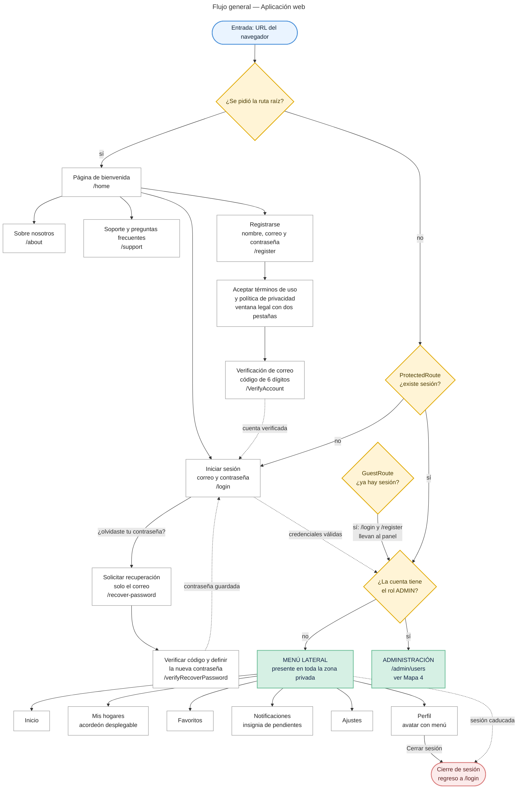
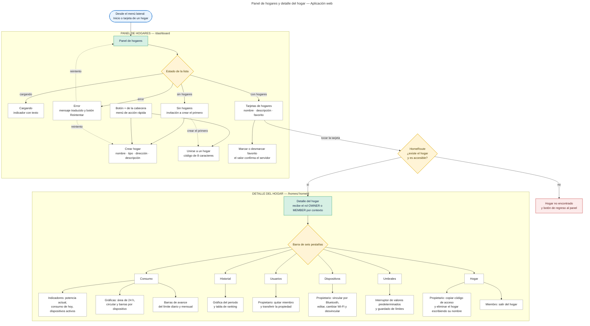
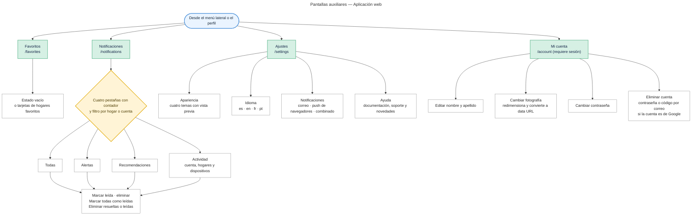
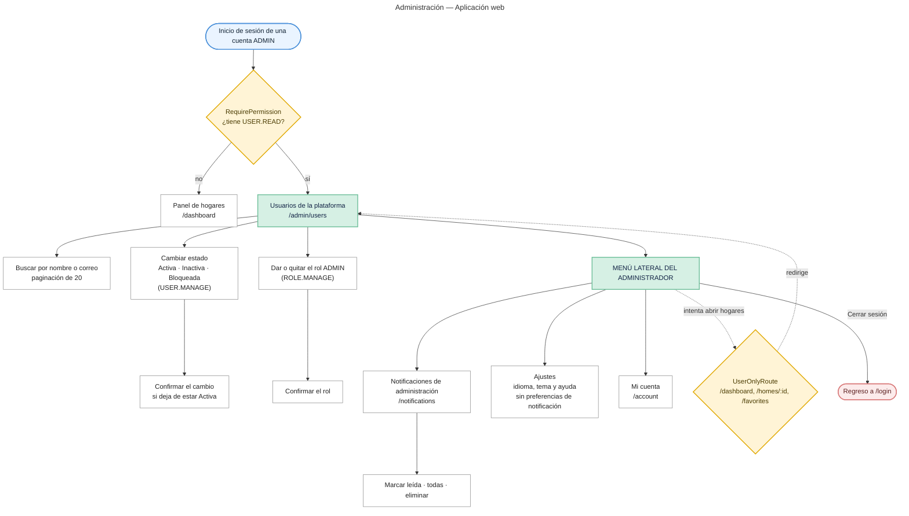

# Mapa de navegación — Aplicación web

**Proyecto:** Monitor de Consumo Eléctrico — EnergyMonitor
**Ficha:** 3145556 — Análisis y Desarrollo de Software (ADSO), SENA CIES Regional Huila
**Versión:** 1.1 (27 de octubre de 2026: rol administrador, guardas de invitado, de permiso y de solo usuario, notificaciones de actividad, ventana legal y cuenta dentro de la zona protegida)

---

## 1. Mapa 1 — Flujo general

Recorre la aplicación desde la entrada hasta la salida, mostrando la zona pública, la guarda de autenticación y los destinos del menú lateral.

**Figura 1.** [Descargar imagen en PNG](mapa-navegacion-web-1.png)

## 2. Mapa 2 — Panel de hogares y detalle del hogar

Detalla la pantalla principal y las seis secciones del detalle de un hogar, con las acciones que el rol permite.

**Figura 2.** [Descargar imagen en PNG](mapa-navegacion-web-2.png)

## 3. Mapa 3 — Pantallas auxiliares

Detalla las pantallas de favoritos, notificaciones, configuración y la de cuenta, que se abre como modal.

**Figura 3.** [Descargar imagen en PNG](mapa-navegacion-web-3.png)

> La Figura 1 a 3 en PNG son anteriores a la versión 1.1 (`[POR ACTUALIZAR]`): deben exportarse de nuevo desde el código Mermaid de este archivo.

## 3.1 Mapa 4 — Administración (rol ADMIN)

Una cuenta con el rol global `ADMIN` solo ve la administración, sus notificaciones, los ajustes y su cuenta. `UserOnlyRoute` la devuelve a `/admin/users` si intenta abrir las pantallas de hogares, y `RequirePermission` envía al panel a quien no tiene `USER.READ`.

**Figura 4.** Imagen PNG pendiente: `mapa-navegacion-web-4.png` (exportar este diagrama).

## 4. Cómo leer los mapas

| **Símbolo** | **Significado** |
|---|---|
| Nodo azul redondeado | Punto de entrada |
| Nodo verde | Módulo o área principal de la aplicación |
| Nodo blanco | Pantalla, sección o acción concreta |
| Nodo ámbar | Guarda de navegación o decisión de estado |
| Nodo rojo | Fin de flujo |
| Flecha sólida | Navegación directa |
| Flecha punteada | Regreso, reintento o cierre de sesión |

## 5. Puntos de control de la navegación

| **Punto de control** | **Comportamiento** |
|---|---|
| Redirección de `/` | La ruta raíz envía a `/home`; no hay pantalla intermedia |
| `GuestRoute` | Con una sesión activa, `/login` y `/register` llevan directo al panel |
| `ProtectedRoute` | Sin sesión, toda ruta privada (incluida `/account`) redirige a `/login` |
| `UserOnlyRoute` | Una cuenta ADMIN que abre `/dashboard`, `/homes/:homeId` o `/favorites` vuelve a `/admin/users` |
| `RequirePermission` | Sin el permiso `USER.READ`, `/admin/users` redirige a `/dashboard` (la API responde 403 de todos modos) |
| `HomeRoute` | Si el hogar de la URL no existe o no es accesible, muestra «Hogar no encontrado» con botón de regreso |
| Rol `OWNER` o `MEMBER` | El detalle recibe el rol por contexto de ruta y muestra u oculta las acciones de gestión |
| Sesión caducada | El cliente HTTP limpia la sesión y envía el navegador a `/login` una sola vez |
| Favorito | Se aplica el valor que devuelve el servidor, no una alternancia local |

## 6. Zonas y rutas

| **Zona** | **Rutas** | **Pantallas** |
|---|---|---|
| Raíz | `/` | Redirección a `/home`, sin pantalla propia |
| Pública | `/home`, `/about`, `/support`, `/login`, `/register`, `/VerifyAccount`, `/recover-password`, `/verifyRecoverPassword` | 8 |
| Privada (usuario) | `/dashboard`, `/homes/:homeId`, `/favorites` | 3 |
| Privada (usuario y administrador) | `/notifications`, `/settings`, `/account` | 3 |
| Administración | `/admin/users` | 1 |
| Cualquier otra ruta | `*` | Página no encontrada |
| **Total de rutas declaradas** | | **16 + `*`** |

**Nota:** desde la versión actual `/account` está **dentro** de `ProtectedRoute`: sin sesión redirige a `/login` (el punto débil que documentaba la versión 1.0 quedó resuelto).

## 7. Perfil de las pantallas privadas

Las pantallas privadas comparten la misma disposición:

- **Columna izquierda — menú lateral:** Inicio · Hogares · Favoritos · Notificaciones · Ajustes (cuenta ADMIN: Administración · Notificaciones · Ajustes)
- **Columna izquierda inferior — perfil:** avatar con Mi cuenta y Cerrar sesión
- **Columna derecha — cabecera:** migas de pan y botón de acción de la pantalla
- **Columna derecha — cuerpo:** el contenido de la pantalla, con desplazamiento propio

En pantallas de 1024 px o menos el menú lateral se convierte en una capa deslizable con fondo oscurecido y botón de menú fijo.

## 8. Artefactos relacionados

| **Artefacto** | **Ubicación** |
|---|---|
| Mapa de navegación móvil | `mapa-navegacion-movil.md` |
| Mapa de navegación analítico (árbol, matriz de acceso, flujos y puntos débiles) | `../navigation-map.md` |
| Definición de rutas | `Energy-Monitor-application/src/routes/AppRoutes.jsx` |
| Menú lateral | `Energy-Monitor-application/src/components/layout/MainLayout/Sidebar/Sidebar.jsx` |
| Diseño de interfaces | `05-diseno-software/ES/05.5-interfaces-graficas.md`, sección 4 |