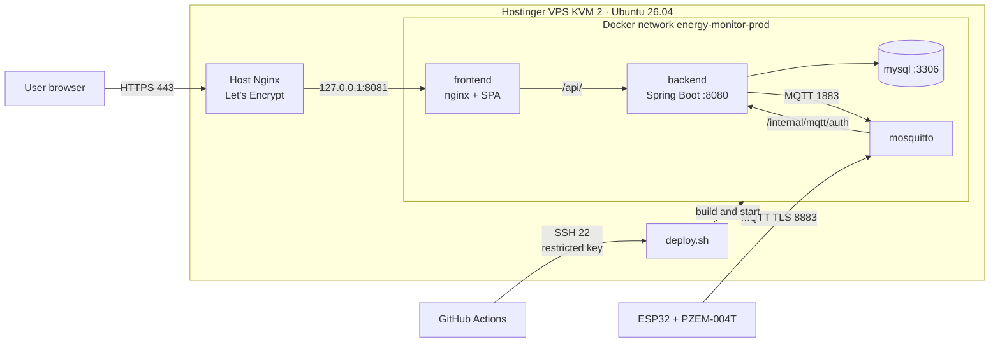
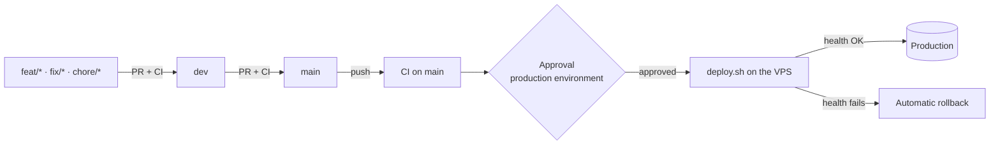

**NATIONAL LEARNING SERVICE – SENA**

**CENTER FOR INDUSTRY, BUSINESS AND SERVICES (CIES)**

**HUILA REGIONAL**

Training Program: Technology in Software Analysis and Development (ADSO)

Group: 3145556

**IMPLEMENTATION AND DEPLOYMENT MANUAL**

**Project: Electrical Consumption Monitor (EnergyMonitor)**

*Web app, REST API, database, MQTT broker and ESP32 + PZEM-004T meters published on a VPS, with continuous integration and deployment*

| **Item**           | **Information**                                                                   |
|--------------------|-----------------------------------------------------------------------------------|
| Team members       | Juan Esteban Cortés Parra, Miguel Ángel García Artunduaga                         |
| Instructor         | `[TO BE CONFIRMED]`                                                               |
| Training center    | Center for Industry, Business and Services (CIES) – SENA Huila Regional           |
| Program            | Technology in Software Analysis and Development (ADSO)                            |
| Group              | 3145556                                                                           |
| Document type      | Implementation and deployment manual                                              |
| Version            | 1.1                                                                               |
| Date               | October 16, 2026 (updated October 20, 2026)                                       |

Neiva, Huila · Colombia · 2026

> **Convention.** The public domain of the project is `energy-monitor.tech` and `<VPS_IP>` is the
> public IP of the server. On the server the domain is defined once
> (`export DOMAIN=energy-monitor.tech`) and the commands use it as `$DOMAIN`. No secret value
> (passwords, keys, tokens) appears in this report.

# Document version control

| **Version** | **Date**   | **Change description**                                                                                                                                   | **Owner**       |
|-------------|------------|----------------------------------------------------------------------------------------------------------------------------------------------------------|-----------------|
| 1.0         | 10/16/2026 | Report and production deployment runbook: web, API, MySQL and MQTT broker on a Hostinger VPS with Docker Compose, Nginx and Let's Encrypt; verification and rollback. | Development team |
| 1.1         | 10/20/2026 | Continuous integration and deployment strategy with GitHub Actions (section 9); selection and cost of the Hostinger KVM 2 plan (3.2); real domain; evidence from the VPS run; incidents of the real deployment; automated update and rollback. | Development team |

# Table of contents

| **Section**                   | **Main content**                                                       |
|-------------------------------|------------------------------------------------------------------------|
| Executive summary             | What is deployed, where and with what.                                 |
| 1 · General information       | Technical sheet, history and summary of changes.                       |
| 2 · Scope and architecture    | Components, topology, network matrix and responsibilities.             |
| 3 · Preparation and security  | Inventory, plan selection and costs, environment variables, backup.    |
| 4 · Deployment runbook        | Step by step: DNS, server, code, secrets, TLS, start-up, admin.        |
| 5 · IoT integration           | Public TLS MQTT broker, certificate and linking of meters.             |
| 6 · Tests and evidence        | Smoke tests, commands and evidence for the academic closing.           |
| 7 · Incidents and decisions   | Problems found during the deployment and technical decisions.          |
| 8 · Operation and contingency | Monitoring, updates, backup, rollback, security and SSH access.        |
| 9 · CI/CD strategy            | Continuous integration and deployment with GitHub Actions.             |
| 10 · Conclusions              | Deployment status, limits and next steps.                              |
| Annexes                       | Paths, commands and reference repositories.                            |

> **Scope of the evidence.** Checks run on the production server are marked **"Confirmed"**; those
> without an attached output or screenshot yet are marked **"Evidence pending"** and are not
> presented as facts.

# Executive summary

EnergyMonitor measures the electricity used by household appliances with ESP32 + PZEM-004T V3
modules that publish telemetry over MQTT with TLS; the Spring Boot backend stores it in MySQL,
evaluates alerts and recommendations, and the React web app shows it to the members of each home.

The system is deployed on a **Hostinger VPS, KVM 2 plan** (2 vCPU, 8 GB RAM) running **Ubuntu 26.04
LTS**, contracted for one month at **48,000 COP**. The whole platform runs in **Docker Compose** from the
`energy-monitor-infra` repository (`docker-compose.prod.yml`): MySQL 8.4, the backend, the Mosquitto
broker with authentication delegated to the backend, and the frontend served by nginx. **Nginx on
the host** is the only HTTP/HTTPS entry point, with **Let's Encrypt** certificates issued by
Certbot. The web app and the API are published at `https://energy-monitor.tech`; meters connect to
`mqtts://mqtt.energy-monitor.tech:8883`.

Updates go through **GitHub Actions**: every pull request runs the tests, and every change that
reaches `main` is deployed to the server after a **manual approval**, with a prior database backup,
a health check and **automatic rollback** if something fails.

The mobile app is **out of scope** for this deployment.

# 1. General information and version control

## 1.1 Technical sheet

| **Field**                    | **Recorded information**                                                     |
|------------------------------|------------------------------------------------------------------------------|
| System                       | EnergyMonitor · household electricity monitor with IoT                       |
| Modality                     | React/Vite web app, Spring Boot REST API, MQTT broker and ESP32 firmware     |
| Environment                  | Production / demonstration deployment reachable from the Internet            |
| Infrastructure provider      | Hostinger VPS · **KVM 2** plan · Ubuntu 26.04 LTS                            |
| Infrastructure cost          | 48,000 COP/month on a monthly contract (27,900 COP/month on a yearly contract); details in 3.2 |
| Domain                       | `energy-monitor.tech` (web and API) · `mqtt.energy-monitor.tech` (broker)    |
| Deployment repository        | `energy-monitor-infra`, file `docker-compose.prod.yml`                       |
| Integration and deployment   | GitHub Actions (`.github/workflows/ci-cd.yml` in backend, web and infra)     |
| Deployed branch              | `main` in all three repositories                                             |
| Consolidation date           | October 16, 2026; continuous deployment active since October 19              |
| Release tag                  | `[TO BE CONFIRMED]` — tagging `v1.0.0` in the repositories is recommended    |
| Version of this report       | 1.1                                                                          |

## 1.2 Document history

| **Version** | **Date**   | **Description**                                                        |
|-------------|------------|------------------------------------------------------------------------|
| 1.0         | 10/16/2026 | Deployment runbook for web, API, MySQL and MQTT broker in production.  |
| 1.1         | 10/20/2026 | CI/CD strategy, KVM 2 plan and costs, real evidence and incidents.     |

## 1.3 Summary of the changes that enable the deployment

- All Docker material consolidated in `energy-monitor-infra`: local stack, development mode and
  `docker-compose.prod.yml` for the server, now including the frontend.
- The `energy-monitor-devices` repository is retired: the firmware moves to the backend's
  `firmware/` folder and the broker configuration to `infra/mosquitto/`.
- Docker image for the frontend (Vite build + nginx) that serves the SPA and forwards only `/api/`
  to the backend: a single origin, no cross-domain CORS, and `/internal/**` never exposed.
- Broker volume permissions fixed (`mosquitto-data-owner` service), graceful backend shutdown
  (`stop_grace_period: 30s`) and `SERVER_FORWARD_HEADERS_STRATEGY=native` behind the proxy.
- Versioned templates in `infra/deploy/`: Nginx site, renewal hook for the broker certificate and
  daily MySQL backup; `make-admin.sh --prod` for the first administrator.
- Backend fix: client errors (missing parameter, invalid type, unknown route) answer 4xx instead
  of 500.
- GitHub Actions pipelines in all three repositories and the `infra/deploy/deploy.sh` script, which
  deploys one component with a backup, a health check and automatic rollback (section 9).

# 2. Scope, topology and architecture

## 2.1 Deployed components

| **Component**     | **Technology / role**                                                           | **Exposure**                            |
|-------------------|---------------------------------------------------------------------------------|-----------------------------------------|
| HTTPS proxy       | Nginx on the host, Let's Encrypt certificates (Certbot)                         | `https://energy-monitor.tech` (80 → 443) |
| Web frontend      | React 19 + Vite; nginx container that serves the SPA and forwards `/api/`       | Behind the proxy (127.0.0.1:8081)       |
| Backend / API     | Java 21, Spring Boot 4.1, JWT RS256, Liquibase, email, Web Push, Expo push      | `/api/v1/**` through the frontend       |
| Database          | MySQL 8.4, Docker volume `mysql-data`                                           | Internal Docker network only            |
| MQTT broker       | Mosquitto 2.0 + mosquitto-go-auth (auth and ACL delegated to the backend)       | `mqtt.energy-monitor.tech:8883` (TLS)   |
| Meters            | ESP32 + PZEM-004T V3, firmware with the Let's Encrypt roots                     | Outbound connection to the broker       |
| CI/CD             | GitHub Actions + `infra/deploy/deploy.sh` on the VPS                            | SSH with a restricted key               |

## 2.2 Architecture diagram



*Figure 1. Logical topology: clients, proxy, application, persistence, broker and deployment channel.*

The main domain serves the web app and, under `/api/`, the API. The frontend nginx forwards only
`/api/` to the backend, so the internal endpoints the broker uses to authenticate each client
(`/internal/mqtt/auth/**`) cannot be reached from the Internet. The broker is the only service
published directly (8883, TLS), because the meters do not speak HTTP.

## 2.3 Network and port matrix

| **Service**           | **Address / port**                      | **Exposure**                |
|-----------------------|-----------------------------------------|-----------------------------|
| SSH                   | 22                                      | Public (administration and GitHub Actions) |
| Host Nginx            | 80 (redirect) / 443 (TLS)               | Public                      |
| Frontend (nginx)      | 127.0.0.1:8081 → container :80          | Host only                   |
| Spring Boot backend   | 127.0.0.1:8080 → container :8080        | Host only (health, debug)   |
| MySQL 8.4             | container :3306                         | Private (Docker network)    |
| Internal Mosquitto    | container :1883 (no TLS)                | Private (Docker network)    |
| Mosquitto for devices | 8883 (TLS)                              | Public                      |

## 2.4 Separation of responsibilities

The browser talks only to `https://energy-monitor.tech`: the SPA and the API share one origin. The
backend manages accounts, JWT sessions, homes, devices, measurements, alerts, recommendations and
notifications, and it is the only source of truth about which device may connect: the broker stores
no users and asks the backend about every connection and every topic (with a 5-minute cache). The
meters only open outbound connections, so they work behind any home router.

# 3. Prerequisites and preparation

## 3.1 Platform inventory

| **Resource**         | **Configuration**                                                              |
|----------------------|--------------------------------------------------------------------------------|
| VPS                  | Hostinger KVM 2 · 2 vCPU · 8 GB RAM · 100 GB NVMe · Ubuntu 26.04 LTS (hostname `srv2066688`) |
| Orchestration        | Docker Engine + Docker Compose v2 plugin                                       |
| Proxy / TLS          | Nginx on the host; Let's Encrypt with Certbot (automatic renewal)              |
| Build                | On the VPS itself (`--build`): Maven inside the backend image, Vite inside the frontend image |
| CI/CD                | GitHub Actions (GitHub-hosted `ubuntu-latest` runners)                         |
| Domain               | `energy-monitor.tech` with A records for `@`, `www` and `mqtt`                 |

## 3.2 Provider and plan selection

**Requirements the infrastructure had to meet:**

- Expose **its own TCP port (8883)** for MQTT with TLS, besides HTTP/HTTPS: many PaaS platforms
  publish only HTTP, while a VPS gives full control over ports and the firewall.
- Run **four permanent containers** (MySQL, JVM backend, Mosquitto and frontend) and, on every
  deployment, **build** the backend with Maven and the frontend with Vite on the same server.
- A fixed, predictable monthly cost in Colombian pesos, suited to a training project.
- A provider with a Spanish-language panel, a manageable firewall and DNS management for the domain.

**Comparison of Hostinger VPS plans:**

| **Plan** | **vCPU** | **RAM** | **NVMe disk** | **Assessment for EnergyMonitor**                                                        |
|----------|----------|---------|---------------|-----------------------------------------------------------------------------------------|
| KVM 1    | 1        | 4 GB    | 50 GB         | Not enough: the JVM, MySQL and a concurrent Maven build exhaust memory and force swap.   |
| **KVM 2**| **2**    | **8 GB**| **100 GB**    | **Chosen**: builds and runs the whole stack without swap, with room to grow in meters and history. |
| KVM 4    | 4        | 16 GB   | 200 GB        | Oversized for a pilot's load; doubles the cost with no current benefit.                 |

**Decision:** the **KVM 2** plan. With 2 vCPU a build does not starve the running backend, and the
8 GB of RAM (7.7 GB usable as reported by the operating system) cover the backend JVM, MySQL,
Mosquitto, nginx and a build at the same time. If the load grows, Hostinger allows upgrading the plan
without reinstalling.

**Contract term:** the plan's price depends on the term. The project contracted it **for one
month** (48,000 COP), enough for the demonstration and the final presentation without committing to
a yearly payment. For continuous operation the 12-month contract is the better option:

| **Contract term**   | **Monthly price** | **Cost of 12 months** | **Note**                                             |
|---------------------|-------------------|-----------------------|------------------------------------------------------|
| Monthly (contracted)| 48,000 COP        | 576,000 COP           | No commitment; renewed month by month                |
| Yearly              | 27,900 COP        | 334,800 COP           | Paid upfront; saves 241,200 COP a year (≈ 42 %)      |

**Operating costs of the current deployment:**

| **Item**                     | **Cost**                | **Note**                                         |
|------------------------------|-------------------------|--------------------------------------------------|
| Hostinger KVM 2 VPS          | 48,000 COP/month        | Monthly contract                                 |
| Domain `energy-monitor.tech` | 0 COP                   | Obtained at no cost; check the renewal price before it expires |
| TLS certificates             | 0 COP                   | Let's Encrypt (free, automatic renewal)          |
| GitHub and GitHub Actions    | 0 COP                   | Within the minutes included at no cost           |
| **Total infrastructure**     | **48,000 COP/month**    | With a yearly contract: 27,900 COP/month         |

## 3.3 Prerequisite checklist

- DNS A records for `energy-monitor.tech`, `www.energy-monitor.tech` and `mqtt.energy-monitor.tech`
  pointing to `<VPS_IP>`.
- SSH access to the VPS with a `sudo` user (or root), with a personal key different from the GitHub
  Actions key (8.5).
- Ports 80 and 443 free for Nginx (do not install another proxy competing for them) and 8883 free
  for the broker.
- Changes merged into `main` in `energy-monitor-infra`, `energy-monitor-backend` and
  `Energy-Monitor-application`.
- An email account for sending (Gmail app password) and, if used, a Google OAuth client with
  `https://energy-monitor.tech` in *Authorized JavaScript origins*.
- Secrets managed outside the repositories, with restricted permissions (`chmod 600`).

## 3.4 Environment variables

Only public values are documented; secrets are generated on the server and live in
`infra/.env.prod` (git-ignored, mode 600).

| **Layer**  | **Variable / value without secrets**                                      | **Purpose**                                     |
|------------|---------------------------------------------------------------------------|-------------------------------------------------|
| Backend    | `SECURITY_CORS_ALLOWED_ORIGINS=https://energy-monitor.tech,https://www.energy-monitor.tech` | Allowed origins          |
| Backend    | `NOTIFICATION_WEB_URL=https://energy-monitor.tech`                        | Links in alert emails                           |
| Backend    | `DEVICE_MQTT_PUBLIC_HOST=mqtt.energy-monitor.tech` · `DEVICE_MQTT_PUBLIC_PORT=8883` | Broker the web app writes to the meter |
| Backend    | `JWT_KEYS_DIR=/opt/energy-monitor/keys` · `BACKEND_UID/GID=10001`         | JWT RSA pair and the user that reads it         |
| Backend    | `MAIL_HOST=smtp.gmail.com` · `MAIL_PORT=587` · `MAIL_FROM=...`            | Recovery, verification and alert emails         |
| Backend    | `MYSQL_PASSWORD`, `MYSQL_ROOT_PASSWORD`, `SECURITY_RESET_PEPPER`, `MQTT_BACKEND_PASS`, `MAIL_PASSWORD`, `GOOGLE_CLIENT_SECRET`, `NOTIFICATION_VAPID_PRIVATE_KEY`, `EXPO_ACCESS_TOKEN` (values omitted) | Protected secrets |
| Broker     | `MQTT_CERT_DIR=/opt/energy-monitor/mqtt-certs`                            | Let's Encrypt certificate for `mqtt.energy-monitor.tech` |
| Web        | `VITE_API_BASE_URL=""` (fixed in the compose file)                        | API on the same origin                          |
| Web        | `VITE_GOOGLE_CLIENT_ID=<public id>`                                       | Google button                                   |
| Proxy      | `WEB_PORT=8081`                                                           | Local port Nginx points to                      |
| GitHub     | `DEPLOY_HOST`, `DEPLOY_USER`, `DEPLOY_SSH_KEY`, `DEPLOY_KNOWN_HOSTS` (secrets of the `production` environment) | GitHub Actions access to the VPS (9.8) |

> **Important.** `VITE_*` variables are baked in when the frontend image is built: changing
> `.env.prod` afterwards does not modify an image that was already built; rebuild `frontend`.

## 3.5 Prior backup and contingency

A new installation has no data to back up. On every later deployment `deploy.sh` runs the MySQL
backup automatically and records the previous version of each repository (section 9.6). In addition:

1. Keep a safe copy of `.env.prod`, `/opt/energy-monitor/keys` and the broker certificate outside
   the server.
2. Make sure no procedure runs `docker compose down -v` or deletes volumes.
3. For a manual update, run `infra/deploy/backup-mysql.sh` first and check that the `.sql.gz` file
   is not empty.

# 4. Step-by-step deployment procedure (runbook)

This procedure covers the **initial installation** of the server. Later updates are done by GitHub
Actions (section 9). Every command runs on the VPS over SSH. First define the session variables:

```bash
export DOMAIN=energy-monitor.tech
export EM=/opt/energy-monitor
```

## 4.1 Domain and DNS

In the Hostinger panel (Domains → DNS / Nameservers) create the **A** records:

| **Name** | **Type** | **Value**   | **TTL** |
|----------|----------|-------------|---------|
| `@`      | A        | `<VPS_IP>`  | 300     |
| `www`    | A        | `<VPS_IP>`  | 300     |
| `mqtt`   | A        | `<VPS_IP>`  | 300     |

Check propagation before requesting certificates:

```bash
getent hosts $DOMAIN www.$DOMAIN mqtt.$DOMAIN
```

## 4.2 Server preparation

```bash
sudo apt update && sudo apt -y upgrade
sudo apt -y install ca-certificates curl git openssl ufw nginx certbot python3-certbot-nginx

# Docker Engine + Compose (official script; read it before running it)
curl -fsSL https://get.docker.com -o get-docker.sh
less get-docker.sh
sudo sh get-docker.sh
# If Docker's repository does not publish packages for 26.04 yet, use Ubuntu's:
#   sudo apt -y install docker.io docker-compose-v2
docker --version && docker compose version
```

Firewall (ports published by Docker bypass ufw; that is why the compose file publishes on
`127.0.0.1` everything that must not be public):

```bash
sudo ufw allow OpenSSH
sudo ufw allow 80/tcp
sudo ufw allow 443/tcp
sudo ufw allow 8883/tcp
sudo ufw enable
sudo ufw status
```

In the **Hostinger panel firewall** (if enabled) open the same ports: 22, 80, 443 and 8883.

The KVM 2 plan (8 GB) does not need swap. A plan with less than 4 GB of RAM does, so that Maven and
Vite can build:

```bash
sudo fallocate -l 2G /swapfile && sudo chmod 600 /swapfile
sudo mkswap /swapfile && sudo swapon /swapfile
echo '/swapfile none swap sw 0 0' | sudo tee -a /etc/fstab
```

## 4.3 Source code

The production compose file builds the backend and the frontend from clones next to `infra`. All
three clones follow `main`, the branch GitHub Actions deploys:

```bash
sudo mkdir -p $EM && sudo chown "$USER": $EM && cd $EM
git clone --branch main https://github.com/Juan-Cortes2045/energy-monitor-infra.git infra
git clone --branch main https://github.com/Juan-Cortes2045/energy-monitor-backend.git backend/energy-monitor-backend
git clone --branch main https://github.com/Juan-Cortes2045/Energy-Monitor-application.git frontend/energy-monitor-web
```

If a repository is private, create an SSH key on the server (`ssh-keygen -t ed25519`), register it
as a read-only *Deploy key* on GitHub (Settings → Deploy keys) and clone with the SSH URL
(`git@github.com:...`).

## 4.4 Secrets and keys

```bash
# JWT RSA pair (the backend reads it as uid 10001)
sudo mkdir -p $EM/keys
sudo openssl genpkey -algorithm RSA -pkeyopt rsa_keygen_bits:2048 -out $EM/keys/private.pem
sudo openssl rsa -in $EM/keys/private.pem -pubout -out $EM/keys/public.pem
sudo chown -R 10001:10001 $EM/keys && sudo chmod 600 $EM/keys/private.pem

# Random values for .env.prod (copy them by hand; they are not kept in the history)
openssl rand -hex 24   # MYSQL_PASSWORD
openssl rand -hex 24   # MYSQL_ROOT_PASSWORD
openssl rand -hex 32   # SECURITY_RESET_PEPPER
openssl rand -hex 24   # MQTT_BACKEND_PASS
```

VAPID keys for browser push (once per environment). Each value must stay on **a single line**, with
no spaces or line breaks (see the incident in section 7):

```bash
openssl ecparam -name prime256v1 -genkey -noout -out vapid.pem
echo "NOTIFICATION_VAPID_PRIVATE_KEY=$(openssl ec -in vapid.pem -outform DER | tail -c +8 | head -c 32 | base64 -w0 | tr '+/' '-_' | tr -d '=')"
echo "NOTIFICATION_VAPID_PUBLIC_KEY=$(openssl ec -in vapid.pem -pubout -outform DER | tail -c 65 | base64 -w0 | tr '+/' '-_' | tr -d '=')"
rm vapid.pem
```

## 4.5 HTTPS proxy: Nginx and Let's Encrypt

```bash
cd $EM/infra
sed "s/DOMINIO/$DOMAIN/g" deploy/nginx-energy-monitor.conf | sudo tee /etc/nginx/sites-available/energy-monitor >/dev/null
sudo ln -sf /etc/nginx/sites-available/energy-monitor /etc/nginx/sites-enabled/energy-monitor
sudo rm -f /etc/nginx/sites-enabled/default
test -s /etc/nginx/sites-available/energy-monitor && echo "site OK"   # must not be empty
sudo nginx -t && sudo systemctl reload nginx

# Certificate for the web app and the API (Certbot adds the 443 block and the HTTPS redirect)
sudo certbot --nginx -d $DOMAIN -d www.$DOMAIN
```

The site forwards **the whole** domain to `127.0.0.1:8081` (frontend nginx), replaces
`X-Forwarded-For` with the real client IP so it cannot be forged, and accepts bodies up to 10 MB.
If the certificate already exists but the site file was regenerated, reinstall it with
`sudo certbot install --nginx --cert-name $DOMAIN`.

## 4.6 MQTT broker certificate

The broker uses its own Let's Encrypt certificate for `mqtt.energy-monitor.tech`. Certbot issues it
with HTTP-01 through Nginx, and the `renew-mqtt-cert.sh` hook copies it to where Mosquitto (uid 1000)
reads it, on issuance and on every renewal:

```bash
sudo certbot certonly --nginx -d mqtt.$DOMAIN
sudo cp $EM/infra/deploy/renew-mqtt-cert.sh /etc/letsencrypt/renewal-hooks/deploy/energy-monitor-mqtt.sh
sudo chmod 755 /etc/letsencrypt/renewal-hooks/deploy/energy-monitor-mqtt.sh
sudo MQTT_DOMAIN=mqtt.$DOMAIN /etc/letsencrypt/renewal-hooks/deploy/energy-monitor-mqtt.sh
ls -l $EM/mqtt-certs          # server.crt and server.key, owned by 1000
```

If `mqtt-certs` stays empty, Mosquitto restarts in a loop: run the hook again (the last line, with
`MQTT_DOMAIN`).

## 4.7 Production configuration (.env.prod)

```bash
cd $EM/infra
cp .env.prod.example .env.prod && chmod 600 .env.prod
nano .env.prod
```

Values to fill in (besides the secrets generated in 4.4):

```
SECURITY_CORS_ALLOWED_ORIGINS=https://energy-monitor.tech,https://www.energy-monitor.tech
NOTIFICATION_WEB_URL=https://energy-monitor.tech
DEVICE_MQTT_PUBLIC_HOST=mqtt.energy-monitor.tech
JWT_KEYS_DIR=/opt/energy-monitor/keys
MQTT_CERT_DIR=/opt/energy-monitor/mqtt-certs
BACKEND_UID=10001
BACKEND_GID=10001
MAIL_USERNAME / MAIL_PASSWORD / MAIL_FROM
GOOGLE_CLIENT_ID / GOOGLE_CLIENT_SECRET / VITE_GOOGLE_CLIENT_ID   (optional)
NOTIFICATION_VAPID_PUBLIC_KEY / NOTIFICATION_VAPID_PRIVATE_KEY    (optional)
EXPO_ACCESS_TOKEN                                                 (optional)
```

Validate without starting anything:

```bash
docker compose -f docker-compose.prod.yml --env-file .env.prod config -q && echo OK
```

## 4.8 Build and start

First create the `emc` alias so the production file does not have to be repeated in every command
(a `docker compose` without `-f docker-compose.prod.yml` would target the local stack and fail):

```bash
echo "alias emc='docker compose -f $EM/infra/docker-compose.prod.yml --env-file $EM/infra/.env.prod --project-directory $EM/infra'" >> ~/.bashrc
source ~/.bashrc

emc up -d --build
emc ps
emc logs -f backend     # Ctrl+C to exit
```

The first build takes several minutes (Maven and npm dependencies). On the first start Liquibase
creates the full schema; the backend takes about 2 minutes to be ready and, meanwhile, the web app
answers **502**. It is ready when the log shows `Started EnergyMonitorBackendApplication` and:

```bash
curl -s http://127.0.0.1:8080/actuator/health      # {"status":"UP"...}
```

## 4.9 First administrator

No account is an administrator after installation. Register the account at
`https://energy-monitor.tech` and then:

```bash
cd $EM/infra
./make-admin.sh --prod admin-email@example.com
```

Without `--prod` the script looks for the local stack and cannot find `MYSQL_ROOT_PASSWORD`. Log
out and back in: the menu shows **Administration**. From there that administrator grants the role
to other accounts.

## 4.10 Daily backup

```bash
sudo crontab -e
# add:
0 3 * * * /opt/energy-monitor/infra/deploy/backup-mysql.sh >> /var/log/energy-monitor-backup.log 2>&1
```

Run it once by hand to check it: `sudo $EM/infra/deploy/backup-mysql.sh`. Backups are kept for 14
days in `/opt/energy-monitor/backups`.

## 4.11 Enabling continuous deployment

Once the initial installation is finished, GitHub Actions is configured (section 9.8). From then on
there are no manual deployments.

# 5. IoT integration: MQTT broker and meters

## 5.1 Goal and exposed service

Let the meters of any home publish their telemetry over the Internet without opening ports on the
router: the ESP32 only opens an outbound connection to `mqtt.energy-monitor.tech:8883` with TLS.

## 5.2 Authentication delegated to the backend

Mosquitto stores no users. With `mosquitto-go-auth` it asks the backend about every connection
(`POST /internal/mqtt/auth/user`, `device_code` / `api_key`) and every topic
(`POST /internal/mqtt/auth/acl`), with a 5-minute cache. The backend stores only the SHA-256 of
each key. These endpoints accept calls only from the internal Docker network
(`MQTT_AUTH_ALLOWED_NETWORKS=172.16.0.0/12,127.0.0.1/32`) and, in addition, they do not go through
the proxy.

## 5.3 Certificate and firmware

In production the broker presents the Let's Encrypt certificate for `mqtt.energy-monitor.tech`.
The firmware (`energy-monitor-backend/firmware/esp32-pzem-monitor`) already includes the ISRG Root
X1 and X2 roots, so it **does not need to be rebuilt** for production. The development CA
(`dev_ca.h`) is only used with the local stack.

## 5.4 Linking a meter

1. The home owner opens `https://energy-monitor.tech` in Chrome/Edge (HTTPS is required for Web
   Bluetooth) and goes to **Home → Devices → Link device**.
2. They hold BOOT for 3 s on the ESP32 (LED blinking) and select it.
3. The web app writes to the module the home Wi-Fi, its `device_code`, the `api_key` and the broker
   `mqtt.energy-monitor.tech:8883` provided by the backend (`DEVICE_MQTT_PUBLIC_HOST`).
4. The module connects; the broker logs `New client connected ... u'<device_code>'` and the web app
   shows the device as **ONLINE**.

# 6. Verification plan and smoke tests

## 6.1 Status matrix per component

| **Check**                           | **Expected evidence**                                                         | **Status**                 |
|-------------------------------------|-------------------------------------------------------------------------------|----------------------------|
| Production compose                  | `docker compose ... config -q` without errors (also on every infra PR)        | Confirmed                  |
| Backend test suite                  | 1131 tests, 0 failures against MySQL 8.4 (locally and in GitHub Actions)      | Confirmed                  |
| Web tests and build                 | Vitest tests and `npm run build` pass (locally and in GitHub Actions)         | Confirmed                  |
| Nginx template                      | `nginx -t` passes (on every infra PR)                                         | Confirmed                  |
| DNS                                 | The three names resolve to `<VPS_IP>`                                         | Confirmed                  |
| HTTPS web app                       | `https://energy-monitor.tech` → 200; `http://` → 301 to HTTPS                 | Confirmed                  |
| Certificates                        | Let's Encrypt valid until 01/14/2027, automatic renewal                      | Confirmed                  |
| API through the proxy               | `GET /api/v1/homes` without a session → 401                                   | Confirmed                  |
| `/internal/**` not exposed          | `POST https://energy-monitor.tech/internal/mqtt/auth/user` → 405 from nginx, never reaches the backend | Confirmed |
| Backend and Liquibase               | `actuator/health` → UP                                                        | Confirmed                  |
| Broker TLS                          | `openssl s_client` to `mqtt.energy-monitor.tech:8883` → `Verify return code: 0` | Confirmed                |
| Continuous deployment               | Green runs of the three pipelines with approval (9.9)                         | Confirmed                  |
| Backup                              | `.sql.gz` produced by `deploy.sh` on every deployment                         | Confirmed                  |
| Backend subscribed to the broker    | Broker log: `New client connected ... u'em-backend'`                          | Evidence pending           |
| Sign-up, login and recovery         | Account created, verification/recovery email with links to the domain        | Evidence pending           |
| Administration                      | `make-admin.sh --prod` and the **Administration** menu visible                | Evidence pending           |
| Meter in production                 | Bluetooth linking, ONLINE status and measurements in the web app              | Evidence pending           |
| Scheduled daily backup              | `crontab` entry and the day's file in `/opt/energy-monitor/backups`           | Evidence pending           |
| Certificate renewal                 | `certbot renew --dry-run` without errors                                      | Evidence pending           |
| Performance with several users      | No load tests have been run                                                   | Pending                    |

## 6.2 Check commands

From any computer:

```bash
curl -s -o /dev/null -w '%{http_code}\n' https://energy-monitor.tech                          # 200
curl -s -o /dev/null -w '%{http_code}\n' http://energy-monitor.tech                           # 301
curl -s -o /dev/null -w '%{http_code}\n' https://energy-monitor.tech/api/v1/homes             # 401
curl -s -o /dev/null -w '%{http_code}\n' -X POST https://energy-monitor.tech/internal/mqtt/auth/user  # 405
echo | openssl s_client -connect energy-monitor.tech:443 -servername energy-monitor.tech 2>/dev/null | openssl x509 -noout -enddate
openssl s_client -connect mqtt.energy-monitor.tech:8883 -servername mqtt.energy-monitor.tech </dev/null 2>/dev/null | grep 'Verify return code'
```

On the server:

```bash
curl -s http://127.0.0.1:8080/actuator/health
emc ps
emc logs --tail 50 mosquitto | grep 'New client connected'
for r in infra backend/energy-monitor-backend frontend/energy-monitor-web; do
  echo "$r: $(git -C /opt/energy-monitor/$r log -1 --oneline)"
done                                                     # must match main on GitHub
ls -lh /opt/energy-monitor/backups | tail -3
sudo certbot renew --dry-run
```

## 6.3 Evidence required for the academic closing

- Screenshot of `https://energy-monitor.tech` open with the HTTPS padlock, and of the dashboard with
  a home.
- Output of `emc ps` with the four services `Up` (no sensitive data).
- Output of `actuator/health` and of `openssl s_client` against the broker, with the date.
- Screenshot of the linked meter as ONLINE and of the measurements received.
- Screenshot of the verification or recovery email with the link to the public domain.
- Output of `certbot renew --dry-run` and of a generated backup.
- Screenshots of the green GitHub Actions runs for backend, web and infra, and of the `production`
  environment approval.

# 7. Incidents found and technical decisions

**During preparation (local environment):**

| **Situation**                                    | **Observed cause**                                                                  | **Action taken / lesson**                                                                                      |
|--------------------------------------------------|-------------------------------------------------------------------------------------|----------------------------------------------------------------------------------------------------------------|
| The ESP32 could not connect (`X509 verification failed`) | The development certificate did not include the PC's current IP             | `prepare.sh` always includes `DEVICE_MQTT_PUBLIC_HOST`; production uses Let's Encrypt with a domain.           |
| The broker rejected the ESP32 (`unknown ca`)     | The firmware had been built with another development CA                             | Reflash from the computer whose CA matches; in production the Let's Encrypt roots avoid the problem.           |
| The firmware did not fit (108 %)                 | Default partition scheme (1.2 MB)                                                   | Use *Minimal SPIFFS (1.9MB APP with OTA)*; NVS does not move and the linking is kept.                          |
| Mosquitto could not save its database (`Permission denied`) | The volume is created owned by root and Mosquitto runs as uid 1000       | `mosquitto-data-owner` service that hands the volume to uid 1000 before the broker starts.                     |
| The backend exited with code 137 when stopped    | Graceful shutdown took longer than the default 10 s                                 | `stop_grace_period: 30s`.                                                                                      |
| Client errors answered 500                       | The global exception handler also caught Spring MVC errors                          | The framework's 4xx status is kept; found by a new test of the recommendations controller.                     |
| Behind the proxy every request had the proxy's IP | The backend ignores `X-Forwarded-For` by design                                    | `SERVER_FORWARD_HEADERS_STRATEGY=native`, and the host Nginx replaces the header with the real IP.             |
| `make-admin.sh` did not work on the server       | It looked for the local container and read `.env`                                   | `--prod` option: uses the `mysql` service from `docker-compose.prod.yml` and `.env.prod`.                      |
| Docker spread over three repositories            | Compose files in backend, `devices` and `infra` with conflicting names and volumes  | All Docker in `infra`; firmware in the backend; `devices` archived.                                            |
| Single proxy                                     | Several proxies would compete for 80/443                                            | Host Nginx as the only entry point; Docker publishes on `127.0.0.1` everything except the broker.              |

**During the VPS deployment and the CI/CD set-up:**

| **Situation**                                    | **Observed cause**                                                                  | **Action taken / lesson**                                                                                      |
|--------------------------------------------------|-------------------------------------------------------------------------------------|----------------------------------------------------------------------------------------------------------------|
| `docker compose ps` did not show the services    | Without `-f docker-compose.prod.yml` the command targets the local stack            | `emc` alias with the file, `.env.prod` and the project directory (4.8).                                        |
| The web app did not load ("This site can't be reached") | The Nginx site file ended up empty when generated                            | Regenerate it with `sed … \| sudo tee`, check it with `test -s` and reinstall the certificate with `certbot install` (4.5). |
| The backend restarted in a loop (`WebPushSender`) | Malformed VAPID keys in `.env.prod` (truncated or with line breaks)                | Regenerate them on the server and paste each on a single line (4.4).                                           |
| Mosquitto restarted in a loop                    | `mqtt-certs` empty: the certificate hook had not run                                | Run the hook with `MQTT_DOMAIN` after issuing the certificate (4.6).                                           |
| The web app answered 502 right after a deployment | The backend takes about 2 minutes to start                                         | Wait for `actuator/health` UP; `deploy.sh` waits up to 300 s before declaring success or rolling back.         |
| Deploying the frontend also rebuilt the backend  | In the compose file the frontend depends on the backend                             | `deploy.sh` uses `up -d --build --no-deps <service>`: only the deployed component changes.                     |
| The server fingerprint did not match             | `ssh-keygen -lf` was run on the PC instead of the server                            | Compare the `ssh-keyscan` fingerprint with `/etc/ssh/ssh_host_ed25519_key.pub` **on the server**.              |
| Personal SSH ended in `Uso: deploy.sh …`         | The PC's SSH agent offered the GitHub Actions key, restricted to `deploy.sh`        | `~/.ssh/config` entry with `IdentitiesOnly yes` and the personal key (8.5).                                    |

# 8. Operation, maintenance and rollback plan

## 8.1 Operational monitoring

```bash
emc ps
docker stats --no-stream
emc logs --tail 100 backend
emc logs --tail 100 mosquitto
sudo tail -n 50 /var/log/nginx/error.log
df -h && free -h
```

## 8.2 Updating the application

The normal path is **GitHub Actions** (section 9): merge the change into `main`, approve the
deployment under *Review deployments* and check that the job ends green.

If GitHub is unavailable, the same script can be run by hand on the server; it does exactly what the
pipeline does (backup, `git pull` of `main`, build, health check and rollback):

```bash
sudo /opt/energy-monitor/infra/deploy/deploy.sh backend     # or frontend, or infra
```

Liquibase applies only the new changesets on start-up. An `infra` deployment re-applies the compose
file and recreates Mosquitto to pick up changes in `mosquitto.conf`.

## 8.3 Controlled rollback

1. **Automatic:** if the health check fails after a deployment, `deploy.sh` moves the repository
   back to the previous version, rebuilds the service and leaves the GitHub job red.
2. **Manual, code:** redeploy a previous version with a *revert* on `main` (it is traced in the
   history and goes through the same pipeline). Avoid `git reset --hard` on the server.
3. **Data:** if a Liquibase migration damaged data, stop the backend (`emc stop backend`), restore
   the latest backup from `/opt/energy-monitor/backups` (command in `deploy/backup-mysql.sh`) and
   deploy the previous version. Every changeset has a `rollback`, but restoring the backup is the
   safest option.
4. **Broker certificate:** `sudo certbot renew` and run the hook by hand (4.6).
5. After any rollback, repeat the checks in 6.2.

## 8.4 Security and good practices

- Clients reach the system only over HTTPS (443) and MQTT TLS (8883); certificates renew
  automatically.
- 8080 and 8081 bound to `127.0.0.1`; MySQL and the MQTT 1883 listener only on the Docker network.
- `/internal/**` does not go through the proxy and, in addition, accepts only private networks.
- `.env.prod` (600), `keys/` (owned by 10001) and `mqtt-certs/` outside the repositories.
- `X-Forwarded-For` replaced in Nginx so the attempt limit uses the real IP.
- Daily backups and before every deployment, with periodic restore tests: a Docker volume is not a
  backup.
- Never run `docker compose down -v` in production: it deletes the database.
- Swagger is not exposed: `/v3/api-docs` and `/swagger-ui` do not go through the proxy. To turn it
  off inside the server as well, add `SPRINGDOC_APIDOCS_ENABLED=false` and
  `SPRINGDOC_SWAGGERUI_ENABLED=false` to the backend.
- The GitHub Actions key can only run `deploy.sh` (9.7) and deployments require human approval.

## 8.5 Administrative SSH access

The server has two authorized keys with different purposes: the administrator's **personal** key
(full shell) and the **GitHub Actions** key (restricted to `deploy.sh`). If the computer's SSH agent
holds both, it may offer the GitHub key first and the connection ends with
`Uso: deploy.sh backend|frontend|infra`. To avoid it, on the administrator's computer:

```
# ~/.ssh/config
Host energy-monitor <VPS_IP>
  HostName <VPS_IP>
  User root
  IdentityFile ~/.ssh/id_ed25519
  IdentitiesOnly yes
```

And authorize the personal key once with `ssh-copy-id -i ~/.ssh/id_ed25519.pub energy-monitor`. The
Hostinger panel's web terminal is the emergency access. The `command="…deploy.sh"…` line is never
removed from `/root/.ssh/authorized_keys`: GitHub Actions uses it.

# 9. Continuous integration and deployment strategy (CI/CD)

## 9.1 Goal

No change reaches production without passing the automated tests, reaching production does not
depend on running commands by hand, and a failed deployment does not leave the service down.

## 9.2 Chosen tool

**GitHub Actions** was chosen over the alternatives:

| **Option**        | **Advantages**                                                   | **Drawbacks for this project**                                         |
|-------------------|------------------------------------------------------------------|------------------------------------------------------------------------|
| **GitHub Actions**| Built into the repositories the team already uses; *environments* with approval and secrets; free runners; no extra server. | Runs limited to the included minutes.               |
| Jenkins           | Very flexible, self-hosted.                                      | Needs another server or takes RAM from the VPS; maintenance and plugins. |
| GitLab CI/CD      | Powerful pipelines and an image registry.                        | Requires migrating or mirroring the GitHub repositories.               |
| Manual deployment | No set-up cost.                                                  | Error-prone (see section 7), no mandatory tests and no traceability.   |

## 9.3 Branch flow



*Figure 2. From the working branch to production.*

- **Backend and web:** `feat/*`, `fix/*` or `chore/*` → PR to `dev` → PR from `dev` to `main`.
- **Infra:** working branches go straight to `main` through a PR.
- The rules on `dev` and `main` require a PR and a green CI check to merge.
- Only `main` is deployed; `dev` is the integration branch and has no server of its own.

## 9.4 Pipelines per repository

Each repository has a `.github/workflows/ci-cd.yml` file with two jobs:

| **Repository**               | **CI job (required check)**       | **What it validates**                                                                                  | **Runs on**                  |
|------------------------------|-----------------------------------|--------------------------------------------------------------------------------------------------------|------------------------------|
| `energy-monitor-backend`     | `Tests`                           | Java 21 + `./mvnw test`: 1131 tests against a MySQL 8.4 service container, with throwaway RSA keys and pepper. On failure it keeps the Surefire reports. | PR and push to `dev`/`main` |
| `Energy-Monitor-application` | `Tests and build`                 | Node 22, `npm ci`, Vitest tests and the production `npm run build`.                                    | PR and push to `dev`/`main`  |
| `energy-monitor-infra`       | `Validate compose and scripts`    | `docker compose config` for the three modes, `bash -n` and `shellcheck` on the scripts, `nginx -t` on the site template. | PR and push to `main` |

The second job, **`Deploy to production`**, runs only on `main` (on push or with *Run workflow*) and
only if CI passed. It waits for the `production` environment approval, runs
`deploy.sh <component>` over SSH and ends with a public smoke test (the web app answers and
`/api/v1/homes` returns 401).

Common settings:

- `concurrency`: a new push to a PR cancels that PR's previous run; deployments are never cancelled
  halfway and are queued.
- `permissions: contents: read`: the pipeline cannot modify the repository.
- No real secret is used by the tests: the backend generates throwaway values on the runner.

## 9.5 Why images are built on the server

The images are built on the VPS (`up -d --build`) instead of being published to an image registry.
That removes the need for a registry and extra credentials, and the production compose file is the
same one used for the initial installation. The cost is that each backend deployment spends a few
minutes building on the server, which the 2 vCPU and 8 GB of the KVM 2 plan absorb (3.2).

## 9.6 What `deploy.sh` does on the server

`infra/deploy/deploy.sh <backend|frontend|infra>`:

1. Takes a **lock** (`flock`): two deployments arriving at the same time from different
   repositories run one after the other.
2. Records the current version of the component's repository.
3. Runs the **MySQL backup** (`backup-mysql.sh`).
4. Runs `git fetch` and `merge --ff-only` of `origin/main`: if the server clone had changes of its
   own, it stops instead of merging.
5. Rebuilds and starts **only** that service (`up -d --build --no-deps`). For `infra` it re-applies
   the whole compose file and recreates Mosquitto.
6. Waits up to 300 s for `actuator/health` to report `UP` and the web app to answer 200.
7. If the check fails, it prints the latest logs, goes back to the previous version, rebuilds it and
   exits with an error, so the GitHub job turns red.

## 9.7 Pipeline security

- **Dedicated, restricted key:** GitHub connects with its own ed25519 key. In `authorized_keys` it
  carries `command="/opt/energy-monitor/infra/deploy/deploy.sh"` and
  `no-port-forwarding,no-agent-forwarding,no-X11-forwarding,no-pty`: it can only run that script
  with one of the three valid arguments. It opens no shell and runs no other command. Tested: with a
  different argument it answers `Uso: deploy.sh backend|frontend|infra` and closes.
- **Verified server:** the runner uses `StrictHostKeyChecking=yes` with the server fingerprint
  stored in `DEPLOY_KNOWN_HOSTS`, so it does not connect to an impersonated server.
- **Human approval:** the `production` environment has *Required reviewers* and accepts only the
  `main` branch.
- **Secrets on GitHub:** `DEPLOY_HOST`, `DEPLOY_USER`, `DEPLOY_SSH_KEY` and `DEPLOY_KNOWN_HOSTS` are
  environment secrets and never appear in the logs. The application secrets stay only in the
  server's `.env.prod`: GitHub never sees them.

## 9.8 Set-up (once)

1. Server clones on `main` (4.3).
2. On the administrator's computer, create the dedicated key:
   `ssh-keygen -t ed25519 -N "" -C github-actions-deploy -f ~/.ssh/energy-monitor-deploy`.
3. On the server, add the `.pub` to `/root/.ssh/authorized_keys` with the prefix
   `command="/opt/energy-monitor/infra/deploy/deploy.sh",no-port-forwarding,no-agent-forwarding,no-X11-forwarding,no-pty`.
4. Get the fingerprint: `ssh-keyscan -t ed25519 <VPS_IP> > ~/.ssh/energy-monitor-known_hosts` and
   compare it with `ssh-keygen -lf /etc/ssh/ssh_host_ed25519_key.pub` **run on the server**.
5. Test the key: `ssh -i ~/.ssh/energy-monitor-deploy root@<VPS_IP> something` must answer with
   the usage message, and `... frontend` must deploy.
6. In the three repositories: *Settings → Environments → New environment* `production`, with
   *Required reviewers*, *Deployment branches* = `main` and the four secrets.
7. Run each pipeline once and then, under *Settings → Rules → Rulesets* for `dev` and `main`,
   require the `Tests`, `Tests and build` and `Validate compose and scripts` checks.

## 9.9 Run evidence

First run of the three pipelines on `main` (October 19, 2026, *Run workflow* with approval of the
`production` environment):

| **Pipeline**   | **Commit** | **CI**                                  | **Deploy to production** | **Result** |
|----------------|------------|-----------------------------------------|--------------------------|------------|
| Web CI/CD      | `2b41cb3`  | Tests and build · 33 s                  | 7 s                      | Success    |
| Infra CI/CD    | `7324110`  | Validate compose and scripts · 10 s     | 7 s                      | Success    |
| Backend CI/CD  | `90ae5ef`  | Tests · 23 min 9 s                      | 7 s                      | Success    |

The total duration of each run includes the time spent waiting for the manual approval. The
deployments took 7 s because the server already had those commits; a deployment with changes also
includes building the image on the VPS.

## 9.10 Limitations and planned improvements

| **Limitation**                                              | **Proposed improvement**                                                  |
|-------------------------------------------------------------|---------------------------------------------------------------------------|
| The backend tests take about 23 minutes per run              | Parallelize the suite or split out the slowest integration tests.         |
| There is no *staging* environment: `dev` is not deployed     | A second stack on the same VPS (another Compose project) for `dev`.       |
| Images are built on the production server                    | Build the images on GitHub and publish them to GitHub Container Registry. |
| The mobile app has no pipeline                               | Android build with EAS in GitHub Actions.                                 |
| There are no tagged versions                                 | Tag `v1.0.0` and deploy by tag.                                           |

# 10. Conclusions and deployment status

EnergyMonitor is **deployed and running** at `https://energy-monitor.tech`, on a Hostinger KVM 2
VPS contracted for one month at 48,000 COP (27,900 COP/month on a yearly contract). A single Compose file brings up the database, backend, broker
and frontend; Nginx centralizes HTTPS; the broker is the only service published directly and
delegates every access decision to the backend; and the meters work in production without
rebuilding the firmware.

With GitHub Actions, every change goes through automated tests before it is merged and reaches
production with approval, a prior backup, a health check and automatic rollback. The incidents of
the manual deployment (section 7) are now handled inside the script itself or documented in the
runbook.

To close the deployment as ready for real use, the evidence marked as pending in section 6.1 is
still needed (meter in production, email, administration, scheduled backup and certificate
renewal), as well as measuring resource usage with several meters connected. The mobile app will be
deployed in a later phase.

> **Result.** Production deployment and CI/CD **confirmed** with real runs; the remaining functional
> checks are flagged so configuration is not mistaken for final testing.

# Annex A. Reference paths and commands

| **Item**                        | **Location / command**                                                |
|---------------------------------|-----------------------------------------------------------------------|
| Production compose              | `/opt/energy-monitor/infra/docker-compose.prod.yml`                   |
| Configuration (protected)       | `/opt/energy-monitor/infra/.env.prod`                                 |
| Backend / web code              | `/opt/energy-monitor/backend/energy-monitor-backend`, `/opt/energy-monitor/frontend/energy-monitor-web` |
| JWT keys                        | `/opt/energy-monitor/keys`                                            |
| Broker certificate              | `/opt/energy-monitor/mqtt-certs` (copied from `/etc/letsencrypt/live/mqtt.energy-monitor.tech/`) |
| Backups                         | `/opt/energy-monitor/backups` (14 days)                               |
| Nginx site                      | `/etc/nginx/sites-available/energy-monitor`                           |
| Renewal hook                    | `/etc/letsencrypt/renewal-hooks/deploy/energy-monitor-mqtt.sh`        |
| Status                          | `emc ps`                                                              |
| Manual deployment               | `sudo /opt/energy-monitor/infra/deploy/deploy.sh backend\|frontend\|infra` |
| First administrator             | `./make-admin.sh --prod email@example.com`                            |
| Firmware                        | `energy-monitor-backend/firmware/esp32-pzem-monitor`                  |
| Pipelines                       | `.github/workflows/ci-cd.yml` in backend, web and infra               |
| Deployment lock                 | `/var/lock/energy-monitor-deploy.lock`                                |

# Annex B. Reference repositories

1. `energy-monitor-infra`: `README.md`, `docker-compose.prod.yml`, `deploy/deploy.sh` and
   `.github/workflows/ci-cd.yml`: run modes, services, deployment procedure and infrastructure
   pipeline.
2. `energy-monitor-backend`: `README.md`, `Dockerfile`, `firmware/README.md` and
   `.github/workflows/ci-cd.yml`: backend configuration, broker, MQTT contract, firmware and backend
   pipeline.
3. `Energy-Monitor-application` (web frontend): `Dockerfile`, `nginx.conf` and
   `.github/workflows/ci-cd.yml`: frontend image, `/api/` proxy and web pipeline.

*Traceability note: the commands reflect the files versioned in these repositories. Results marked
as confirmed come from the real run on the server and in GitHub Actions.*
