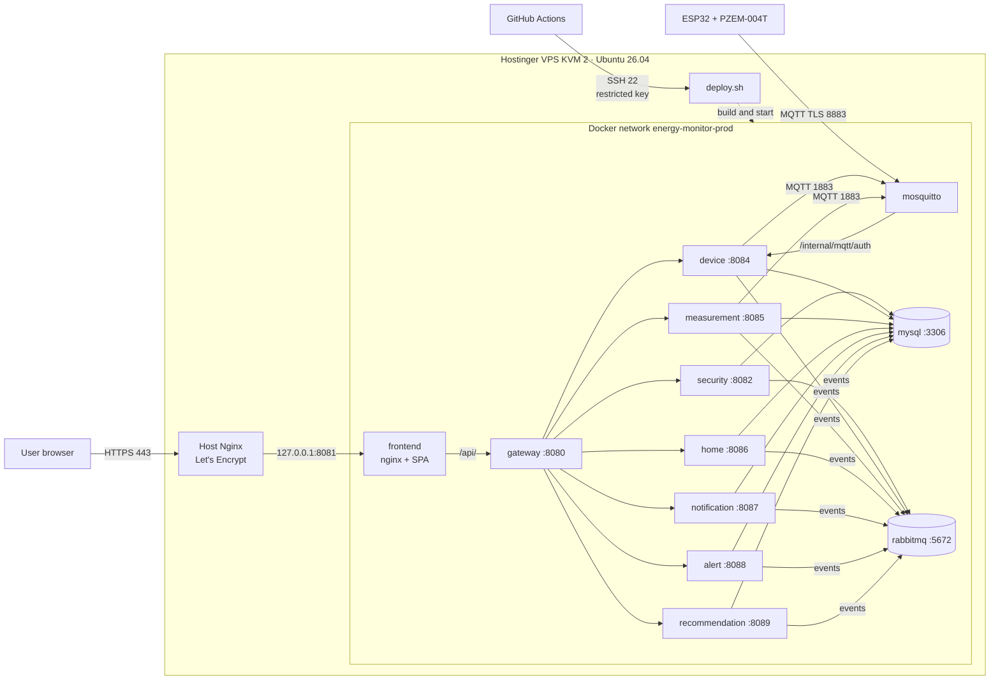
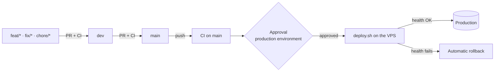

**NATIONAL LEARNING SERVICE – SENA**

**CENTER FOR INDUSTRY, BUSINESS AND SERVICES (CIES)**

**HUILA REGIONAL**

Training Program: Technology in Software Analysis and Development (ADSO)

Group: 3145556

**IMPLEMENTATION AND DEPLOYMENT MANUAL**

**Project: Electrical Consumption Monitor (EnergyMonitor)**

*Web app, API gateway and Spring Boot services, database, message queue, MQTT broker and ESP32 + PZEM-004T meters published on a VPS, with continuous integration and deployment*

| **Item**           | **Information**                                                                   |
|--------------------|-----------------------------------------------------------------------------------|
| Team members       | Juan Esteban Cortés Parra, Miguel Ángel García Artunduaga                         |
| Training center    | Center for Industry, Business and Services (CIES) – SENA Huila Regional           |
| Program            | Technology in Software Analysis and Development (ADSO)                            |
| Group              | 3145556                                                                           |
| Document type      | Implementation and deployment manual                                              |
| Version            | 1.3                                                                               |
| Date               | October 16, 2026 (updated October 28, 2026)                                       |

Neiva, Huila · Colombia · 2026

> **Convention.** The public domain of the project is `energy-monitor.tech` and `<VPS_IP>` is the
> public IP of the server. On the server the domain is defined once
> (`export DOMAIN=energy-monitor.tech`) and the commands use it as `$DOMAIN`. No secret value
> (passwords, keys, tokens) appears in this report.

# Document version control

| **Version** | **Date**   | **Change description**                                                                                                                                   | **Owner**       |
|-------------|------------|----------------------------------------------------------------------------------------------------------------------------------------------------------|-----------------|
| 1.0         | 10/16/2026 | Report and production deployment runbook: web, API, MySQL and MQTT broker on a Hostinger VPS with Docker Compose, Nginx and Let's Encrypt; verification and rollback. | Development team |
| 1.1         | 10/20/2026 | Continuous integration and deployment strategy with GitHub Actions (section 9); selection and cost of the Hostinger KVM 2 plan (3.2); real domain; evidence from the VPS run; incidents of the real deployment; automated update and rollback. | Development team |
| 1.2         | 10/24/2026 | Service architecture in production: API gateway and security, device and measurement services alongside the backend (home, alert, recommendation and notification), RabbitMQ with a *transactional outbox* and the broker authenticated by the device service; new and retired variables (`MEASUREMENT_CONTEXT`, `MQTT_MEASUREMENT_SERVICE_USER/PASS` replacing `MQTT_BACKEND_USER/PASS`); `deploy.sh` with seven components; pipelines and secrets in each repository; first deployment of the services on an existing server (4.12). | Development team |
| 1.3         | 10/28/2026 | Complete migration: homes, notifications, alerts and recommendations as independent services and retirement of the backend; `deploy.sh` with ten components; pipelines and secrets in the ten deployable repositories; migration run on the server (4.13) with its incidents (section 7); registration with prior email verification, terms and account-deletion code (`SECURITY_ACCOUNT_DELETION_CODE_MAIL_ENABLED`). | Development team |

# Table of contents

| **Section**                   | **Main content**                                                       |
|-------------------------------|------------------------------------------------------------------------|
| Executive summary             | What is deployed, where and with what.                                 |
| 1 · General information       | Technical sheet, history and summary of changes.                       |
| 2 · Scope and architecture    | Components, topology, network matrix and responsibilities.             |
| 3 · Preparation and security  | Inventory, plan selection and costs, environment variables, backup.    |
| 4 · Deployment runbook        | Step by step: DNS, server, code, secrets, TLS, start-up, admin and first deployment of the services. |
| 5 · IoT integration           | Public TLS MQTT broker, certificate and linking of meters.             |
| 6 · Tests and evidence        | Smoke tests, commands and evidence for the academic closing.           |
| 7 · Incidents and decisions   | Problems found during the deployment and technical decisions.          |
| 8 · Operation and contingency | Monitoring, updates, backup, rollback, security and SSH access.        |
| 9 · CI/CD strategy            | Continuous integration and deployment with GitHub Actions.             |
| 10 · Conclusions              | Deployment status, limits and next steps.                              |
| Annexes                       | Paths, commands and reference repositories.                            |

> **Scope of the evidence.** Checks run on the production server are marked **"Confirmed"**; those
> without an attached output or screenshot yet are marked **"Evidence pending"** and are not
> presented as facts.

# Executive summary

EnergyMonitor measures the electricity used by household appliances with ESP32 + PZEM-004T V3
modules that publish telemetry over MQTT with TLS; the measurement service stores it in MySQL, the
alert and recommendation services evaluate it, the notification service informs the users and the
React web app shows it to the members of each home. Since October 28, 2026 the API is split into
seven Spring Boot services behind an **API gateway**: security, devices, measurements, homes,
notifications, alerts and recommendations. The monolithic backend (`energy-monitor-backend`) was
retired and its repository is kept as history, with the meter firmware. The public API routes did
not change for the clients.

The system is deployed on a **Hostinger VPS, KVM 2 plan** (2 vCPU, 8 GB RAM) running **Ubuntu 26.04
LTS**, contracted for one month at **48,000 COP**. The whole platform runs in **Docker Compose** from the
`energy-monitor-infra` repository (`docker-compose.prod.yml`): MySQL 8.4, RabbitMQ 4.1, the API
gateway, the seven services, the Mosquitto broker with
authentication delegated to the device service, and the frontend served by nginx. **Nginx on
the host** is the only HTTP/HTTPS entry point, with **Let's Encrypt** certificates issued by
Certbot. The web app and the API are published at `https://energy-monitor.tech`; meters connect to
`mqtts://mqtt.energy-monitor.tech:8883`.

Updates go through **GitHub Actions**: every pull request runs the tests, and every change that
reaches `main` is deployed to the server after a **manual approval**, with a prior database backup,
a health check and **automatic rollback** if something fails.

The mobile app is **out of scope** for this deployment.

# 1. General information and version control

## 1.1 Technical sheet

| **Field**                    | **Recorded information**                                                     |
|------------------------------|------------------------------------------------------------------------------|
| System                       | EnergyMonitor · household electricity monitor with IoT                       |
| Modality                     | React/Vite web app, API gateway and seven Spring Boot services (security, devices, measurements, homes, notifications, alerts and recommendations), RabbitMQ, MQTT broker and ESP32 firmware |
| Environment                  | Production / demonstration deployment reachable from the Internet            |
| Infrastructure provider      | Hostinger VPS · **KVM 2** plan · Ubuntu 26.04 LTS                            |
| Infrastructure cost          | 48,000 COP/month on a monthly contract (27,900 COP/month on a yearly contract); details in 3.2 |
| Domain                       | `energy-monitor.tech` (web and API) · `mqtt.energy-monitor.tech` (broker)    |
| Deployment repository        | `energy-monitor-infra`, file `docker-compose.prod.yml`                       |
| Integration and deployment   | GitHub Actions (`.github/workflows/ci-cd.yml` in the gateway, the seven services, the web app and the infrastructure) |
| Deployed branch              | `main` in the ten deployed repositories                                      |
| Consolidation date           | October 16, 2026; continuous deployment active since October 19; security, device and measurement services since October 24; home, notification, alert and recommendation services and backend retirement on October 28 |
| Release tag                  | `[TO BE CONFIRMED]` — tagging `v1.0.0` in the repositories is recommended    |
| Version of this report       | 1.3                                                                          |

## 1.2 Document history

| **Version** | **Date**   | **Description**                                                        |
|-------------|------------|------------------------------------------------------------------------|
| 1.0         | 10/16/2026 | Deployment runbook for web, API, MySQL and MQTT broker in production.  |
| 1.1         | 10/20/2026 | CI/CD strategy, KVM 2 plan and costs, real evidence and incidents.     |
| 1.2         | 10/24/2026 | API gateway, security, device and measurement services, RabbitMQ and new variables. |
| 1.3         | 10/28/2026 | Home, notification, alert and recommendation services; backend retired; migration run on the server. |

## 1.3 Summary of the changes that enable the deployment

- All Docker material consolidated in `energy-monitor-infra`: local stack, development mode and
  `docker-compose.prod.yml` for the server, now including the frontend.
- The `energy-monitor-devices` repository is retired: the firmware moves to the backend's
  `firmware/` folder and the broker configuration to `infra/mosquitto/`.
- Docker image for the frontend (Vite build + nginx) that serves the SPA and forwards only `/api/`
  to the API (since version 1.2, to the API gateway): a single origin, no cross-domain CORS, and
  `/internal/**` never exposed.
- Broker volume permissions fixed (`mosquitto-data-owner` service), graceful backend shutdown
  (`stop_grace_period: 30s`) and `SERVER_FORWARD_HEADERS_STRATEGY=native` behind the proxy.
- Versioned templates in `infra/deploy/`: Nginx site, renewal hook for the broker certificate and
  daily MySQL backup; `make-admin.sh --prod` for the first administrator.
- Backend fix: client errors (missing parameter, invalid type, unknown route) answer 4xx instead
  of 500.
- GitHub Actions pipelines in all three repositories and the `infra/deploy/deploy.sh` script, which
  deploys one component with a backup, a health check and automatic rollback (section 9).
- **Version 1.2 (October 24, 2026):** the security, device and measurement contexts left the
  backend for services of their own (`en-monitor-security-service` :8082,
  `en-monitor-device-service` :8084 and `en-monitor-measurement-service` :8085), with an API gateway
  (`en-monitor-api-gateway` :8080) as the only entry point of the API. The backend (:8083) keeps
  `home`, `alert`, `recommendation` and `notification`, plus three proxy packages with no domain or
  tables (`security`, `device` and `measurement`). The services talk over internal REST
  (`/internal/**` with `X-Internal-Token`) and through events on RabbitMQ 4.1 with a *transactional
  outbox*. The broker authenticates against the device service, the measurement service is the only
  one that stores telemetry, and the backend no longer connects to the broker. Each new service has
  its own pipeline and `deploy.sh` accepts seven components.
- **Version 1.3 (October 28, 2026):** the `home`, `notification`, `alert` and `recommendation`
  contexts left the backend for `en-monitor-home-service` :8086,
  `en-monitor-notification-service` :8087, `en-monitor-alert-service` :8088 and
  `en-monitor-recommendation-service` :8089, and the backend was retired: the
  `energy-monitor-backend` repository stays as history and holds the firmware. `deploy.sh` accepts
  ten components, each service has its pipeline and the migration was run on the server on
  October 28 (4.13). New variables: `HOME_CONTEXT`, `NOTIFICATION_CONTEXT`, `ALERT_CONTEXT` and
  `RECOMMENDATION_CONTEXT`, and the `SECURITY_ACCOUNT_DELETION_CODE_MAIL_ENABLED` switch for the
  account-deletion code.
# 2. Scope, topology and architecture

## 2.1 Deployed components

| **Component**     | **Technology / role**                                                           | **Exposure**                            |
|-------------------|---------------------------------------------------------------------------------|-----------------------------------------|
| HTTPS proxy       | Nginx on the host, Let's Encrypt certificates (Certbot)                         | `https://energy-monitor.tech` (80 → 443) |
| Web frontend      | React 19 + Vite; nginx container that serves the SPA and forwards `/api/` to the gateway | Behind the proxy (127.0.0.1:8081) |
| API gateway       | Spring Cloud Gateway (Spring Boot 4.0.8, Java 21), `gateway` container :8080: only entry point of the API, CORS, token validation, limit on public account POSTs, rejection of `/internal/**` | `/api/v1/**` through the frontend |
| Security service  | Java 21, Spring Boot 4.1.1, `security` container :8082: accounts, sessions, JWT RS256, Google, RBAC and user administration | Internal Docker network only |
| Device service    | Java 21, Spring Boot 4.1.1, `device` container :8084: linking, credentials, broker authentication and ACL, commands and connectivity | Internal Docker network only |
| Measurement service | Java 21, Spring Boot 4.1.1, `measurement` container :8085: the only one that stores telemetry; history, statistics, consumption and levels | Internal Docker network only |
| Home service      | Java 21, Spring Boot 4.1.1, `home` container :8086: homes, members, roles, favorites, thresholds, deletion and transfer; answers the checks the other services make | Internal Docker network only |
| Notification service | Java 21, Spring Boot 4.1.1, `notification` container :8087: deliveries, preferences, email (the only one that sends email), Web Push, Expo push, in-app notices and home and device activity | Internal Docker network only |
| Alert service     | Java 21, Spring Boot 4.1.1, `alert` container :8088: consumption and connectivity alerts from the readings and the device events | Internal Docker network only |
| Recommendation service | Java 21, Spring Boot 4.1.1, `recommendation` container :8089: saving rules evaluated every hour | Internal Docker network only |
| Message queue     | RabbitMQ 4.1, `rabbitmq-data` volume: events between services (*outbox*) and email requests | Docker network; console on 127.0.0.1:15672 |
| Database          | MySQL 8.4, a single shared `energy_monitor` database (each service with its own tables), `mysql-data` volume | Internal Docker network only |
| MQTT broker       | Mosquitto 2.0 + mosquitto-go-auth (auth and ACL delegated to the device service) | `mqtt.energy-monitor.tech:8883` (TLS)  |
| Meters            | ESP32 + PZEM-004T V3, firmware with the Let's Encrypt roots                     | Outbound connection to the broker       |
| CI/CD             | GitHub Actions + `infra/deploy/deploy.sh` on the VPS                            | SSH with a restricted key               |

## 2.2 Architecture diagram



*Figure 1. Logical topology: clients, proxy, gateway and services, persistence, message queue, broker and deployment channel. Internal REST calls between services (`/internal/**`) are left out to keep the figure readable.*

The main domain serves the web app and, under `/api/`, the API. The frontend nginx forwards only
`/api/` to the API gateway, which sends each route to its service (`/api/v1/auth/**`,
`/api/v1/admin/users/**`, `/api/v1/admin/roles/**` and `/api/v1/support/**` to security;
`/api/v1/homes/{homeId}/devices/**` and `/api/v1/appliance-types/**` to devices;
`/api/v1/measurements/**`, `/api/v1/consumption-levels/**` and `/api/v1/homes/{homeId}/consumption/**` to
measurements; the rest of `/api/v1/homes/**` and `/api/v1/home-types/**` to homes; `/api/v1/notifications/**` and
`/api/v1/admin/notifications/**` to notifications; `/api/v1/alerts/**` to alerts;
`/api/v1/recommendations/**` to recommendations; any other route answers 404) and rejects `/internal/**`. So the internal
endpoints between services and those the broker uses to authenticate each client
(`/internal/mqtt/auth/**`) cannot be reached from the Internet. The broker is the only service
published directly (8883, TLS), because the meters do not speak HTTP.

## 2.3 Network and port matrix

| **Service**           | **Address / port**                      | **Exposure**                |
|-----------------------|-----------------------------------------|-----------------------------|
| SSH                   | 22                                      | Public (administration and GitHub Actions) |
| Host Nginx            | 80 (redirect) / 443 (TLS)               | Public                      |
| Frontend (nginx)      | 127.0.0.1:8081 → container :80          | Host only                   |
| API gateway           | container :8080                         | Private (Docker network)    |
| Security, device, measurement, home, notification, alert and recommendation | containers :8082, :8084, :8085, :8086, :8087, :8088 and :8089 | Private (Docker network) |
| RabbitMQ              | container :5672 (AMQP); console 127.0.0.1:15672 | Private; console only through an SSH tunnel |
| MySQL 8.4             | container :3306                         | Private (Docker network)    |
| Internal Mosquitto    | container :1883 (no TLS)                | Private (Docker network)    |
| Mosquitto for devices | 8883 (TLS)                              | Public                      |

## 2.4 Separation of responsibilities

The browser talks only to `https://energy-monitor.tech`: the SPA and the API share one origin, and
the web session travels in HttpOnly cookies. The API gateway is the only entry point of the API and
validates the token (RS256) except on the public endpoints. The security service manages accounts,
sessions, JWT and administration; the device service handles linking and credentials and is the only
source of truth about which device may connect: the broker stores no users and asks it about every
connection and every topic (with a 5-minute cache). The measurement service is the only one that
stores telemetry and announces each reading on RabbitMQ (`measurement.recorded`); the home service
manages homes, members and thresholds; the alert service creates the alerts from the readings and
the device events; the recommendation service evaluates them every hour; and the notification
service delivers them and is the only one that sends email. The services
query each other over `/internal/**` (only from the Docker network and with the `X-Internal-Token`
header) and notify each other through events on RabbitMQ with a *transactional outbox* (at-least-once
delivery and queues with a *dead-letter* after three attempts). They all use the same MySQL
database, each with its own tables and Liquibase changesets. The meters only open outbound
connections, so they work behind any home router.

# 3. Prerequisites and preparation

## 3.1 Platform inventory

| **Resource**         | **Configuration**                                                              |
|----------------------|--------------------------------------------------------------------------------|
| VPS                  | Hostinger KVM 2 · 2 vCPU · 8 GB RAM · 100 GB NVMe · Ubuntu 26.04 LTS (hostname `srv2066688`) |
| Orchestration        | Docker Engine + Docker Compose v2 plugin                                       |
| Proxy / TLS          | Nginx on the host; Let's Encrypt with Certbot (automatic renewal)              |
| Build                | On the VPS itself (`--build`): Maven inside the image of each Java service, Vite inside the frontend image |
| CI/CD                | GitHub Actions (GitHub-hosted `ubuntu-latest` runners)                         |
| Domain               | `energy-monitor.tech` with A records for `@`, `www` and `mqtt`                 |

## 3.2 Provider and plan selection

**Requirements the infrastructure had to meet:**

- Expose **its own TCP port (8883)** for MQTT with TLS, besides HTTP/HTTPS: many PaaS platforms
  publish only HTTP, while a VPS gives full control over ports and the firewall.
- Run **four permanent containers** (MySQL, JVM backend, Mosquitto and frontend) and, on every
  deployment, **build** the backend with Maven and the frontend with Vite on the same server.
- A fixed, predictable monthly cost in Colombian pesos, suited to a training project.
- A provider with a Spanish-language panel, a manageable firewall and DNS management for the domain.

**Comparison of Hostinger VPS plans:**

| **Plan** | **vCPU** | **RAM** | **NVMe disk** | **Assessment for EnergyMonitor**                                                        |
|----------|----------|---------|---------------|-----------------------------------------------------------------------------------------|
| KVM 1    | 1        | 4 GB    | 50 GB         | Not enough: the JVM, MySQL and a concurrent Maven build exhaust memory and force swap.   |
| **KVM 2**| **2**    | **8 GB**| **100 GB**    | **Chosen**: builds and runs the whole stack without swap, with room to grow in meters and history. |
| KVM 4    | 4        | 16 GB   | 200 GB        | Oversized for a pilot's load; doubles the cost with no current benefit.                 |

**Decision:** the **KVM 2** plan. With 2 vCPU a build does not starve the running backend, and the
8 GB of RAM (7.7 GB usable as reported by the operating system) cover the backend JVM, MySQL,
Mosquitto, nginx and a build at the same time. If the load grows, Hostinger allows upgrading the plan
without reinstalling.

> **Version 1.2.** With the service architecture the stack grew to nine permanent containers
> (MySQL, RabbitMQ, the gateway, the security, device and measurement services, the backend,
> Mosquitto and the frontend), five of them JVMs, on the same KVM 2 plan. Resource usage with that
> stack has not been measured yet (6.1).

**Contract term:** the plan's price depends on the term. The project contracted it **for one
month** (48,000 COP), enough for the demonstration and the final presentation without committing to
a yearly payment. For continuous operation the 12-month contract is the better option:

| **Contract term**   | **Monthly price** | **Cost of 12 months** | **Note**                                             |
|---------------------|-------------------|-----------------------|------------------------------------------------------|
| Monthly (contracted)| 48,000 COP        | 576,000 COP           | No commitment; renewed month by month                |
| Yearly              | 27,900 COP        | 334,800 COP           | Paid upfront; saves 241,200 COP a year (≈ 42 %)      |

**Operating costs of the current deployment:**

| **Item**                     | **Cost**                | **Note**                                         |
|------------------------------|-------------------------|--------------------------------------------------|
| Hostinger KVM 2 VPS          | 48,000 COP/month        | Monthly contract                                 |
| Domain `energy-monitor.tech` | 0 COP                   | Obtained at no cost; check the renewal price before it expires |
| TLS certificates             | 0 COP                   | Let's Encrypt (free, automatic renewal)          |
| GitHub and GitHub Actions    | 0 COP                   | Within the minutes included at no cost           |
| **Total infrastructure**     | **48,000 COP/month**    | With a yearly contract: 27,900 COP/month         |

## 3.3 Prerequisite checklist

- DNS A records for `energy-monitor.tech`, `www.energy-monitor.tech` and `mqtt.energy-monitor.tech`
  pointing to `<VPS_IP>`.
- SSH access to the VPS with a `sudo` user (or root), with a personal key different from the GitHub
  Actions key (8.5).
- Ports 80 and 443 free for Nginx (do not install another proxy competing for them) and 8883 free
  for the broker.
- Changes merged into `main` in `energy-monitor-infra`, `en-monitor-api-gateway`,
  `en-monitor-security-service`, `en-monitor-device-service`, `en-monitor-measurement-service`,
  `en-monitor-home-service`, `en-monitor-notification-service`, `en-monitor-alert-service`,
  `en-monitor-recommendation-service` and `Energy-Monitor-application`.
- An email account for sending (Gmail app password) and, if used, a Google OAuth client with
  `https://energy-monitor.tech` in *Authorized JavaScript origins*.
- Secrets managed outside the repositories, with restricted permissions (`chmod 600`).

## 3.4 Environment variables

Only public values are documented; secrets are generated on the server and live in
`infra/.env.prod` (git-ignored, mode 600).

| **Layer**  | **Variable / value without secrets**                                      | **Purpose**                                     |
|------------|---------------------------------------------------------------------------|-------------------------------------------------|
| Code       | `SECURITY_CONTEXT`, `DEVICE_CONTEXT`, `MEASUREMENT_CONTEXT`, `HOME_CONTEXT`, `NOTIFICATION_CONTEXT`, `ALERT_CONTEXT`, `RECOMMENDATION_CONTEXT`, `GATEWAY_CONTEXT`, `FRONTEND_CONTEXT` (default `../backend/...` and `../frontend/energy-monitor-web`) | Clones each image is built from |
| Gateway    | `SECURITY_CORS_ALLOWED_ORIGINS=https://energy-monitor.tech,https://www.energy-monitor.tech` | Allowed origins (CORS is answered by the gateway) |
| Notifications | `NOTIFICATION_WEB_URL=https://energy-monitor.tech`                 | Links in alert emails                           |
| Devices    | `DEVICE_MQTT_PUBLIC_HOST=mqtt.energy-monitor.tech` · `DEVICE_MQTT_PUBLIC_PORT=8883` | Broker the web app writes to the meter |
| Security   | `JWT_KEYS_DIR=/opt/energy-monitor/keys` · `BACKEND_UID/GID=10001`         | JWT RSA pair and the user the security service runs as, the only one that reads `private.pem`; the others receive only `public.pem` |
| Security   | `SECURITY_ACCOUNT_DELETION_CODE_MAIL_ENABLED=true`                        | Switch of the email with the deletion code of a Google account; turn it on only once the notification service is deployed (with the switch off, asking for the code answers 503) |
| Notifications | `MAIL_HOST=smtp.gmail.com` · `MAIL_PORT=587` · `MAIL_FROM=...`  | Recovery, verification, deletion-code and alert emails (only the notification service sends email) |
| Messaging  | `RABBITMQ_USERNAME=energy-monitor`                                        | RabbitMQ user, the same in every service        |
| Broker     | `MQTT_DEVICE_SERVICE_USER=em-device-service` · `MQTT_MEASUREMENT_SERVICE_USER=em-measurement-service` | MQTT users of the device and measurement services |
| All        | `MYSQL_PASSWORD`, `MYSQL_ROOT_PASSWORD`, `SECURITY_RESET_PEPPER`, `RABBITMQ_PASSWORD`, `INTERNAL_API_TOKEN`, `MQTT_DEVICE_SERVICE_PASS`, `MQTT_MEASUREMENT_SERVICE_PASS`, `MAIL_PASSWORD`, `GOOGLE_CLIENT_SECRET`, `NOTIFICATION_VAPID_PRIVATE_KEY`, `EXPO_ACCESS_TOKEN` (values omitted) | Protected secrets |
| Broker     | `MQTT_CERT_DIR=/opt/energy-monitor/mqtt-certs`                            | Let's Encrypt certificate for `mqtt.energy-monitor.tech` |
| Web        | `VITE_API_BASE_URL=""` (fixed in the compose file)                        | API on the same origin                          |
| Web        | `VITE_GOOGLE_CLIENT_ID=<public id>`                                       | Google button                                   |
| Proxy      | `WEB_PORT=8081`                                                           | Local port Nginx points to                      |
| GitHub     | `DEPLOY_HOST`, `DEPLOY_USER`, `DEPLOY_SSH_KEY`, `DEPLOY_KNOWN_HOSTS` (secrets of the `production` environment of each repository) | GitHub Actions access to the VPS (9.8) |

The internal addresses between services (`SECURITY_SERVICE_URL`, `DEVICE_SERVICE_URL`,
`MEASUREMENT_SERVICE_URL`, `HOME_SERVICE_URL`, `NOTIFICATION_SERVICE_URL`, `ALERT_SERVICE_URL` and
`RECOMMENDATION_SERVICE_URL`) are fixed in `docker-compose.prod.yml` and do not go in `.env.prod`.
`INTERNAL_API_TOKEN` and `RABBITMQ_PASSWORD` have the same value in every service: each container
takes them from `.env.prod`.

> **Retired variables.** In version 1.2, `MQTT_BACKEND_USER/PASS`, `MQTT_CLIENT_ID` and
> `DEVICE_OFFLINE_AFTER` stopped belonging to the backend, which does not connect to the broker. In
> version 1.3, with the backend retired, `BACKEND_CONTEXT` no longer exists. The switches
> `HOME_OUTBOX_RELAY_ENABLED`, `ACCOUNT_DELETED_CONSUMER_ENABLED`, `SECURITY_EVENTS_CONSUMER_ENABLED`,
> `ALERT_EVENTS_CONSUMER_ENABLED`, `ALERT_CONSUMERS_ENABLED`, `ALERT_SERVICE_OUTBOX_RELAY_ENABLED`,
> `RECOMMENDATION_SCHEDULER_ENABLED` and `RECOMMENDATION_OUTBOX_RELAY_ENABLED` are `true` by default:
> delete them from `.env.prod` if they were `false`.

> **Important.** `VITE_*` variables are baked in when the frontend image is built: changing
> `.env.prod` afterwards does not modify an image that was already built; rebuild `frontend`.

## 3.5 Prior backup and contingency

A new installation has no data to back up. On every later deployment `deploy.sh` runs the MySQL
backup automatically and records the previous version of each repository (section 9.6). In addition:

1. Keep a safe copy of `.env.prod`, `/opt/energy-monitor/keys` and the broker certificate outside
   the server.
2. Make sure no procedure runs `docker compose down -v` or deletes volumes.
3. For a manual update, run `infra/deploy/backup-mysql.sh` first and check that the `.sql.gz` file
   is not empty.

# 4. Step-by-step deployment procedure (runbook)

This procedure covers the **initial installation** of the server. Later updates are done by GitHub
Actions (section 9). Every command runs on the VPS over SSH. First define the session variables:

```bash
export DOMAIN=energy-monitor.tech
export EM=/opt/energy-monitor
```

## 4.1 Domain and DNS

In the Hostinger panel (Domains → DNS / Nameservers) create the **A** records:

| **Name** | **Type** | **Value**   | **TTL** |
|----------|----------|-------------|---------|
| `@`      | A        | `<VPS_IP>`  | 300     |
| `www`    | A        | `<VPS_IP>`  | 300     |
| `mqtt`   | A        | `<VPS_IP>`  | 300     |

Check propagation before requesting certificates:

```bash
getent hosts $DOMAIN www.$DOMAIN mqtt.$DOMAIN
```

## 4.2 Server preparation

```bash
sudo apt update && sudo apt -y upgrade
sudo apt -y install ca-certificates curl git openssl ufw nginx certbot python3-certbot-nginx

# Docker Engine + Compose (official script; read it before running it)
curl -fsSL https://get.docker.com -o get-docker.sh
less get-docker.sh
sudo sh get-docker.sh
# If Docker's repository does not publish packages for 26.04 yet, use Ubuntu's:
#   sudo apt -y install docker.io docker-compose-v2
docker --version && docker compose version
```

Firewall (ports published by Docker bypass ufw; that is why the compose file publishes on
`127.0.0.1` everything that must not be public):

```bash
sudo ufw allow OpenSSH
sudo ufw allow 80/tcp
sudo ufw allow 443/tcp
sudo ufw allow 8883/tcp
sudo ufw enable
sudo ufw status
```

In the **Hostinger panel firewall** (if enabled) open the same ports: 22, 80, 443 and 8883.

The KVM 2 plan (8 GB) does not need swap. A plan with less than 4 GB of RAM does, so that Maven and
Vite can build:

```bash
sudo fallocate -l 2G /swapfile && sudo chmod 600 /swapfile
sudo mkswap /swapfile && sudo swapon /swapfile
echo '/swapfile none swap sw 0 0' | sudo tee -a /etc/fstab
```

## 4.3 Source code

The production compose file builds the gateway, the seven services and the frontend from clones
next to `infra`. All ten clones follow `main`, the branch GitHub Actions deploys:

```bash
sudo mkdir -p $EM && sudo chown "$USER": $EM && cd $EM
git clone --branch main https://github.com/Juan-Cortes2045/energy-monitor-infra.git infra
git clone --branch main https://github.com/Juan-Cortes2045/en-monitor-api-gateway.git backend/en-monitor-api-gateway
git clone --branch main https://github.com/Juan-Cortes2045/en-monitor-security-service.git backend/en-monitor-security-service
git clone --branch main https://github.com/Juan-Cortes2045/en-monitor-device-service.git backend/en-monitor-device-service
git clone --branch main https://github.com/Juan-Cortes2045/en-monitor-measurement-service.git backend/en-monitor-measurement-service
git clone --branch main https://github.com/angelgarcia0/en-monitor-home-service.git backend/en-monitor-home-service
git clone --branch main https://github.com/angelgarcia0/en-monitor-notification-service.git backend/en-monitor-notification-service
git clone --branch main https://github.com/angelgarcia0/en-monitor-alert-service.git backend/en-monitor-alert-service
git clone --branch main https://github.com/angelgarcia0/en-monitor-recommendation-service.git backend/en-monitor-recommendation-service
git clone --branch main https://github.com/Juan-Cortes2045/Energy-Monitor-application.git frontend/energy-monitor-web
```

If a clone lives at another path, set it in `.env.prod` with its `*_CONTEXT` variable (3.4).

If a repository is private, create an SSH key on the server (`ssh-keygen -t ed25519`), register it
as a read-only *Deploy key* on GitHub (Settings → Deploy keys) and clone with the SSH URL
(`git@github.com:...`).

## 4.4 Secrets and keys

```bash
# JWT RSA pair: only the security service reads private.pem (uid 10001);
# public.pem is also read by the gateway and the other services
sudo mkdir -p $EM/keys
sudo openssl genpkey -algorithm RSA -pkeyopt rsa_keygen_bits:2048 -out $EM/keys/private.pem
sudo openssl rsa -in $EM/keys/private.pem -pubout -out $EM/keys/public.pem
sudo chown -R 10001:10001 $EM/keys && sudo chmod 600 $EM/keys/private.pem && sudo chmod 644 $EM/keys/public.pem

# Random values for .env.prod (copy them by hand; they are not kept in the history)
openssl rand -hex 24   # MYSQL_PASSWORD
openssl rand -hex 24   # MYSQL_ROOT_PASSWORD
openssl rand -hex 32   # SECURITY_RESET_PEPPER
openssl rand -hex 24   # RABBITMQ_PASSWORD
openssl rand -hex 32   # INTERNAL_API_TOKEN
openssl rand -hex 24   # MQTT_DEVICE_SERVICE_PASS
openssl rand -hex 24   # MQTT_MEASUREMENT_SERVICE_PASS
```

VAPID keys for browser push (once per environment). Each value must stay on **a single line**, with
no spaces or line breaks (see the incident in section 7):

```bash
openssl ecparam -name prime256v1 -genkey -noout -out vapid.pem
echo "NOTIFICATION_VAPID_PRIVATE_KEY=$(openssl ec -in vapid.pem -outform DER | tail -c +8 | head -c 32 | base64 -w0 | tr '+/' '-_' | tr -d '=')"
echo "NOTIFICATION_VAPID_PUBLIC_KEY=$(openssl ec -in vapid.pem -pubout -outform DER | tail -c 65 | base64 -w0 | tr '+/' '-_' | tr -d '=')"
rm vapid.pem
```

## 4.5 HTTPS proxy: Nginx and Let's Encrypt

```bash
cd $EM/infra
sed "s/DOMINIO/$DOMAIN/g" deploy/nginx-energy-monitor.conf | sudo tee /etc/nginx/sites-available/energy-monitor >/dev/null
sudo ln -sf /etc/nginx/sites-available/energy-monitor /etc/nginx/sites-enabled/energy-monitor
sudo rm -f /etc/nginx/sites-enabled/default
test -s /etc/nginx/sites-available/energy-monitor && echo "site OK"   # must not be empty
sudo nginx -t && sudo systemctl reload nginx

# Certificate for the web app and the API (Certbot adds the 443 block and the HTTPS redirect)
sudo certbot --nginx -d $DOMAIN -d www.$DOMAIN
```

The site forwards **the whole** domain to `127.0.0.1:8081` (frontend nginx), replaces
`X-Forwarded-For` with the real client IP so it cannot be forged, and accepts bodies up to 10 MB.
If the certificate already exists but the site file was regenerated, reinstall it with
`sudo certbot install --nginx --cert-name $DOMAIN`.

## 4.6 MQTT broker certificate

The broker uses its own Let's Encrypt certificate for `mqtt.energy-monitor.tech`. Certbot issues it
with HTTP-01 through Nginx, and the `renew-mqtt-cert.sh` hook copies it to where Mosquitto (uid 1000)
reads it, on issuance and on every renewal:

```bash
sudo certbot certonly --nginx -d mqtt.$DOMAIN
sudo cp $EM/infra/deploy/renew-mqtt-cert.sh /etc/letsencrypt/renewal-hooks/deploy/energy-monitor-mqtt.sh
sudo chmod 755 /etc/letsencrypt/renewal-hooks/deploy/energy-monitor-mqtt.sh
sudo MQTT_DOMAIN=mqtt.$DOMAIN /etc/letsencrypt/renewal-hooks/deploy/energy-monitor-mqtt.sh
ls -l $EM/mqtt-certs          # server.crt and server.key, owned by 1000
```

If `mqtt-certs` stays empty, Mosquitto restarts in a loop: run the hook again (the last line, with
`MQTT_DOMAIN`).

## 4.7 Production configuration (.env.prod)

```bash
cd $EM/infra
cp .env.prod.example .env.prod && chmod 600 .env.prod
nano .env.prod
```

Values to fill in (besides the secrets generated in 4.4). The `*_CONTEXT` paths,
`RABBITMQ_USERNAME`, `MQTT_DEVICE_SERVICE_USER` and `MQTT_MEASUREMENT_SERVICE_USER` already have their
default value in the template:

```
SECURITY_CORS_ALLOWED_ORIGINS=https://energy-monitor.tech,https://www.energy-monitor.tech
NOTIFICATION_WEB_URL=https://energy-monitor.tech
DEVICE_MQTT_PUBLIC_HOST=mqtt.energy-monitor.tech
JWT_KEYS_DIR=/opt/energy-monitor/keys
MQTT_CERT_DIR=/opt/energy-monitor/mqtt-certs
BACKEND_UID=10001
BACKEND_GID=10001
MAIL_USERNAME / MAIL_PASSWORD / MAIL_FROM
GOOGLE_CLIENT_ID / GOOGLE_CLIENT_SECRET / VITE_GOOGLE_CLIENT_ID   (optional)
NOTIFICATION_VAPID_PUBLIC_KEY / NOTIFICATION_VAPID_PRIVATE_KEY    (optional)
EXPO_ACCESS_TOKEN                                                 (optional)
```

Validate without starting anything:

```bash
docker compose -f docker-compose.prod.yml --env-file .env.prod config -q && echo OK
```

## 4.8 Build and start

First create the `emc` alias so the production file does not have to be repeated in every command
(a `docker compose` without `-f docker-compose.prod.yml` would target the local stack and fail):

```bash
echo "alias emc='docker compose -f $EM/infra/docker-compose.prod.yml --env-file $EM/infra/.env.prod --project-directory $EM/infra'" >> ~/.bashrc
source ~/.bashrc

emc up -d --build
emc ps
emc logs -f security device measurement home notification alert recommendation gateway     # Ctrl+C to exit
```

The first build takes several minutes (Maven and npm dependencies, one image per Java service). On
the first start each service applies its own Liquibase changesets to the shared database; the
services take about 2 minutes to be ready and, meanwhile, the web app may answer **502** or the API
**503**. It is ready when `emc ps` shows `gateway`, `security`, `device`, `measurement`, `home`, `notification`, `alert` and
`recommendation` as `(healthy)`. The services publish no ports on the host; their health is checked inside the
container:

```bash
emc exec gateway curl -fsS http://localhost:8080/actuator/health    # {"status":"UP"...}
emc exec home curl -fsS http://localhost:8086/actuator/health    # same for security :8082, device :8084, measurement :8085, notification :8087, alert :8088 and recommendation :8089
```

## 4.9 First administrator

No account is an administrator after installation. Register the account at
`https://energy-monitor.tech` and then:

```bash
cd $EM/infra
./make-admin.sh --prod admin-email@example.com
```

Without `--prod` the script looks for the local stack and cannot find `MYSQL_ROOT_PASSWORD`. Log
out and back in: the menu shows **Administration**. From there that administrator grants the role
to other accounts.

## 4.10 Daily backup

```bash
sudo crontab -e
# add:
0 3 * * * /opt/energy-monitor/infra/deploy/backup-mysql.sh >> /var/log/energy-monitor-backup.log 2>&1
```

Run it once by hand to check it: `sudo $EM/infra/deploy/backup-mysql.sh`. Backups are kept for 14
days in `/opt/energy-monitor/backups`.

## 4.11 Enabling continuous deployment

Once the initial installation is finished, GitHub Actions is configured (section 9.8). From then on
there are no manual deployments.

## 4.12 First deployment of the services on an existing server

A server installed with an earlier version (backend only) moves to the service architecture in three
steps, in this order. In all three, the Liquibase changesets the backend had already applied are
recognized in `DATABASECHANGELOG` (they were moved with the same path) and are not repeated.

1. **Gateway and security service.** Clone `en-monitor-api-gateway` and
   `en-monitor-security-service` into `backend/`; add `RABBITMQ_PASSWORD`, `INTERNAL_API_TOKEN` and
   `SECURITY_CONTEXT`/`GATEWAY_CONTEXT` to `.env.prod`, keeping the same `SECURITY_RESET_PEPPER`
   (with another one, recovery codes already sent stop working), and run `deploy/deploy.sh infra`: it
   creates RabbitMQ, builds the security service and the gateway, and recreates the rest.
2. **Device service.** It goes together, on `main`, with the backend without the device module and
   the new gateway routes. Clone `en-monitor-device-service` into `backend/`, add `DEVICE_CONTEXT`
   and `MQTT_DEVICE_SERVICE_PASS` to `.env.prod` and run `deploy/deploy.sh infra`: it builds the
   service and recreates the backend, the gateway and the broker, which from then on asks
   `device:8084`. Only `device_outbox` is created; the meters keep their `device_code` and API key and
   do not need to be linked again.
3. **Measurement service.** It goes together, on `main`, with the backend without the measurement
   module, the new gateway routes and the device service that recognizes the new MQTT user:
   1. MySQL backup (`deploy/backup-mysql.sh`).
   2. Clone `en-monitor-measurement-service` into `backend/` (`--branch main`) and add
      `MEASUREMENT_CONTEXT` and `MQTT_MEASUREMENT_SERVICE_PASS` (`openssl rand -hex 24`) to
      `.env.prod`. `MQTT_BACKEND_USER/PASS` are no longer used.
   3. Deploy the device service first (`deploy.sh device`): from then on the broker accepts the
      measurement user.
   4. `deploy/deploy.sh infra`: builds the measurement service (it applies `measurement-004`, its
      *outbox*), recreates the backend without an MQTT client and the gateway with the new routes.
      The readings stay in the same `measurement` table: the history does not move.

From then on, each new repository deploys its own service with its pipeline (9.4).

## 4.13 Migration of October 28, 2026 (executed)

This is the procedure that was run on the server on October 28, 2026 to go from the three services
and the backend to the seven services and retire the backend, with what was observed at each step.
The incidents are in section 7.

1. **Backup.** `deploy/backup-mysql.sh` produced the `.sql.gz` in `/opt/energy-monitor/backups`.
2. **Pending backend events.** The `backend_outbox` table did not exist on that server (the
   installed version was older), so there were no events to drain. If it existed, no row with
   `published_at IS NULL` may remain before retiring the backend.
3. **Clones.** The four new repositories on `main` (4.3).
4. **`.env.prod`.** Without the old switches set to `false` and with the required values present
   (checked without printing them).
5. **`deploy.sh infra`.** It built home, notification, alert and recommendation, removed the
   backend container (`--remove-orphans`) and recreated Mosquitto. The second run ended in `OK` at
   03:54, with infra at `ceb1543` (the first one had incident 1 of section 7).
6. **One service at a time.** `deploy.sh gateway`, `device` (from `b64bda5` to `06c1bdc`),
   `measurement`, `frontend` and `security`: they bring the new gateway routes and the account
   changes. Each one ended in `OK`.
7. **Backend queues.** `rabbitmqctl delete_queue` of the ten `energy-monitor-backend.*` queues
   (with their `.dlq`), which nobody consumes anymore.
8. **Verification.** `emc ps` with the eight services `healthy`, `GET /api/v1/homes` → 401 and, in
   the logs, only two error lines from `measurement` (MQTT client «Lost connection») that match the
   Mosquitto restarts of `deploy.sh infra` and recover by themselves.
9. **Account-deletion code.** Check that the `notification-service.notification.mail` queue has the
   `mail.account-deletion` binding, add `SECURITY_ACCOUNT_DELETION_CODE_MAIL_ENABLED=true` to
   `.env.prod` and run `deploy.sh infra` again (`OK` at 04:00).

**Order matters.** The new web app must be deployed before or together with security: the new
security service answers 202 to registration and requires `acceptTerms` (428 if missing), which the
previous web app does not send. On the server `frontend` was deployed with the previous version
because the web PR to `main` had not been merged (incident 3). It was merged afterwards (`main`
commit `698d4c9`) and the team confirmed on October 28 that the new web app is already deployed.

# 5. IoT integration: MQTT broker and meters

## 5.1 Goal and exposed service

Let the meters of any home publish their telemetry over the Internet without opening ports on the
router: the ESP32 only opens an outbound connection to `mqtt.energy-monitor.tech:8883` with TLS.

## 5.2 Authentication delegated to the device service

Mosquitto stores no users. With `mosquitto-go-auth` it asks the device service (`device:8084`) about
every connection (`POST /internal/mqtt/auth/user`, `device_code` / `api_key`) and every topic
(`POST /internal/mqtt/auth/acl`), with a 5-minute cache. The service stores only the SHA-256 of
each key. These endpoints accept calls only from the internal Docker network
(`MQTT_AUTH_ALLOWED_NETWORKS=172.16.0.0/12,127.0.0.1/32`, fixed in the compose file) and, in
addition, they go through neither the proxy nor the gateway.

Clients the broker accepts:

| **Client**                   | **User**                                      | **What it does**                                                     |
|------------------------------|-----------------------------------------------|----------------------------------------------------------------------|
| Device service               | `MQTT_DEVICE_SERVICE_USER` (`em-device-service`) | Reads telemetry and status for connectivity (OFFLINE after 150 s without data); the only one that publishes commands |
| Measurement service          | `MQTT_MEASUREMENT_SERVICE_USER` (`em-measurement-service`) | Only reads telemetry and stores each reading               |
| ESP32 meter                  | `device_code` + API key                       | Publishes only on its topics `energy-monitor/devices/{deviceId}/telemetry` (every 60 s) and `/status` (retained and *last will*), and receives `/command` |

Both services connect through the internal listener without TLS (`tcp://mosquitto:1883`). No other
service connects to the broker: the alert service receives each reading over RabbitMQ
(`measurement.recorded`).

## 5.3 Certificate and firmware

In production the broker presents the Let's Encrypt certificate for `mqtt.energy-monitor.tech`.
The firmware (`energy-monitor-backend/firmware/esp32-pzem-monitor`) already includes the ISRG Root
X1 and X2 roots, so it **does not need to be rebuilt** for production. The development CA
(`dev_ca.h`) is only used with the local stack.

## 5.4 Linking a meter

1. The home owner opens `https://energy-monitor.tech` in Chrome/Edge (HTTPS is required for Web
   Bluetooth) and goes to **Home → Devices → Link device**.
2. They hold BOOT for 3 s on the ESP32 (LED blinking) and select it.
3. The web app writes to the module the home Wi-Fi, its `device_code`, the `api_key` and the broker
   `mqtt.energy-monitor.tech:8883` provided by the device service (`DEVICE_MQTT_PUBLIC_HOST`).
4. The module connects; the broker logs `New client connected ... u'<device_code>'` and the web app
   shows the device as **ONLINE**.

# 6. Verification plan and smoke tests

## 6.1 Status matrix per component

| **Check**                           | **Expected evidence**                                                         | **Status**                 |
|-------------------------------------|-------------------------------------------------------------------------------|----------------------------|
| Production compose                  | `docker compose ... config -q` without errors (also on every infra PR)        | Confirmed                  |
| Service test suites                 | Green (10/28/2026): security 773, homes 260, notifications 234, measurements 151, devices 129, alerts 119, recommendations 71 and gateway 69; web 228. In version 1.1 the single backend had 1131 | Confirmed |
| End-to-end tests                    | `infra/e2e/`: `device-flow` (24), `measurement-flow` (28), `alert-flow` (36), `activity-flow` (60) and `account-deletion-flow` (12) on the local stack | Confirmed (local stack) |
| Web tests and build                 | Vitest tests and `npm run build` pass (locally and in GitHub Actions)         | Confirmed                  |
| Nginx template                      | `nginx -t` passes (on every infra PR)                                         | Confirmed                  |
| DNS                                 | The three names resolve to `<VPS_IP>`                                         | Confirmed                  |
| HTTPS web app                       | `https://energy-monitor.tech` → 200; `http://` → 301 to HTTPS                 | Confirmed                  |
| Certificates                        | Let's Encrypt valid until 01/14/2027, automatic renewal                      | Confirmed                  |
| API through the proxy               | `GET /api/v1/homes` without a session → 401 (answered by the gateway)         | Confirmed                  |
| `/internal/**` not exposed          | `POST https://energy-monitor.tech/internal/mqtt/auth/user` → 405 from nginx, never reaches the API | Confirmed |
| Java services and Liquibase         | `gateway`, `security`, `device`, `measurement`, `home`, `notification`, `alert` and `recommendation` `(healthy)` (`deploy.sh` requires it on every deployment); confirmed on the server on 10/28/2026 | Confirmed |
| Broker TLS                          | `openssl s_client` to `mqtt.energy-monitor.tech:8883` → `Verify return code: 0` | Confirmed                |
| Continuous deployment               | Green runs of the pipelines with approval (9.9); every repository except the mobile app has CI/CD and is in production (confirmed by the team on 10/28/2026) | Confirmed                 |
| Backup                              | `.sql.gz` produced by `deploy.sh` on every deployment                         | Confirmed                  |
| Services subscribed to the broker   | Broker log: `New client connected ... u'em-device-service'` and `u'em-measurement-service'` | Evidence pending |
| Sign-up, login and recovery         | Account created, verification/recovery email with links to the domain        | Evidence pending           |
| Administration                      | `make-admin.sh --prod` and the **Administration** menu visible                | Evidence pending           |
| Meter in production                 | Bluetooth linking, ONLINE status and measurements in the web app              | Evidence pending           |
| Scheduled daily backup              | `crontab` entry and the day's file in `/opt/energy-monitor/backups`           | Evidence pending           |
| Certificate renewal                 | `certbot renew --dry-run` without errors                                      | Evidence pending           |
| Performance with several users      | No load tests have been run                                                   | Pending                    |
| Resources with the service stack    | VPS CPU and RAM usage with the eight Java services (`docker stats`)           | Evidence pending          |
| Migration of 10/28/2026             | `deploy.sh infra` `OK`, `/api/v1/homes` → 401, `mail.account-deletion` bound and backend queues deleted (4.13) | Confirmed                 |
| Web app with terms and Google rules | The deployed web app is the one on `main` (`698d4c9`) and registration answers 202 | Confirmed by the team (10/28/2026) |
| Google account deletion code        | Email received and account deleted with a test account in production          | Evidence pending          |

## 6.2 Check commands

From any computer:

```bash
curl -s -o /dev/null -w '%{http_code}\n' https://energy-monitor.tech                          # 200
curl -s -o /dev/null -w '%{http_code}\n' http://energy-monitor.tech                           # 301
curl -s -o /dev/null -w '%{http_code}\n' https://energy-monitor.tech/api/v1/homes             # 401 (homes)
curl -s -o /dev/null -w '%{http_code}\n' https://energy-monitor.tech/api/v1/appliance-types   # 401 (devices)
curl -s -o /dev/null -w '%{http_code}\n' https://energy-monitor.tech/api/v1/consumption-levels # 401 (measurements)
curl -s -o /dev/null -w '%{http_code}\n' -X POST https://energy-monitor.tech/internal/mqtt/auth/user  # 405
echo | openssl s_client -connect energy-monitor.tech:443 -servername energy-monitor.tech 2>/dev/null | openssl x509 -noout -enddate
openssl s_client -connect mqtt.energy-monitor.tech:8883 -servername mqtt.energy-monitor.tech </dev/null 2>/dev/null | grep 'Verify return code'
```

On the server:

```bash
emc ps                                                   # the eight Java services (healthy)
emc exec gateway curl -fsS http://localhost:8080/actuator/health
emc logs --tail 50 mosquitto | grep 'New client connected'
for r in infra backend/en-monitor-api-gateway backend/en-monitor-security-service \
         backend/en-monitor-device-service backend/en-monitor-measurement-service \
         backend/en-monitor-home-service backend/en-monitor-notification-service \
         backend/en-monitor-alert-service backend/en-monitor-recommendation-service \
         frontend/energy-monitor-web; do
  echo "$r: $(git -C /opt/energy-monitor/$r log -1 --oneline)"
done                                                     # must match main on GitHub
ls -lh /opt/energy-monitor/backups | tail -3
sudo certbot renew --dry-run
```

## 6.3 Evidence required for the academic closing

- Screenshot of `https://energy-monitor.tech` open with the HTTPS padlock, and of the dashboard with
  a home.
- Output of `emc ps` with the containers `Up` and the eight Java services `(healthy)` (no sensitive
  data).
- Output of the gateway's `actuator/health` and of `openssl s_client` against the broker, with the
  date.
- Screenshot of the linked meter as ONLINE and of the measurements received.
- Screenshot of the verification or recovery email with the link to the public domain.
- Output of `certbot renew --dry-run` and of a generated backup.
- Screenshots of the green GitHub Actions runs for the gateway, the seven services, the web and
  infra, and of the `production` environment approval.

# 7. Incidents found and technical decisions

**During preparation (local environment):**

| **Situation**                                    | **Observed cause**                                                                  | **Action taken / lesson**                                                                                      |
|--------------------------------------------------|-------------------------------------------------------------------------------------|----------------------------------------------------------------------------------------------------------------|
| The ESP32 could not connect (`X509 verification failed`) | The development certificate did not include the PC's current IP             | `prepare.sh` always includes `DEVICE_MQTT_PUBLIC_HOST`; production uses Let's Encrypt with a domain.           |
| The broker rejected the ESP32 (`unknown ca`)     | The firmware had been built with another development CA                             | Reflash from the computer whose CA matches; in production the Let's Encrypt roots avoid the problem.           |
| The firmware did not fit (108 %)                 | Default partition scheme (1.2 MB)                                                   | Use *Minimal SPIFFS (1.9MB APP with OTA)*; NVS does not move and the linking is kept.                          |
| Mosquitto could not save its database (`Permission denied`) | The volume is created owned by root and Mosquitto runs as uid 1000       | `mosquitto-data-owner` service that hands the volume to uid 1000 before the broker starts.                     |
| The backend exited with code 137 when stopped    | Graceful shutdown took longer than the default 10 s                                 | `stop_grace_period: 30s`.                                                                                      |
| Client errors answered 500                       | The global exception handler also caught Spring MVC errors                          | The framework's 4xx status is kept; found by a new test of the recommendations controller.                     |
| Behind the proxy every request had the proxy's IP | The backend ignores `X-Forwarded-For` by design                                    | `SERVER_FORWARD_HEADERS_STRATEGY=native`, and the host Nginx replaces the header with the real IP.             |
| `make-admin.sh` did not work on the server       | It looked for the local container and read `.env`                                   | `--prod` option: uses the `mysql` service from `docker-compose.prod.yml` and `.env.prod`.                      |
| Docker spread over three repositories            | Compose files in backend, `devices` and `infra` with conflicting names and volumes  | All Docker in `infra`; firmware in the backend; `devices` archived.                                            |
| Single proxy                                     | Several proxies would compete for 80/443                                            | Host Nginx as the only entry point; Docker publishes on `127.0.0.1` everything except the broker.              |

**During the VPS deployment and the CI/CD set-up:**

| **Situation**                                    | **Observed cause**                                                                  | **Action taken / lesson**                                                                                      |
|--------------------------------------------------|-------------------------------------------------------------------------------------|----------------------------------------------------------------------------------------------------------------|
| `docker compose ps` did not show the services    | Without `-f docker-compose.prod.yml` the command targets the local stack            | `emc` alias with the file, `.env.prod` and the project directory (4.8).                                        |
| The web app did not load ("This site can't be reached") | The Nginx site file ended up empty when generated                            | Regenerate it with `sed … \| sudo tee`, check it with `test -s` and reinstall the certificate with `certbot install` (4.5). |
| The backend restarted in a loop (`WebPushSender`) | Malformed VAPID keys in `.env.prod` (truncated or with line breaks)                | Regenerate them on the server and paste each on a single line (4.4).                                           |
| Mosquitto restarted in a loop                    | `mqtt-certs` empty: the certificate hook had not run                                | Run the hook with `MQTT_DOMAIN` after issuing the certificate (4.6).                                           |
| The web app answered 502 right after a deployment | The backend takes about 2 minutes to start                                         | Wait for `actuator/health` UP; `deploy.sh` waits up to 300 s before declaring success or rolling back.         |
| Deploying the frontend also rebuilt the backend  | In the compose file the frontend depends on the backend                             | `deploy.sh` uses `up -d --build --no-deps <service>`: only the deployed component changes.                     |
| The server fingerprint did not match             | `ssh-keygen -lf` was run on the PC instead of the server                            | Compare the `ssh-keyscan` fingerprint with `/etc/ssh/ssh_host_ed25519_key.pub` **on the server**.              |
| Personal SSH ended in `Uso: deploy.sh …`         | The PC's SSH agent offered the GitHub Actions key, restricted to `deploy.sh`        | Entry in `~/.ssh/config` with `IdentitiesOnly yes` and the personal key (8.5).                                 |

**During the migration of October 28, 2026 (4.13):**

| **Situation**                                    | **Observed cause**                                                                  | **Action taken / lesson**                                                                                      |
|--------------------------------------------------|-------------------------------------------------------------------------------------|----------------------------------------------------------------------------------------------------------------|
| `deploy.sh infra` never finished and repeated `no such service: backend` | The script already loaded in memory was the old one and still required the `backend` container to be healthy, which the infra `git pull` had just removed from the compose file | `Ctrl+C` before the 900 s wait (which would have triggered a rollback) and run `deploy.sh infra` again, which now reads the new script. Lesson: when a change modifies `deploy.sh`, the first deployment runs with the old script; run it twice or `git pull` infra first. |
| `docker compose ps` asked for every variable     | It was run without `-f docker-compose.prod.yml --env-file .env.prod`                | Use the `emc` alias (4.8); no harm, only the wrong file.                                                       |
| The deployed web app was still the old one (`current version e59bece`, `new version e59bece`) | The new web version was not merged into `main` | Merge the PR from `dev` to `main` and deploy `frontend`. Meanwhile, registration and Google sign-in answer 428. Lesson: check with `git log` that `main` contains what will be deployed and deploy the web app before security. |
| The deploy job failed with `remote username contains invalid characters` or `hostname contains invalid characters` | The `DEPLOY_USER` or `DEPLOY_HOST` secret was saved with a trailing newline or space | Type the value again by hand, without pasting it or pressing Enter at the end, and use *Re-run failed jobs* (9.8). |
| The home, notification, alert and recommendation repositories did not deploy | They lacked the `production` environment with its four secrets, and the notification one had no pipeline | Create the environment and the secrets in each repository (9.8) and the notification `ci-cd.yml` (9.4). |

# 8. Operation, maintenance and rollback plan

## 8.1 Operational monitoring

```bash
emc ps
docker stats --no-stream
emc logs --tail 100 gateway
emc logs --tail 100 security device measurement home notification alert recommendation
emc logs --tail 100 mosquitto
emc exec rabbitmq rabbitmqctl list_queues name messages      # the .dlq queues must stay at 0
sudo tail -n 50 /var/log/nginx/error.log
df -h && free -h
```

The RabbitMQ console (127.0.0.1:15672) is opened from the administrator's computer through a tunnel:
`ssh -L 15672:127.0.0.1:15672 energy-monitor`. An API answering **503** means the gateway cannot
reach the service for that route, and **504**, that the service took longer than 30 s.

## 8.2 Updating the application

The normal path is **GitHub Actions** (section 9): merge the change into `main`, approve the
deployment under *Review deployments* and check that the job ends green.

If GitHub is unavailable, the same script can be run by hand on the server; it does exactly what the
pipeline does (backup, `git pull` of `main`, build, health check and rollback):

```bash
sudo /opt/energy-monitor/infra/deploy/deploy.sh security     # or device, measurement, home, notification, alert, recommendation, gateway, frontend, infra
```

Liquibase applies only each service's new changesets on start-up. An `infra` deployment re-applies
the compose file, creates or builds the new services and recreates Mosquitto to pick up changes in
`mosquitto.conf`.

## 8.3 Controlled rollback

1. **Automatic:** if the health check fails after a deployment, `deploy.sh` moves the repository
   back to the previous version, rebuilds the service and leaves the GitHub job red.
2. **Manual, code:** redeploy a previous version with a *revert* on `main` (it is traced in the
   history and goes through the same pipeline). Avoid `git reset --hard` on the server.
3. **Data:** if a Liquibase migration damaged data, stop the services that write to the database
   (`emc stop gateway security device measurement home notification alert recommendation`), restore
   the latest backup from `/opt/energy-monitor/backups` (command in `deploy/backup-mysql.sh`) and
   deploy the previous version. Every changeset has a `rollback`, but restoring the backup is the
   safest option.
4. **Broker certificate:** `sudo certbot renew` and run the hook by hand (4.6).
5. After any rollback, repeat the checks in 6.2.

## 8.4 Security and good practices

- Clients reach the system only over HTTPS (443) and MQTT TLS (8883); certificates renew
  automatically.
- Only 8081 (web) and 15672 (RabbitMQ console) bound to `127.0.0.1`; the gateway, the services,
  MySQL, AMQP and the MQTT 1883 listener only on the Docker network.
- `/internal/**` does not go through the proxy, the gateway rejects it, and the services accept it
  only from the Docker network and with the `X-Internal-Token` header (`INTERNAL_API_TOKEN`),
  compared in constant time.
- `.env.prod` (600), `keys/` (owned by 10001) and `mqtt-certs/` outside the repositories.
- `X-Forwarded-For` replaced in Nginx so the attempt limit uses the real IP; the gateway and the
  security service accept it only if the connection comes from the Docker network. The gateway also
  limits the public account POSTs (20 per IP and route per minute; it answers 429).
- Daily backups and before every deployment, with periodic restore tests: a Docker volume is not a
  backup.
- Never run `docker compose down -v` in production: it deletes the database.
- Swagger is not exposed: `/v3/api-docs` and `/swagger-ui` go through neither the proxy nor the
  gateway. To turn it off inside the server as well, add `SPRINGDOC_APIDOCS_ENABLED=false` and
  `SPRINGDOC_SWAGGERUI_ENABLED=false` to each service.
- The GitHub Actions key can only run `deploy.sh` (9.7) and deployments require human approval.

## 8.5 Administrative SSH access

The server has two authorized keys with different purposes: the administrator's **personal** key
(full shell) and the **GitHub Actions** key (restricted to `deploy.sh`). If the computer's SSH agent
holds both, it may offer the GitHub key first and the connection ends with
`Uso: deploy.sh security|device|measurement|home|notification|alert|recommendation|gateway|frontend|infra`. To avoid it, on the
administrator's computer:

```
# ~/.ssh/config
Host energy-monitor <VPS_IP>
  HostName <VPS_IP>
  User root
  IdentityFile ~/.ssh/id_ed25519
  IdentitiesOnly yes
```

And authorize the personal key once with `ssh-copy-id -i ~/.ssh/id_ed25519.pub energy-monitor`. The
Hostinger panel's web terminal is the emergency access. The `command="…deploy.sh"…` line is never
removed from `/root/.ssh/authorized_keys`: GitHub Actions uses it.

# 9. Continuous integration and deployment strategy (CI/CD)

## 9.1 Goal

No change reaches production without passing the automated tests, reaching production does not
depend on running commands by hand, and a failed deployment does not leave the service down.

## 9.2 Chosen tool

**GitHub Actions** was chosen over the alternatives:

| **Option**        | **Advantages**                                                   | **Drawbacks for this project**                                         |
|-------------------|------------------------------------------------------------------|------------------------------------------------------------------------|
| **GitHub Actions**| Built into the repositories the team already uses; *environments* with approval and secrets; free runners; no extra server. | Runs limited to the included minutes.               |
| Jenkins           | Very flexible, self-hosted.                                      | Needs another server or takes RAM from the VPS; maintenance and plugins. |
| GitLab CI/CD      | Powerful pipelines and an image registry.                        | Requires migrating or mirroring the GitHub repositories.               |
| Manual deployment | No set-up cost.                                                  | Error-prone (see section 7), no mandatory tests and no traceability.   |

## 9.3 Branch flow



*Figure 2. From the working branch to production.*

- **All repositories** (gateway, seven services, web and infra): `feat/*`, `fix/*` or
  `chore/*` → PR to `dev` → PR from `dev` to `main`. In infra the check runs on PRs to `main`.
- The rules on `dev` and `main` require a PR and a green CI check to merge.
- Only `main` is deployed; `dev` is the integration branch and has no server of its own.

## 9.4 Pipelines per repository

Each repository has a `.github/workflows/ci-cd.yml` file with two jobs:

| **Repository**               | **CI job (required check)**       | **What it validates**                                                                                  | **Runs on**                  |
|------------------------------|-----------------------------------|--------------------------------------------------------------------------------------------------------|------------------------------|
| `en-monitor-api-gateway`     | `Tests`                           | Java 21 + `./mvnw test` (69 tests); needs no database. On failure it keeps the Surefire reports. | PR and push to `dev`/`main` |
| `en-monitor-security-service` | `Tests`                          | Java 21 + `./mvnw test` against a MySQL 8.4 service container (773 tests), with a throwaway RSA pair. | PR and push to `dev`/`main` |
| `en-monitor-device-service`  | `Tests` and `Docker image`        | Java 21 + `./mvnw test` against a MySQL 8.4 service container (129 tests), with a throwaway public key; it also builds the Docker image. | PR and push to `dev`/`main` |
| `en-monitor-measurement-service` | `Tests` and `Docker image`    | Java 21 + `./mvnw test` against a MySQL 8.4 service container (151 tests), with a throwaway public key; it also builds the Docker image. | PR and push to `dev`/`main` |
| `en-monitor-home-service`    | `Tests` and `Docker image`        | Java 21 + `./mvnw test` against a MySQL 8.4 service container (260 tests), with a throwaway public key; it also builds the Docker image. | PR and push to `dev`/`main` |
| `en-monitor-notification-service` | `Tests` and `Docker image`   | Java 21 + `./mvnw test` against a MySQL 8.4 service container (234 tests), with a throwaway public key; it also builds the Docker image. Added on October 28, 2026. | PR and push to `dev`/`main` |
| `en-monitor-alert-service`   | `Tests` and `Docker image`        | Java 21 + `./mvnw test` against a MySQL 8.4 service container (119 tests), with a throwaway public key; it also builds the Docker image. | PR and push to `dev`/`main` |
| `en-monitor-recommendation-service` | `Tests` and `Docker image` | Java 21 + `./mvnw test` against a MySQL 8.4 service container (71 tests), with a throwaway public key; it also builds the Docker image. | PR and push to `dev`/`main` |
| `Energy-Monitor-application` | `Tests and build`                 | Node 22, `npm ci`, Vitest tests and the production `npm run build`.                                    | PR and push to `dev`/`main`  |
| `energy-monitor-infra`       | `Validate compose and scripts`    | `docker compose config` for the three modes, `bash -n` and `shellcheck` on the scripts, `nginx -t` on the site template. | PR and push to `main` |

The last job, **`Deploy to production`**, runs only on `main` (on push or with *Run workflow*) and
only if CI passed. It waits for the `production` environment approval, runs
`deploy.sh <component>` over SSH (`gateway`, `security`, `device`, `measurement`, `home`,
`notification`, `alert`, `recommendation`, `frontend` or `infra`, depending on the repository) and ends with a public smoke test against
`https://energy-monitor.tech` (for example, `/api/v1/homes` or `/api/v1/consumption-levels` return
401 through the gateway). The test counts in the table are those of October 28, 2026.

Common settings:

- `concurrency`: a new push to a PR cancels that PR's previous run; deployments are never cancelled
  halfway and are queued.
- `permissions: contents: read`: the pipeline cannot modify the repository.
- No real secret is used by the tests: each service generates throwaway values on the runner.

## 9.5 Why images are built on the server

The images are built on the VPS (`up -d --build`) instead of being published to an image registry.
That removes the need for a registry and extra credentials, and the production compose file is the
same one used for the initial installation. The cost is that each deployment of a Java service
spends a few minutes building on the server, which the 2 vCPU and 8 GB of the KVM 2 plan absorb (3.2).

## 9.6 What `deploy.sh` does on the server

`infra/deploy/deploy.sh <security|device|measurement|home|notification|alert|recommendation|gateway|frontend|infra>`:

1. Takes a **lock** (`flock`): two deployments arriving at the same time from different
   repositories run one after the other.
2. Records the current version of the component's repository.
3. Runs the **MySQL backup** (`backup-mysql.sh`).
4. Runs `git fetch` and `merge --ff-only` of `origin/main`: if the server clone had changes of its
   own, it stops instead of merging.
5. Rebuilds and starts **only** that service (`up -d --build --no-deps`): the frontend depends on
   the gateway and the gateway on the services, and without `--no-deps` they would be rebuilt too.
   For `infra` it re-applies the whole compose file (`up -d --remove-orphans`, which creates or
   builds the new services) and recreates Mosquitto.
6. Waits up to 300 s (configurable with `HEALTH_TIMEOUT_S`) for the eight Java services
   (`security`, `device`, `measurement`, `home`, `notification`, `alert`, `recommendation` and
   `gateway`) to be `healthy` according to their container's *healthcheck* (`/actuator/health`
   inside the Docker network), the web app to answer 200 and `/api/v1/homes` to answer 401 through
   the gateway.
7. If the check fails, it prints the latest logs, goes back to the previous version, rebuilds it and
   exits with an error, so the GitHub job turns red.

## 9.7 Pipeline security

- **Dedicated, restricted key:** GitHub connects with its own ed25519 key. In `authorized_keys` it
  carries `command="/opt/energy-monitor/infra/deploy/deploy.sh"` and
  `no-port-forwarding,no-agent-forwarding,no-X11-forwarding,no-pty`: it can only run that script
  with one of the ten valid arguments. It opens no shell and runs no other command. With a
  different argument it answers `Uso: deploy.sh security|device|measurement|home|notification|alert|recommendation|gateway|frontend|infra`
  and closes.
- **Verified server:** the runner uses `StrictHostKeyChecking=yes` with the server fingerprint
  stored in `DEPLOY_KNOWN_HOSTS`, so it does not connect to an impersonated server.
- **Human approval:** the `production` environment has *Required reviewers* and accepts only the
  `main` branch.
- **Secrets on GitHub:** `DEPLOY_HOST`, `DEPLOY_USER`, `DEPLOY_SSH_KEY` and `DEPLOY_KNOWN_HOSTS` are
  environment secrets and never appear in the logs. The application secrets stay only in the
  server's `.env.prod`: GitHub never sees them.

## 9.8 Set-up (once)

1. Server clones on `main` (4.3).
2. On the administrator's computer, create the dedicated key:
   `ssh-keygen -t ed25519 -N "" -C github-actions-deploy -f ~/.ssh/energy-monitor-deploy`.
3. On the server, add the `.pub` to `/root/.ssh/authorized_keys` with the prefix
   `command="/opt/energy-monitor/infra/deploy/deploy.sh",no-port-forwarding,no-agent-forwarding,no-X11-forwarding,no-pty`.
4. Get the fingerprint: `ssh-keyscan -t ed25519 <VPS_IP> > ~/.ssh/energy-monitor-known_hosts` and
   compare it with `ssh-keygen -lf /etc/ssh/ssh_host_ed25519_key.pub` **run on the server**.
5. Test the key: `ssh -i ~/.ssh/energy-monitor-deploy root@<VPS_IP> something` must answer with
   the usage message, and `... frontend` must deploy.
6. In each repository with a pipeline (`en-monitor-api-gateway`, `en-monitor-security-service`,
   `en-monitor-device-service`, `en-monitor-measurement-service`, `en-monitor-home-service`,
   `en-monitor-notification-service`, `en-monitor-alert-service`,
   `en-monitor-recommendation-service`, `Energy-Monitor-application` and `energy-monitor-infra`): *Settings → Environments → New
   environment* `production`, with *Required reviewers*, *Deployment branches* = `main` and the four
   secrets (`DEPLOY_HOST`, `DEPLOY_USER`, `DEPLOY_SSH_KEY`, `DEPLOY_KNOWN_HOSTS`). A new repository
   needs its own environment: secrets are not shared between repositories. The values are typed by
   hand, with no quotes, spaces or trailing newline: an extra space in `DEPLOY_USER` or
   `DEPLOY_HOST` makes the job fail with `contains invalid characters`. For the repositories of
   another account (homes, notifications, alerts and recommendations) administrator permissions
   are required.
7. Run each pipeline once and then, under *Settings → Rules → Rulesets* for `dev` and `main`,
   require the `Tests` (gateway and services), `Tests and build` (web) and `Validate
   compose and scripts` (infra) checks.

## 9.9 Run evidence

First run of the three pipelines on `main` (October 19, 2026, *Run workflow* with approval of the
`production` environment):

| **Pipeline**   | **Commit** | **CI**                                  | **Deploy to production** | **Result** |
|----------------|------------|-----------------------------------------|--------------------------|------------|
| Web CI/CD      | `2b41cb3`  | Tests and build · 33 s                  | 7 s                      | Success    |
| Infra CI/CD    | `7324110`  | Validate compose and scripts · 10 s     | 7 s                      | Success    |
| Backend CI/CD  | `90ae5ef`  | Tests · 23 min 9 s                      | 7 s                      | Success    |

The total duration of each run includes the time spent waiting for the manual approval. The
deployments took 7 s because the server already had those commits; a deployment with changes also
includes building the image on the VPS. That run belongs to version 1.1, with the single backend;
the runs of the gateway and service pipelines are not recorded in this table. The `main` commits in
production on October 28, 2026 are listed in `15-enlaces-repositorios-github/enlaces.md`.

## 9.10 Limitations and planned improvements

| **Limitation**                                              | **Proposed improvement**                                                  |
|-------------------------------------------------------------|---------------------------------------------------------------------------|
| The backend tests took about 23 minutes per run with the 1131 tests of version 1.1; it has not been measured again with the eight services | Parallelize the suite or split out the slowest integration tests.         |
| There is no *staging* environment: `dev` is not deployed     | A second stack on the same VPS (another Compose project) for `dev`.       |
| Images are built on the production server                    | Build the images on GitHub and publish them to GitHub Container Registry. |
| The mobile app has no pipeline                               | Android build with EAS in GitHub Actions.                                 |
| There are no tagged versions                                 | Tag `v1.0.0` and deploy by tag.                                           |

# 10. Conclusions and deployment status

EnergyMonitor is **deployed and running** at `https://energy-monitor.tech`, on a Hostinger KVM 2
VPS contracted for one month at 48,000 COP (27,900 COP/month on a yearly contract). A single Compose file brings up the database, message queue,
API gateway, the seven services (security, devices, measurements, homes, notifications, alerts and
recommendations), broker and frontend; Nginx
centralizes HTTPS; the gateway is the only entry point of the API; the broker is the only service
published directly and delegates every access decision to the device service; and the meters work
in production without rebuilding the firmware. The move to the service architecture (October 24 and
28, 2026) did not change the public API routes nor require relinking the meters.

With GitHub Actions, every change goes through automated tests before it is merged and reaches
production with approval, a prior backup, a health check and automatic rollback. The incidents of
the manual deployment (section 7) are now handled inside the script itself or documented in the
runbook.

To close the deployment as ready for real use, the evidence marked as pending in section 6.1 is
still needed (meter in production, email, administration, scheduled backup and certificate
renewal), as well as measuring resource usage with several meters connected. After the October 28
migration the team confirmed that the new web app and every service are deployed and that every
repository except the mobile app has CI/CD in production; only the evidence of deleting a Google
account with the emailed code is missing. The mobile app will be deployed in a later phase and its APK must be rebuilt, because
the previous one does not send `acceptTerms`. The migration to microservices of the four modules that
were still in the backend (`home`, `alert`, `recommendation` and `notification`), carried out by
Miguel Ángel García Artunduaga, was completed on October 28, 2026 and the backend was retired; each
new service already has its repository, its container and its `deploy.sh` component.

> **Result.** Production deployment and CI/CD **confirmed** with real runs; the remaining functional
> checks are flagged so configuration is not mistaken for final testing.

# Annex A. Reference paths and commands

| **Item**                        | **Location / command**                                                |
|---------------------------------|-----------------------------------------------------------------------|
| Production compose              | `/opt/energy-monitor/infra/docker-compose.prod.yml`                   |
| Configuration (protected)       | `/opt/energy-monitor/infra/.env.prod`                                 |
| Service code                    | `/opt/energy-monitor/backend/` (`en-monitor-api-gateway`, `en-monitor-security-service`, `en-monitor-device-service`, `en-monitor-measurement-service`, `en-monitor-home-service`, `en-monitor-notification-service`, `en-monitor-alert-service`, `en-monitor-recommendation-service`) |
| Web code                        | `/opt/energy-monitor/frontend/energy-monitor-web`                     |
| JWT keys                        | `/opt/energy-monitor/keys`                                            |
| Broker certificate              | `/opt/energy-monitor/mqtt-certs` (copied from `/etc/letsencrypt/live/mqtt.energy-monitor.tech/`) |
| Backups                         | `/opt/energy-monitor/backups` (14 days)                               |
| Nginx site                      | `/etc/nginx/sites-available/energy-monitor`                           |
| Renewal hook                    | `/etc/letsencrypt/renewal-hooks/deploy/energy-monitor-mqtt.sh`        |
| Status                          | `emc ps`                                                              |
| Manual deployment               | `sudo /opt/energy-monitor/infra/deploy/deploy.sh security\|device\|measurement\|home\|notification\|alert\|recommendation\|gateway\|frontend\|infra` |
| RabbitMQ console                | `ssh -L 15672:127.0.0.1:15672 energy-monitor` and open `http://localhost:15672` |
| First administrator             | `./make-admin.sh --prod email@example.com`                            |
| Firmware                        | `energy-monitor-backend/firmware/esp32-pzem-monitor` (retired repository, kept with the firmware) |
| Pipelines                       | `.github/workflows/ci-cd.yml` in the gateway, the seven services, the web app and infra |
| Deployment lock                 | `/var/lock/energy-monitor-deploy.lock`                                |

# Annex B. Reference repositories

1. `energy-monitor-infra`: `README.md`, `docker-compose.prod.yml`, `deploy/deploy.sh` and
   `.github/workflows/ci-cd.yml`: run modes, services, deployment procedure and infrastructure
   pipeline.
2. `energy-monitor-backend` (retired): `firmware/README.md`, MQTT contract and meter firmware, and its
   `README.md` with the history of the monolith.
3. `Energy-Monitor-application` (web frontend): `Dockerfile`, `nginx.conf` and
   `.github/workflows/ci-cd.yml`: frontend image, `/api/` proxy and web pipeline.
4. `en-monitor-api-gateway`, `en-monitor-security-service`, `en-monitor-device-service`,
   `en-monitor-measurement-service`, `en-monitor-home-service`, `en-monitor-notification-service`,
   `en-monitor-alert-service` and `en-monitor-recommendation-service`: the `README.md`, `Dockerfile` and `.github/workflows/ci-cd.yml`
   of each one (and `docs/Architecture.md` in the first three): gateway routes, internal API,
   events, variables and pipeline of each service.

*Traceability note: the commands reflect the files versioned in these repositories. Results marked
as confirmed come from the real run on the server and in GitHub Actions.*
