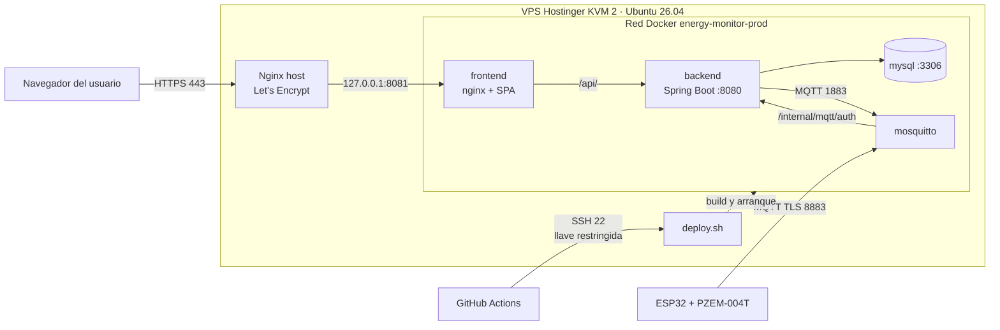
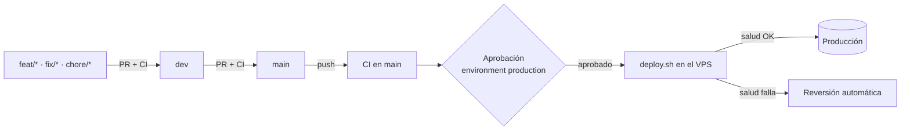

**SERVICIO NACIONAL DE APRENDIZAJE – SENA**

**CENTRO DE LA INDUSTRIA, LA EMPRESA Y LOS SERVICIOS (CIES)**

**REGIONAL HUILA**

Programa de Formación: Tecnología en Análisis y Desarrollo de Software (ADSO)

Ficha: 3145556

**MANUAL DE IMPLEMENTACIÓN Y DESPLIEGUE**

**Proyecto: Monitor de Consumo Eléctrico (EnergyMonitor)**

*Aplicación web, API REST, base de datos, broker MQTT y medidores ESP32 + PZEM-004T publicados en un VPS, con integración y despliegue continuos*

| **Dato**             | **Información**                                                                 |
|----------------------|---------------------------------------------------------------------------------|
| Integrantes          | Juan Esteban Cortés Parra, Miguel Ángel García Artunduaga                       |
| Centro de Formación  | Centro de la Industria, la Empresa y los Servicios (CIES) – SENA Regional Huila |
| Programa             | Tecnología en Análisis y Desarrollo de Software (ADSO)                          |
| Ficha                | 3145556                                                                         |
| Tipo de documento    | Manual de implementación y despliegue                                           |
| Versión              | 1.1                                                                             |
| Fecha de elaboración | 16 de octubre de 2026 (actualizado el 20 de octubre de 2026)                    |

Neiva, Huila · Colombia · 2026

> **Convención de este documento.** El dominio público del proyecto es `energy-monitor.tech` y
> `<IP_VPS>` es la IP pública del servidor. En el servidor el dominio se define una sola vez
> (`export DOMAIN=energy-monitor.tech`) y los comandos lo usan como `$DOMAIN`. Ningún valor secreto
> (contraseñas, claves, tokens) aparece en este informe.

# Control de versiones del documento

| **Versión** | **Fecha**  | **Descripción del cambio**                                                                                                                                                  | **Responsable**      |
|-------------|------------|-----------------------------------------------------------------------------------------------------------------------------------------------------------------------------|----------------------|
| 1.0         | 16/10/2026 | Creación del informe y runbook de despliegue en producción: web, API, MySQL y broker MQTT en VPS Hostinger con Docker Compose, Nginx y Let's Encrypt; verificación y reversión. | Equipo desarrollador |
| 1.1         | 20/10/2026 | Estrategia de integración y despliegue continuo con GitHub Actions (sección 9); selección y costo del plan Hostinger KVM 2 (3.2); dominio real; evidencias de la ejecución en el VPS; incidentes del despliegue real; actualización y reversión automatizadas. | Equipo desarrollador |

# Tabla de contenido

| **Sección**                    | **Contenido principal**                                                  |
|--------------------------------|--------------------------------------------------------------------------|
| Resumen ejecutivo              | Qué se despliega, dónde y con qué.                                       |
| 1 · Información general        | Ficha técnica, historial y resumen de cambios del despliegue.            |
| 2 · Alcance y arquitectura     | Componentes, topología, matriz de red y responsabilidades.               |
| 3 · Preparación y seguridad    | Inventario, selección del plan y costos, variables de entorno, respaldo. |
| 4 · Runbook de despliegue      | Paso a paso: DNS, servidor, código, secretos, TLS, arranque, admin.      |
| 5 · Integración IoT            | Broker MQTT con TLS público, certificado y vinculación de medidores.     |
| 6 · Pruebas y evidencias       | Pruebas de humo, comandos y evidencias para el cierre académico.         |
| 7 · Incidentes y decisiones    | Problemas encontrados en el despliegue y decisiones técnicas.            |
| 8 · Operación y contingencia   | Monitoreo, actualización, respaldo, reversión, seguridad y acceso SSH.   |
| 9 · Estrategia CI/CD           | Integración y despliegue continuos con GitHub Actions.                   |
| 10 · Conclusiones              | Estado del despliegue, límites y próximos pasos.                         |
| Anexos                         | Rutas, comandos y repositorios de referencia.                            |

> **Alcance de la evidencia.** Las verificaciones ejecutadas en el servidor de producción se marcan
> **«Confirmado»**; las que aún no tienen una salida o captura adjunta se marcan **«Pendiente de
> evidencia»** y no se presentan como hechos.

# Resumen ejecutivo

EnergyMonitor mide el consumo eléctrico de electrodomésticos con módulos ESP32 + PZEM-004T V3 que
publican telemetría por MQTT con TLS; el backend Spring Boot la almacena en MySQL, evalúa alertas y
recomendaciones, y la aplicación web React la presenta a los miembros de cada hogar.

El sistema está desplegado en un **VPS Hostinger plan KVM 2** (2 vCPU, 8 GB de RAM) con **Ubuntu
26.04 LTS**, contratado por un mes a **48.000 COP**. Toda la plataforma corre en **Docker Compose** desde el
repositorio `energy-monitor-infra` (`docker-compose.prod.yml`): MySQL 8.4, backend, broker Mosquitto
con autenticación delegada al backend y frontend servido por nginx. **Nginx en el host** es el único
punto de entrada HTTP/HTTPS, con certificados **Let's Encrypt** emitidos por Certbot. La web y la API
se publican en `https://energy-monitor.tech`; los medidores se conectan a
`mqtts://mqtt.energy-monitor.tech:8883`.

Las actualizaciones se hacen con **GitHub Actions**: cada *pull request* ejecuta las pruebas, y cada
cambio que llega a `main` se despliega en el servidor tras una **aprobación manual**, con respaldo
previo de la base de datos, prueba de salud y **reversión automática** si algo falla.

La aplicación móvil queda **fuera del alcance** de este despliegue.

# 1. Información general y control de versiones

## 1.1 Ficha técnica

| **Campo**                    | **Información registrada**                                                   |
|------------------------------|------------------------------------------------------------------------------|
| Sistema                      | EnergyMonitor · monitor de consumo eléctrico doméstico con IoT               |
| Modalidad                    | Aplicación web React/Vite, API REST Spring Boot, broker MQTT y firmware ESP32 |
| Ambiente                     | Producción / despliegue demostrativo accesible por Internet                  |
| Proveedor de infraestructura | Hostinger VPS · plan **KVM 2** · Ubuntu 26.04 LTS                            |
| Costo de infraestructura     | 48.000 COP/mes con contrato mensual (27.900 COP/mes con contrato anual); detalle en 3.2 |
| Dominio                      | `energy-monitor.tech` (web y API) · `mqtt.energy-monitor.tech` (broker)      |
| Repositorio de despliegue    | `energy-monitor-infra`, archivo `docker-compose.prod.yml`                    |
| Integración y despliegue     | GitHub Actions (`.github/workflows/ci-cd.yml` en backend, web e infra)       |
| Rama desplegada              | `main` en los tres repositorios                                              |
| Fecha de consolidación       | 16 de octubre de 2026; despliegue continuo activo desde el 19 de octubre     |
| Etiqueta de release          | `[POR CONFIRMAR]` — se recomienda etiquetar `v1.0.0` en los repositorios     |
| Versión de este informe      | 1.1                                                                          |

## 1.2 Historial documental

| **Versión** | **Fecha**  | **Descripción**                                                        |
|-------------|------------|------------------------------------------------------------------------|
| 1.0         | 16/10/2026 | Runbook de despliegue de web, API, MySQL y broker MQTT en producción.  |
| 1.1         | 20/10/2026 | Estrategia CI/CD, plan KVM 2 y costos, evidencias e incidentes reales. |

## 1.3 Resumen de cambios que habilitan el despliegue

- Consolidación de todo lo de Docker en `energy-monitor-infra`: pila local, modo desarrollo y
  `docker-compose.prod.yml` para servidor, ahora con el frontend incluido.
- Retiro del repositorio `energy-monitor-devices`: el firmware pasa a `firmware/` del backend y la
  configuración del broker a `infra/mosquitto/`.
- Imagen Docker del frontend (build de Vite + nginx) que sirve la SPA y reenvía solo `/api/` al
  backend: un único origen, sin CORS entre dominios, y `/internal/**` nunca expuesto.
- Permisos del volumen del broker corregidos (servicio `mosquitto-data-owner`), apagado ordenado del
  backend (`stop_grace_period: 30s`) y `SERVER_FORWARD_HEADERS_STRATEGY=native` detrás del proxy.
- Plantillas versionadas en `infra/deploy/`: sitio de Nginx, hook de renovación del certificado del
  broker y respaldo diario de MySQL; `make-admin.sh --prod` para el primer administrador.
- Corrección en el backend: errores del cliente (parámetro faltante, tipo inválido, ruta
  inexistente) responden 4xx en lugar de 500.
- Pipelines de GitHub Actions en los tres repositorios y script `infra/deploy/deploy.sh`, que
  despliega un componente con respaldo, prueba de salud y reversión automática (sección 9).

# 2. Alcance, topología y arquitectura

## 2.1 Componentes desplegados

| **Componente**    | **Tecnología / función**                                                        | **Publicación**                         |
|-------------------|---------------------------------------------------------------------------------|-----------------------------------------|
| Proxy HTTPS       | Nginx en el host, certificados Let's Encrypt (Certbot)                          | `https://energy-monitor.tech` (80 → 443) |
| Frontend web      | React 19 + Vite; contenedor nginx que sirve la SPA y reenvía `/api/`            | Detrás del proxy (127.0.0.1:8081)       |
| Backend / API     | Java 21, Spring Boot 4.1, JWT RS256, Liquibase, correo, Web Push, push Expo     | `/api/v1/**` a través del frontend      |
| Base de datos     | MySQL 8.4, volumen Docker `mysql-data`                                          | Solo red Docker interna                 |
| Broker MQTT       | Mosquitto 2.0 + mosquitto-go-auth (auth y ACL delegadas al backend)             | `mqtt.energy-monitor.tech:8883` (TLS)   |
| Medidores         | ESP32 + PZEM-004T V3, firmware con raíces de Let's Encrypt                      | Conexión saliente al broker             |
| CI/CD             | GitHub Actions + `infra/deploy/deploy.sh` en el VPS                             | SSH con llave restringida               |

## 2.2 Diagrama de arquitectura



*Figura 1. Topología lógica: clientes, proxy, aplicación, persistencia, broker y canal de despliegue.*

El dominio principal sirve la web y, por la ruta `/api/`, la API. El nginx del frontend solo
reenvía `/api/` al backend, de modo que los endpoints internos con los que el broker autentica a
cada cliente (`/internal/mqtt/auth/**`) no son alcanzables desde Internet. El broker es el único
servicio publicado directamente (8883, TLS), porque los medidores no hablan HTTP.

## 2.3 Matriz de red y puertos

| **Servicio**          | **Dirección / puerto**                  | **Exposición**              |
|-----------------------|-----------------------------------------|-----------------------------|
| SSH                   | 22                                      | Público (administración y GitHub Actions) |
| Nginx host            | 80 (redirección) / 443 (TLS)            | Público                     |
| Frontend (nginx)      | 127.0.0.1:8081 → contenedor :80         | Solo host                   |
| Backend Spring Boot   | 127.0.0.1:8080 → contenedor :8080       | Solo host (health, depurar) |
| MySQL 8.4             | contenedor :3306                        | Privado (red Docker)        |
| Mosquitto interno     | contenedor :1883 (sin TLS)              | Privado (red Docker)        |
| Mosquitto dispositivos| 8883 (TLS)                              | Público                     |

## 2.4 Separación de responsabilidades

El navegador habla solo con `https://energy-monitor.tech`: la SPA y la API comparten origen. El
backend gestiona cuentas, sesiones JWT, hogares, dispositivos, mediciones, alertas, recomendaciones y
notificaciones, y es la única fuente de verdad de qué dispositivo puede conectarse: el broker no
guarda usuarios y le pregunta al backend por cada conexión y cada tópico (con caché de 5 min). Los
medidores solo abren conexiones salientes, así que funcionan detrás de cualquier router doméstico.

# 3. Requisitos previos y preparación

## 3.1 Inventario de plataforma

| **Recurso**          | **Configuración**                                                              |
|----------------------|--------------------------------------------------------------------------------|
| VPS                  | Hostinger KVM 2 · 2 vCPU · 8 GB RAM · 100 GB NVMe · Ubuntu 26.04 LTS (hostname `srv2066688`) |
| Orquestación         | Docker Engine + plugin Docker Compose v2                                       |
| Proxy / TLS          | Nginx en el host; Let's Encrypt con Certbot (renovación automática)            |
| Compilación          | En el propio VPS (`--build`): Maven dentro de la imagen del backend, Vite en la del frontend |
| CI/CD                | GitHub Actions (runners `ubuntu-latest` alojados por GitHub)                   |
| Dominio              | `energy-monitor.tech` con registros A para `@`, `www` y `mqtt`                 |

## 3.2 Selección del proveedor y del plan

**Requisitos que debía cumplir la infraestructura:**

- Exponer un **puerto TCP propio (8883)** para MQTT con TLS, además de HTTP/HTTPS: muchas
  plataformas PaaS solo publican HTTP, y un VPS da control total de puertos y firewall.
- Ejecutar **cuatro contenedores permanentes** (MySQL, backend JVM, Mosquitto y frontend) y, en cada
  despliegue, **compilar** el backend con Maven y el frontend con Vite en el mismo servidor.
- Costo mensual fijo y predecible, en pesos, acorde a un proyecto formativo.
- Proveedor con panel en español, firewall administrable y gestión de DNS del dominio.

**Comparación de planes VPS de Hostinger:**

| **Plan** | **vCPU** | **RAM** | **Disco NVMe** | **Evaluación para EnergyMonitor**                                                       |
|----------|----------|---------|----------------|-----------------------------------------------------------------------------------------|
| KVM 1    | 1        | 4 GB    | 50 GB          | Insuficiente: la JVM, MySQL y una compilación de Maven simultánea agotan la memoria y obligan a usar swap. |
| **KVM 2**| **2**    | **8 GB**| **100 GB**     | **Elegido**: compila y ejecuta toda la pila sin swap, con margen para crecer en medidores e historial. |
| KVM 4    | 4        | 16 GB   | 200 GB         | Sobredimensionado para la carga de un piloto; duplica el costo sin beneficio actual.    |

**Decisión:** plan **KVM 2**. Con 2 vCPU la compilación no bloquea al backend en ejecución, y los
8 GB de RAM (7,7 GB utilizables según el sistema operativo) alcanzan para la JVM del backend, MySQL,
Mosquitto, nginx y una compilación al mismo tiempo. Si la carga crece, Hostinger permite subir de
plan sin reinstalar.

**Plazo de contratación:** el precio del plan depende del plazo. El proyecto lo contrató **por un
mes** (48.000 COP), suficiente para la demostración y la sustentación sin comprometer un pago anual.
Para una operación continua conviene el contrato de 12 meses:

| **Plazo de contratación** | **Precio mensual** | **Costo de 12 meses** | **Observación**                                      |
|---------------------------|--------------------|-----------------------|------------------------------------------------------|
| Mensual (contratado)      | 48.000 COP         | 576.000 COP           | Sin compromiso; se renueva mes a mes                 |
| Anual                     | 27.900 COP         | 334.800 COP           | Pago anticipado; ahorra 241.200 COP al año (≈ 42 %)  |

**Costos de operación del despliegue actual:**

| **Concepto**                 | **Costo**             | **Observación**                                  |
|------------------------------|-----------------------|--------------------------------------------------|
| VPS Hostinger KVM 2          | 48.000 COP/mes        | Contrato mensual                                 |
| Dominio `energy-monitor.tech`| 0 COP                 | Obtenido sin costo; revisar el precio de renovación antes del vencimiento |
| Certificados TLS             | 0 COP                 | Let's Encrypt (gratuito, renovación automática)  |
| GitHub y GitHub Actions      | 0 COP                 | Dentro de los minutos incluidos sin costo        |
| **Total infraestructura**    | **48.000 COP/mes**    | Con contrato anual: 27.900 COP/mes               |

## 3.3 Checklist de prerrequisitos

- Registros DNS A de `energy-monitor.tech`, `www.energy-monitor.tech` y `mqtt.energy-monitor.tech`
  apuntando a `<IP_VPS>`.
- Acceso SSH al VPS con un usuario con `sudo` (o root), con una llave personal distinta de la de
  GitHub Actions (8.5).
- Puertos 80 y 443 libres para Nginx (no instalar otro proxy que compita por ellos) y 8883 libre
  para el broker.
- Cambios fusionados en `main` en `energy-monitor-infra`, `energy-monitor-backend` y
  `Energy-Monitor-application`.
- Cuenta de correo para envío (contraseña de aplicación de Gmail) y, si se usa, cliente OAuth de
  Google con `https://energy-monitor.tech` en *Authorized JavaScript origins*.
- Secretos gestionados fuera de los repositorios, con permisos restringidos (`chmod 600`).

## 3.4 Gestión de variables de entorno

Se documentan solo valores públicos; los secretos se generan en el servidor y viven en
`infra/.env.prod` (ignorado por git, permisos 600).

| **Capa**   | **Variable / valor sin secretos**                                        | **Propósito**                                   |
|------------|---------------------------------------------------------------------------|-------------------------------------------------|
| Backend    | `SECURITY_CORS_ALLOWED_ORIGINS=https://energy-monitor.tech,https://www.energy-monitor.tech` | Orígenes permitidos      |
| Backend    | `NOTIFICATION_WEB_URL=https://energy-monitor.tech`                        | Enlaces de los correos de alerta                |
| Backend    | `DEVICE_MQTT_PUBLIC_HOST=mqtt.energy-monitor.tech` · `DEVICE_MQTT_PUBLIC_PORT=8883` | Broker que la web escribe al medidor  |
| Backend    | `JWT_KEYS_DIR=/opt/energy-monitor/keys` · `BACKEND_UID/GID=10001`         | Par RSA de los JWT y usuario que lo lee         |
| Backend    | `MAIL_HOST=smtp.gmail.com` · `MAIL_PORT=587` · `MAIL_FROM=...`            | Correo de recuperación, verificación y alertas  |
| Backend    | `MYSQL_PASSWORD`, `MYSQL_ROOT_PASSWORD`, `SECURITY_RESET_PEPPER`, `MQTT_BACKEND_PASS`, `MAIL_PASSWORD`, `GOOGLE_CLIENT_SECRET`, `NOTIFICATION_VAPID_PRIVATE_KEY`, `EXPO_ACCESS_TOKEN` (valores omitidos) | Secretos protegidos |
| Broker     | `MQTT_CERT_DIR=/opt/energy-monitor/mqtt-certs`                            | Certificado Let's Encrypt de `mqtt.energy-monitor.tech` |
| Web        | `VITE_API_BASE_URL=""` (fijo en la compose)                               | API en el mismo origen                          |
| Web        | `VITE_GOOGLE_CLIENT_ID=<id público>`                                      | Botón de Google                                 |
| Proxy      | `WEB_PORT=8081`                                                           | Puerto local al que apunta Nginx                |
| GitHub     | `DEPLOY_HOST`, `DEPLOY_USER`, `DEPLOY_SSH_KEY`, `DEPLOY_KNOWN_HOSTS` (secretos del environment `production`) | Acceso de GitHub Actions al VPS (9.8) |

> **Importante.** Las variables `VITE_*` se incorporan al compilar la imagen del frontend: cambiar
> `.env.prod` después no modifica una imagen ya construida; hay que reconstruir `frontend`.

## 3.5 Respaldo y contingencia previa

En una instalación nueva no hay datos que respaldar. En cada despliegue posterior `deploy.sh`
ejecuta automáticamente el respaldo de MySQL y registra la versión anterior de cada repositorio
(sección 9.6). Además:

1. Conservar una copia segura de `.env.prod`, de `/opt/energy-monitor/keys` y del certificado del
   broker fuera del servidor.
2. Confirmar que ningún procedimiento ejecuta `docker compose down -v` ni borra volúmenes.
3. En una actualización manual, ejecutar antes `infra/deploy/backup-mysql.sh` y comprobar que el
   archivo `.sql.gz` no esté vacío.

# 4. Procedimiento de despliegue paso a paso (runbook)

Este procedimiento corresponde a la **instalación inicial** del servidor. Las actualizaciones
posteriores las hace GitHub Actions (sección 9). Todos los comandos se ejecutan en el VPS por SSH.
Definir primero las variables de la sesión:

```bash
export DOMAIN=energy-monitor.tech
export EM=/opt/energy-monitor
```

## 4.1 Dominio y DNS

En el panel de Hostinger (Dominios → DNS / Nameservers) crear los registros **A**:

| **Nombre** | **Tipo** | **Valor**   | **TTL** |
|------------|----------|-------------|---------|
| `@`        | A        | `<IP_VPS>`  | 300     |
| `www`      | A        | `<IP_VPS>`  | 300     |
| `mqtt`     | A        | `<IP_VPS>`  | 300     |

Verificar la propagación antes de pedir certificados:

```bash
getent hosts $DOMAIN www.$DOMAIN mqtt.$DOMAIN
```

## 4.2 Preparación del servidor

```bash
sudo apt update && sudo apt -y upgrade
sudo apt -y install ca-certificates curl git openssl ufw nginx certbot python3-certbot-nginx

# Docker Engine + Compose (script oficial; revisar su contenido antes de ejecutarlo)
curl -fsSL https://get.docker.com -o get-docker.sh
less get-docker.sh
sudo sh get-docker.sh
# Si el repositorio de Docker aún no publica paquetes para 26.04, usar los de Ubuntu:
#   sudo apt -y install docker.io docker-compose-v2
docker --version && docker compose version
```

Firewall (los puertos que publica Docker no pasan por ufw; por eso la compose solo publica en
`127.0.0.1` lo que no debe ser público):

```bash
sudo ufw allow OpenSSH
sudo ufw allow 80/tcp
sudo ufw allow 443/tcp
sudo ufw allow 8883/tcp
sudo ufw enable
sudo ufw status
```

En el **firewall del panel de Hostinger** (si está activo) abrir los mismos puertos: 22, 80, 443 y
8883.

Con el plan KVM 2 (8 GB) no se necesita swap. En un plan con menos de 4 GB de RAM sí hay que crearla
para que compilen Maven y Vite:

```bash
sudo fallocate -l 2G /swapfile && sudo chmod 600 /swapfile
sudo mkswap /swapfile && sudo swapon /swapfile
echo '/swapfile none swap sw 0 0' | sudo tee -a /etc/fstab
```

## 4.3 Código fuente

La compose de producción construye el backend y el frontend desde clones vecinos de `infra`. Los
tres clones siguen la rama `main`, que es la que despliega GitHub Actions:

```bash
sudo mkdir -p $EM && sudo chown "$USER": $EM && cd $EM
git clone --branch main https://github.com/Juan-Cortes2045/energy-monitor-infra.git infra
git clone --branch main https://github.com/Juan-Cortes2045/energy-monitor-backend.git backend/energy-monitor-backend
git clone --branch main https://github.com/Juan-Cortes2045/Energy-Monitor-application.git frontend/energy-monitor-web
```

Si un repositorio es privado, crear una clave SSH en el servidor (`ssh-keygen -t ed25519`),
registrarla como *Deploy key* de solo lectura en GitHub (Settings → Deploy keys) y clonar con la URL
SSH (`git@github.com:...`).

## 4.4 Secretos y claves

```bash
# Par RSA de los JWT (lo lee el backend como uid 10001)
sudo mkdir -p $EM/keys
sudo openssl genpkey -algorithm RSA -pkeyopt rsa_keygen_bits:2048 -out $EM/keys/private.pem
sudo openssl rsa -in $EM/keys/private.pem -pubout -out $EM/keys/public.pem
sudo chown -R 10001:10001 $EM/keys && sudo chmod 600 $EM/keys/private.pem

# Valores aleatorios para .env.prod (se copian a mano; no se guardan en el historial)
openssl rand -hex 24   # MYSQL_PASSWORD
openssl rand -hex 24   # MYSQL_ROOT_PASSWORD
openssl rand -hex 32   # SECURITY_RESET_PEPPER
openssl rand -hex 24   # MQTT_BACKEND_PASS
```

Claves VAPID para push en el navegador (una vez por entorno). Cada valor debe quedar en **una sola
línea**, sin espacios ni saltos (ver incidente en la sección 7):

```bash
openssl ecparam -name prime256v1 -genkey -noout -out vapid.pem
echo "NOTIFICATION_VAPID_PRIVATE_KEY=$(openssl ec -in vapid.pem -outform DER | tail -c +8 | head -c 32 | base64 -w0 | tr '+/' '-_' | tr -d '=')"
echo "NOTIFICATION_VAPID_PUBLIC_KEY=$(openssl ec -in vapid.pem -pubout -outform DER | tail -c 65 | base64 -w0 | tr '+/' '-_' | tr -d '=')"
rm vapid.pem
```

## 4.5 Proxy HTTPS: Nginx y Let's Encrypt

```bash
cd $EM/infra
sed "s/DOMINIO/$DOMAIN/g" deploy/nginx-energy-monitor.conf | sudo tee /etc/nginx/sites-available/energy-monitor >/dev/null
sudo ln -sf /etc/nginx/sites-available/energy-monitor /etc/nginx/sites-enabled/energy-monitor
sudo rm -f /etc/nginx/sites-enabled/default
test -s /etc/nginx/sites-available/energy-monitor && echo "sitio OK"   # no debe quedar vacío
sudo nginx -t && sudo systemctl reload nginx

# Certificado de la web y la API (Certbot agrega el bloque 443 y la redirección a HTTPS)
sudo certbot --nginx -d $DOMAIN -d www.$DOMAIN
```

El sitio reenvía **todo** el dominio a `127.0.0.1:8081` (nginx del frontend), reemplaza
`X-Forwarded-For` por la IP real del cliente para que no pueda falsificarse y admite cuerpos de
hasta 10 MB. Si el certificado ya existe pero el sitio se regeneró, se reinstala con
`sudo certbot install --nginx --cert-name $DOMAIN`.

## 4.6 Certificado del broker MQTT

El broker usa su propio certificado Let's Encrypt para `mqtt.energy-monitor.tech`. Certbot lo emite
por HTTP-01 a través de Nginx y el hook `renew-mqtt-cert.sh` lo copia donde lo lee Mosquitto
(uid 1000) en la emisión y en cada renovación:

```bash
sudo certbot certonly --nginx -d mqtt.$DOMAIN
sudo cp $EM/infra/deploy/renew-mqtt-cert.sh /etc/letsencrypt/renewal-hooks/deploy/energy-monitor-mqtt.sh
sudo chmod 755 /etc/letsencrypt/renewal-hooks/deploy/energy-monitor-mqtt.sh
sudo MQTT_DOMAIN=mqtt.$DOMAIN /etc/letsencrypt/renewal-hooks/deploy/energy-monitor-mqtt.sh
ls -l $EM/mqtt-certs          # server.crt y server.key, dueño 1000
```

Si `mqtt-certs` queda vacío, Mosquitto se reinicia en bucle: ejecutar de nuevo el hook (última línea
con `MQTT_DOMAIN`).

## 4.7 Configuración de producción (.env.prod)

```bash
cd $EM/infra
cp .env.prod.example .env.prod && chmod 600 .env.prod
nano .env.prod
```

Valores a completar (además de los secretos generados en 4.4):

```
SECURITY_CORS_ALLOWED_ORIGINS=https://energy-monitor.tech,https://www.energy-monitor.tech
NOTIFICATION_WEB_URL=https://energy-monitor.tech
DEVICE_MQTT_PUBLIC_HOST=mqtt.energy-monitor.tech
JWT_KEYS_DIR=/opt/energy-monitor/keys
MQTT_CERT_DIR=/opt/energy-monitor/mqtt-certs
BACKEND_UID=10001
BACKEND_GID=10001
MAIL_USERNAME / MAIL_PASSWORD / MAIL_FROM
GOOGLE_CLIENT_ID / GOOGLE_CLIENT_SECRET / VITE_GOOGLE_CLIENT_ID   (opcional)
NOTIFICATION_VAPID_PUBLIC_KEY / NOTIFICATION_VAPID_PRIVATE_KEY    (opcional)
EXPO_ACCESS_TOKEN                                                 (opcional)
```

Validar sin arrancar nada:

```bash
docker compose -f docker-compose.prod.yml --env-file .env.prod config -q && echo OK
```

## 4.8 Construcción y arranque

Primero se crea el alias `emc`, para no repetir el archivo de producción en cada comando (un
`docker compose` sin `-f docker-compose.prod.yml` usaría la pila local y fallaría):

```bash
echo "alias emc='docker compose -f $EM/infra/docker-compose.prod.yml --env-file $EM/infra/.env.prod --project-directory $EM/infra'" >> ~/.bashrc
source ~/.bashrc

emc up -d --build
emc ps
emc logs -f backend     # Ctrl+C para salir
```

La primera construcción tarda varios minutos (dependencias de Maven y npm). En el primer arranque
Liquibase crea el esquema completo; el backend tarda unos 2 minutos en quedar listo y, mientras
tanto, la web responde **502**. Está listo cuando el log muestra
`Started EnergyMonitorBackendApplication` y:

```bash
curl -s http://127.0.0.1:8080/actuator/health      # {"status":"UP"...}
```

## 4.9 Primer administrador

Ninguna cuenta es administradora al instalar. Registrar la cuenta en `https://energy-monitor.tech`
y luego:

```bash
cd $EM/infra
./make-admin.sh --prod correo-del-admin@ejemplo.com
```

Sin `--prod` el script busca la pila local y no encuentra `MYSQL_ROOT_PASSWORD`. Cerrar sesión y
volver a entrar: el menú muestra **Administración**. Desde ahí ese administrador otorga el rol a
otras cuentas.

## 4.10 Respaldo diario

```bash
sudo crontab -e
# agregar:
0 3 * * * /opt/energy-monitor/infra/deploy/backup-mysql.sh >> /var/log/energy-monitor-backup.log 2>&1
```

Ejecutarlo una vez a mano para comprobarlo: `sudo $EM/infra/deploy/backup-mysql.sh`. Los respaldos
se conservan 14 días en `/opt/energy-monitor/backups`.

## 4.11 Habilitar el despliegue continuo

Al terminar la instalación inicial se configura GitHub Actions (sección 9.8). Desde ese momento no
se vuelve a desplegar a mano.

# 5. Integración IoT: broker MQTT y medidores

## 5.1 Objetivo y servicio expuesto

Permitir que los medidores de cualquier hogar publiquen su telemetría por Internet sin abrir puertos
en el router: el ESP32 solo abre una conexión saliente a `mqtt.energy-monitor.tech:8883` con TLS.

## 5.2 Autenticación delegada al backend

Mosquitto no guarda usuarios. Con `mosquitto-go-auth` pregunta al backend por cada conexión
(`POST /internal/mqtt/auth/user`, `device_code` / `api_key`) y por cada tópico
(`POST /internal/mqtt/auth/acl`), con caché de 5 minutos. El backend solo guarda el SHA-256 de cada
clave. Esos endpoints solo aceptan llamadas desde la red interna de Docker
(`MQTT_AUTH_ALLOWED_NETWORKS=172.16.0.0/12,127.0.0.1/32`) y además no pasan por el proxy.

## 5.3 Certificado y firmware

En producción el broker presenta el certificado Let's Encrypt de `mqtt.energy-monitor.tech`. El
firmware (`energy-monitor-backend/firmware/esp32-pzem-monitor`) ya incluye las raíces ISRG Root X1 y
X2, así que **no requiere recompilarse** para producción. La CA de desarrollo (`dev_ca.h`) solo se
usa con la pila local.

## 5.4 Vinculación de un medidor

1. El propietario del hogar abre `https://energy-monitor.tech` en Chrome/Edge (HTTPS es obligatorio
   para Web Bluetooth) y entra a **Hogar → Dispositivos → Vincular dispositivo**.
2. Mantiene presionado BOOT 3 s en el ESP32 (LED parpadeando) y lo selecciona.
3. La web escribe al módulo la Wi-Fi del hogar, su `device_code`, la `api_key` y el broker
   `mqtt.energy-monitor.tech:8883` que entrega el backend (`DEVICE_MQTT_PUBLIC_HOST`).
4. El módulo se conecta; el broker registra `New client connected ... u'<device_code>'` y la web
   muestra el dispositivo **ONLINE**.

# 6. Plan de verificación y pruebas de humo

## 6.1 Matriz de estado por componente

| **Verificación**                    | **Evidencia esperada**                                                        | **Estado**                 |
|-------------------------------------|-------------------------------------------------------------------------------|----------------------------|
| Compose de producción               | `docker compose ... config -q` sin errores (también en cada PR de infra)      | Confirmado                 |
| Suite de pruebas del backend        | 1131 pruebas, 0 fallos contra MySQL 8.4 (local y en GitHub Actions)           | Confirmado                 |
| Pruebas y build de la web           | Pruebas Vitest y `npm run build` correctos (local y en GitHub Actions)        | Confirmado                 |
| Plantilla de Nginx                  | `nginx -t` correcto (en cada PR de infra)                                     | Confirmado                 |
| DNS                                 | Los tres nombres resuelven a `<IP_VPS>`                                       | Confirmado                 |
| Web HTTPS                           | `https://energy-monitor.tech` → 200; `http://` → 301 a HTTPS                  | Confirmado                 |
| Certificados                        | Let's Encrypt válidos hasta el 14/01/2027, renovación automática             | Confirmado                 |
| API a través del proxy              | `GET /api/v1/homes` sin sesión → 401                                          | Confirmado                 |
| `/internal/**` no expuesto          | `POST https://energy-monitor.tech/internal/mqtt/auth/user` → 405 de nginx, no llega al backend | Confirmado |
| Backend y Liquibase                 | `actuator/health` → UP                                                        | Confirmado                 |
| Broker TLS                          | `openssl s_client` a `mqtt.energy-monitor.tech:8883` → `Verify return code: 0` | Confirmado                |
| Despliegue continuo                 | Ejecuciones en verde de los tres pipelines con aprobación (9.9)               | Confirmado                 |
| Respaldo                            | `.sql.gz` generado por `deploy.sh` en cada despliegue                         | Confirmado                 |
| Backend suscrito al broker          | Log del broker: `New client connected ... u'em-backend'`                      | Pendiente de evidencia     |
| Registro, login y recuperación      | Cuenta creada, correo de verificación/recuperación con enlaces al dominio     | Pendiente de evidencia     |
| Administración                      | `make-admin.sh --prod` y menú **Administración** visible                      | Pendiente de evidencia     |
| Medidor en producción               | Vinculación por Bluetooth, estado ONLINE y mediciones en la web               | Pendiente de evidencia     |
| Respaldo diario programado          | Entrada en `crontab` y archivo del día en `/opt/energy-monitor/backups`       | Pendiente de evidencia     |
| Renovación de certificados          | `certbot renew --dry-run` sin errores                                         | Pendiente de evidencia     |
| Rendimiento con varios usuarios     | No se han realizado pruebas de carga                                          | Pendiente                  |

## 6.2 Comandos de comprobación

Desde cualquier equipo:

```bash
curl -s -o /dev/null -w '%{http_code}\n' https://energy-monitor.tech                          # 200
curl -s -o /dev/null -w '%{http_code}\n' http://energy-monitor.tech                           # 301
curl -s -o /dev/null -w '%{http_code}\n' https://energy-monitor.tech/api/v1/homes             # 401
curl -s -o /dev/null -w '%{http_code}\n' -X POST https://energy-monitor.tech/internal/mqtt/auth/user  # 405
echo | openssl s_client -connect energy-monitor.tech:443 -servername energy-monitor.tech 2>/dev/null | openssl x509 -noout -enddate
openssl s_client -connect mqtt.energy-monitor.tech:8883 -servername mqtt.energy-monitor.tech </dev/null 2>/dev/null | grep 'Verify return code'
```

En el servidor:

```bash
curl -s http://127.0.0.1:8080/actuator/health
emc ps
emc logs --tail 50 mosquitto | grep 'New client connected'
for r in infra backend/energy-monitor-backend frontend/energy-monitor-web; do
  echo "$r: $(git -C /opt/energy-monitor/$r log -1 --oneline)"
done                                                     # debe coincidir con main en GitHub
ls -lh /opt/energy-monitor/backups | tail -3
sudo certbot renew --dry-run
```

## 6.3 Evidencias requeridas para el cierre académico

- Captura de `https://energy-monitor.tech` abierto con el candado de HTTPS y del panel con un hogar.
- Salida de `emc ps` con los cuatro servicios en estado `Up` (sin datos sensibles).
- Salida de `actuator/health` y de `openssl s_client` al broker, con fecha.
- Captura del medidor vinculado en estado ONLINE y de mediciones recibidas.
- Captura del correo de verificación o recuperación con el enlace al dominio público.
- Salida de `certbot renew --dry-run` y de un respaldo generado.
- Capturas de las ejecuciones de GitHub Actions de backend, web e infra en verde y de la aprobación
  del environment `production`.

# 7. Incidentes encontrados y decisiones técnicas

**Durante la preparación (entorno local):**

| **Situación**                                    | **Causa observada**                                                                 | **Acción aplicada / lección**                                                                                  |
|--------------------------------------------------|-------------------------------------------------------------------------------------|----------------------------------------------------------------------------------------------------------------|
| El ESP32 no conectaba (`X509 verification failed`) | El certificado de desarrollo no incluía la IP actual del PC                        | `prepare.sh` incluye siempre `DEVICE_MQTT_PUBLIC_HOST`; en producción se usa Let's Encrypt con dominio.        |
| El broker rechazaba al ESP32 (`unknown ca`)      | El firmware se había compilado con otra CA de desarrollo                            | Reflashear desde el equipo cuya CA coincide; en producción las raíces Let's Encrypt evitan el problema.        |
| El firmware no cabía (108 %)                     | Esquema de particiones por defecto (1,2 MB)                                         | Usar *Minimal SPIFFS (1.9MB APP with OTA)*; la NVS no se mueve y se conserva la vinculación.                   |
| Mosquitto no guardaba su base (`Permission denied`) | El volumen nace con dueño root y Mosquitto corre como uid 1000                    | Servicio `mosquitto-data-owner` que entrega el volumen a uid 1000 antes de arrancar el broker.                  |
| El backend terminaba con código 137 al detenerse | El apagado ordenado superaba los 10 s por defecto                                   | `stop_grace_period: 30s`.                                                                                      |
| Errores del cliente respondían 500               | El manejador global de excepciones capturaba también los errores de Spring MVC      | Se conserva el estado 4xx del framework; detectado por una prueba nueva del controlador de recomendaciones.   |
| Detrás del proxy todas las peticiones tenían la IP del proxy | El backend ignora `X-Forwarded-For` por diseño                           | `SERVER_FORWARD_HEADERS_STRATEGY=native` y Nginx del host reemplaza el encabezado con la IP real.             |
| `make-admin.sh` no servía en el servidor         | Buscaba el contenedor local y leía `.env`                                           | Opción `--prod`: usa el servicio `mysql` de `docker-compose.prod.yml` y `.env.prod`.                           |
| Docker repartido en tres repositorios            | Compose del backend, de `devices` y de `infra` con nombres y volúmenes en conflicto | Todo Docker en `infra`; firmware en el backend; `devices` archivado.                                           |
| Proxy único                                      | Varios proxies competirían por 80/443                                               | Nginx del host como único punto de entrada; Docker publica en `127.0.0.1` todo lo que no es el broker.         |

**Durante el despliegue en el VPS y la puesta en marcha del CI/CD:**

| **Situación**                                    | **Causa observada**                                                                 | **Acción aplicada / lección**                                                                                  |
|--------------------------------------------------|-------------------------------------------------------------------------------------|----------------------------------------------------------------------------------------------------------------|
| `docker compose ps` no mostraba los servicios    | El comando sin `-f docker-compose.prod.yml` apunta a la pila local                  | Alias `emc` con el archivo, el `.env.prod` y el directorio del proyecto (4.8).                                 |
| La web no cargaba («No se puede acceder a este sitio») | El archivo del sitio de Nginx quedó vacío al generarlo                        | Regenerar con `sed … \| sudo tee`, comprobar con `test -s` y reinstalar el certificado con `certbot install` (4.5). |
| El backend se reiniciaba en bucle (`WebPushSender`) | Claves VAPID mal formadas en `.env.prod` (cortadas o con saltos de línea)        | Regenerarlas en el servidor y pegarlas en una sola línea (4.4).                                                |
| Mosquitto se reiniciaba en bucle                 | `mqtt-certs` vacío: el hook del certificado no se había ejecutado                   | Ejecutar el hook con `MQTT_DOMAIN` tras emitir el certificado (4.6).                                           |
| La web respondía 502 justo después de desplegar  | El backend tarda unos 2 minutos en arrancar                                         | Esperar `actuator/health` UP; `deploy.sh` espera hasta 300 s antes de declarar éxito o revertir.               |
| Desplegar el frontend reconstruía también el backend | En la compose el frontend depende del backend                                   | `deploy.sh` usa `up -d --build --no-deps <servicio>`: solo cambia el componente desplegado.                     |
| La huella del servidor no coincidía              | `ssh-keygen -lf` se ejecutó en el PC y no en el servidor                            | Comparar la huella de `ssh-keyscan` con la de `/etc/ssh/ssh_host_ed25519_key.pub` **en el servidor**.          |
| El SSH personal terminaba en `Uso: deploy.sh …`  | El agente SSH del PC ofrecía la llave de GitHub Actions, restringida a `deploy.sh`  | Entrada en `~/.ssh/config` con `IdentitiesOnly yes` y la llave personal (8.5).                                 |

# 8. Operación, mantenimiento y plan de reversión

## 8.1 Monitoreo operativo

```bash
emc ps
docker stats --no-stream
emc logs --tail 100 backend
emc logs --tail 100 mosquitto
sudo tail -n 50 /var/log/nginx/error.log
df -h && free -h
```

## 8.2 Actualización de la aplicación

La vía normal es **GitHub Actions** (sección 9): fusionar el cambio en `main`, aprobar el despliegue
en *Review deployments* y revisar que el job termine en verde.

Si GitHub no está disponible, el mismo script se puede ejecutar a mano en el servidor; hace exactamente
lo mismo que el pipeline (respaldo, `git pull` de `main`, build, prueba de salud y reversión):

```bash
sudo /opt/energy-monitor/infra/deploy/deploy.sh backend     # o frontend, o infra
```

Liquibase aplica solo los changesets nuevos al arrancar. Un despliegue de `infra` vuelve a aplicar la
compose y recrea Mosquitto para tomar cambios en `mosquitto.conf`.

## 8.3 Reversión controlada

1. **Automática:** si la prueba de salud falla tras un despliegue, `deploy.sh` vuelve el repositorio
   a la versión anterior, reconstruye el servicio y deja el job de GitHub en rojo.
2. **Manual de código:** volver a desplegar una versión anterior con un *revert* en `main` (queda
   trazado en el historial y pasa por el mismo pipeline). Evitar `git reset --hard` en el servidor.
3. **Datos:** si una migración Liquibase dañó datos, detener el backend (`emc stop backend`),
   restaurar el último respaldo de `/opt/energy-monitor/backups` (comando en
   `deploy/backup-mysql.sh`) y desplegar la versión anterior. Cada changeset tiene `rollback`, pero
   restaurar el respaldo es lo más seguro.
4. **Certificado del broker:** `sudo certbot renew` y ejecutar el hook a mano (4.6).
5. Después de cualquier reversión repetir las pruebas de 6.2.

## 8.4 Seguridad y buenas prácticas

- Acceso de clientes solo por HTTPS (443) y MQTT TLS (8883); certificados con renovación automática.
- 8080 y 8081 ligados a `127.0.0.1`; MySQL y el listener MQTT 1883 solo en la red Docker.
- `/internal/**` no pasa por el proxy y además solo acepta redes privadas.
- `.env.prod` (600), `keys/` (dueño 10001) y `mqtt-certs/` fuera de los repositorios.
- `X-Forwarded-For` reemplazado en Nginx para que el límite de intentos use la IP real.
- Respaldos diarios y antes de cada despliegue, con prueba de restauración periódica: un volumen de
  Docker no es un respaldo.
- Nunca `docker compose down -v` en producción: borra la base de datos.
- Swagger no queda expuesto: `/v3/api-docs` y `/swagger-ui` no pasan por el proxy. Para apagarlo
  también dentro del servidor, agregar al backend `SPRINGDOC_APIDOCS_ENABLED=false` y
  `SPRINGDOC_SWAGGERUI_ENABLED=false`.
- La llave de GitHub Actions solo puede ejecutar `deploy.sh` (9.7) y los despliegues requieren
  aprobación humana.

## 8.5 Acceso administrativo por SSH

El servidor tiene dos llaves autorizadas con propósitos distintos: la **personal** del
administrador (consola completa) y la de **GitHub Actions** (restringida a `deploy.sh`). Si el
agente SSH del equipo tiene cargadas las dos, puede ofrecer primero la de GitHub y la conexión
termina con `Uso: deploy.sh backend|frontend|infra`. Para evitarlo, en el equipo del administrador:

```
# ~/.ssh/config
Host energy-monitor <IP_VPS>
  HostName <IP_VPS>
  User root
  IdentityFile ~/.ssh/id_ed25519
  IdentitiesOnly yes
```

Y autorizar la llave personal una sola vez con `ssh-copy-id -i ~/.ssh/id_ed25519.pub energy-monitor`.
La terminal web del panel de Hostinger sirve de acceso de emergencia. Nunca se borra de
`/root/.ssh/authorized_keys` la línea `command="…deploy.sh"…`: es la que usa GitHub Actions.

# 9. Estrategia de integración y despliegue continuo (CI/CD)

## 9.1 Objetivo

Que ningún cambio llegue a producción sin pasar las pruebas automáticas, que llegar a producción no
dependa de ejecutar comandos a mano, y que un despliegue fallido no deje el servicio caído.

## 9.2 Herramienta elegida

Se eligió **GitHub Actions** frente a otras opciones:

| **Opción**        | **Ventajas**                                                     | **Desventajas para este proyecto**                                     |
|-------------------|------------------------------------------------------------------|------------------------------------------------------------------------|
| **GitHub Actions**| Integrado en los repositorios que ya usa el equipo; *environments* con aprobación y secretos; runners gratuitos; sin servidor adicional. | Ejecuciones limitadas a los minutos incluidos.               |
| Jenkins           | Muy flexible, autoalojado.                                       | Requiere otro servidor o consumir RAM del VPS; mantenimiento y plugins. |
| GitLab CI/CD      | Pipelines potentes y registro de imágenes.                       | Obliga a migrar o espejar los repositorios de GitHub.                  |
| Despliegue manual | Ningún costo de configuración.                                   | Propenso a errores (ver sección 7), sin pruebas obligatorias ni trazabilidad. |

## 9.3 Flujo de ramas



*Figura 2. De la rama de trabajo a producción.*

- **Backend y web:** `feat/*`, `fix/*` o `chore/*` → PR a `dev` → PR de `dev` a `main`.
- **Infra:** las ramas de trabajo van directo a `main` por PR.
- Las reglas de las ramas `dev` y `main` exigen PR y que el *check* de CI esté en verde para fusionar.
- Solo `main` se despliega; `dev` es la rama de integración y no tiene servidor propio.

## 9.4 Pipelines por repositorio

Cada repositorio tiene un archivo `.github/workflows/ci-cd.yml` con dos jobs:

| **Repositorio**              | **Job de CI (check obligatorio)** | **Qué valida**                                                                                         | **Se ejecuta en**            |
|------------------------------|-----------------------------------|--------------------------------------------------------------------------------------------------------|------------------------------|
| `energy-monitor-backend`     | `Tests`                           | Java 21 + `./mvnw test`: 1131 pruebas contra un MySQL 8.4 de servicio, con llaves RSA y *pepper* desechables. Si falla, guarda los reportes de Surefire. | PR y push a `dev`/`main` |
| `Energy-Monitor-application` | `Tests and build`                 | Node 22, `npm ci`, pruebas Vitest y `npm run build` de producción.                                     | PR y push a `dev`/`main`     |
| `energy-monitor-infra`       | `Validate compose and scripts`    | `docker compose config` de los tres modos, `bash -n` y `shellcheck` de los scripts, `nginx -t` de la plantilla del sitio. | PR y push a `main` |

El segundo job, **`Deploy to production`**, solo corre en `main` (por push o con *Run workflow*) y
solo si el CI pasó. Espera la aprobación del environment `production`, ejecuta por SSH
`deploy.sh <componente>` y termina con una prueba de humo pública (la web responde y
`/api/v1/homes` devuelve 401).

Ajustes comunes:

- `concurrency`: un PR nuevo cancela la ejecución anterior del mismo PR; los despliegues nunca se
  cancelan a medias y se encolan.
- `permissions: contents: read`: el pipeline no puede modificar el repositorio.
- Ningún secreto real se usa en las pruebas: el backend genera valores desechables en el runner.

## 9.5 Por qué se compila en el servidor

Las imágenes se construyen en el VPS (`up -d --build`) en lugar de publicarse en un registro de
imágenes. Así no se necesita un registro ni credenciales adicionales, y la compose de producción es
la misma que la de la instalación inicial. El costo es que cada despliegue del backend tarda unos
minutos de compilación en el servidor, cubierto por los 2 vCPU y 8 GB del plan KVM 2 (3.2).

## 9.6 Qué hace `deploy.sh` en el servidor

`infra/deploy/deploy.sh <backend|frontend|infra>`:

1. Toma un **candado** (`flock`): dos despliegues que lleguen a la vez desde repositorios distintos
   se ejecutan uno tras otro.
2. Registra la versión actual del repositorio del componente.
3. Ejecuta el **respaldo de MySQL** (`backup-mysql.sh`).
4. Hace `git fetch` y `merge --ff-only` de `origin/main`: si el clon del servidor tuviera cambios
   propios, se detiene en lugar de mezclar.
5. Reconstruye y arranca **solo** ese servicio (`up -d --build --no-deps`). Para `infra` vuelve a
   aplicar toda la compose y recrea Mosquitto.
6. Espera hasta 300 s a que `actuator/health` diga `UP` y la web responda 200.
7. Si la prueba falla, muestra los últimos logs, vuelve a la versión anterior, la reconstruye y
   termina con error, con lo que el job de GitHub queda en rojo.

## 9.7 Seguridad del pipeline

- **Llave dedicada y restringida:** GitHub entra con una llave ed25519 propia. En
  `authorized_keys` tiene `command="/opt/energy-monitor/infra/deploy/deploy.sh"` y
  `no-port-forwarding,no-agent-forwarding,no-X11-forwarding,no-pty`: solo puede ejecutar ese script
  con uno de los tres argumentos válidos. No abre consola ni ejecuta otros comandos. Probado: con un
  argumento distinto responde `Uso: deploy.sh backend|frontend|infra` y cierra.
- **Servidor verificado:** el runner usa `StrictHostKeyChecking=yes` con la huella del servidor
  guardada en `DEPLOY_KNOWN_HOSTS`, así que no se conecta a un servidor suplantado.
- **Aprobación humana:** el environment `production` tiene *Required reviewers* y solo admite la
  rama `main`.
- **Secretos en GitHub:** `DEPLOY_HOST`, `DEPLOY_USER`, `DEPLOY_SSH_KEY` y `DEPLOY_KNOWN_HOSTS`
  viven como secretos del environment y no aparecen en los logs. Los secretos de la aplicación siguen
  solo en `.env.prod` del servidor: GitHub nunca los conoce.

## 9.8 Configuración (una vez)

1. Clones del servidor en `main` (4.3).
2. En el equipo del administrador, crear la llave dedicada:
   `ssh-keygen -t ed25519 -N "" -C github-actions-deploy -f ~/.ssh/energy-monitor-deploy`.
3. En el servidor, agregar la `.pub` a `/root/.ssh/authorized_keys` con el prefijo
   `command="/opt/energy-monitor/infra/deploy/deploy.sh",no-port-forwarding,no-agent-forwarding,no-X11-forwarding,no-pty`.
4. Obtener la huella: `ssh-keyscan -t ed25519 <IP_VPS> > ~/.ssh/energy-monitor-known_hosts` y
   compararla con `ssh-keygen -lf /etc/ssh/ssh_host_ed25519_key.pub` **ejecutado en el servidor**.
5. Probar la llave: `ssh -i ~/.ssh/energy-monitor-deploy root@<IP_VPS> algo` debe responder con el
   mensaje de uso, y `... frontend` debe desplegar.
6. En los tres repositorios: *Settings → Environments → New environment* `production`, con
   *Required reviewers*, *Deployment branches* = `main` y los cuatro secretos.
7. Ejecutar una vez cada pipeline y luego, en *Settings → Rules → Rulesets* de `dev` y `main`,
   exigir los checks `Tests`, `Tests and build` y `Validate compose and scripts`.

## 9.9 Evidencias de ejecución

Primera ejecución de los tres pipelines sobre `main` (19 de octubre de 2026, *Run workflow* con
aprobación del environment `production`):

| **Pipeline**   | **Commit** | **CI**                                  | **Deploy to production** | **Resultado** |
|----------------|------------|-----------------------------------------|--------------------------|---------------|
| Web CI/CD      | `2b41cb3`  | Tests and build · 33 s                  | 7 s                      | Success       |
| Infra CI/CD    | `7324110`  | Validate compose and scripts · 10 s     | 7 s                      | Success       |
| Backend CI/CD  | `90ae5ef`  | Tests · 23 min 9 s                      | 7 s                      | Success       |

La duración total de cada ejecución incluye el tiempo de espera de la aprobación manual. Los
despliegues tardaron 7 s porque el servidor ya tenía esos commits; un despliegue con cambios
incluye además la compilación de la imagen en el VPS.

## 9.10 Limitaciones y mejoras previstas

| **Limitación**                                              | **Mejora propuesta**                                                      |
|-------------------------------------------------------------|---------------------------------------------------------------------------|
| Las pruebas del backend tardan unos 23 minutos por ejecución | Paralelizar la suite o separar las pruebas de integración más lentas.     |
| No hay entorno de *staging*: `dev` no se despliega           | Un segundo stack en el mismo VPS (otro proyecto Compose) para `dev`.       |
| Se compila en el servidor de producción                      | Construir las imágenes en GitHub y publicarlas en GitHub Container Registry. |
| La app móvil no tiene pipeline                               | Build de Android con EAS en GitHub Actions.                               |
| No hay versiones etiquetadas                                 | Etiquetar `v1.0.0` y desplegar por etiqueta.                              |

# 10. Conclusiones y estado del despliegue

EnergyMonitor está **desplegado y operativo** en `https://energy-monitor.tech`, en un VPS Hostinger
KVM 2 contratado por un mes a 48.000 COP (27.900 COP/mes si se contrata por un año). Un solo archivo de Compose levanta base de datos, backend, broker y
frontend; Nginx centraliza HTTPS; el broker es el único servicio publicado directamente y delega toda
decisión de acceso en el backend; y los medidores funcionan en producción sin recompilar el firmware.

Con GitHub Actions, cada cambio pasa por pruebas automáticas antes de fusionarse y llega a producción
con aprobación, respaldo previo, prueba de salud y reversión automática. Los incidentes del
despliegue manual (sección 7) quedaron resueltos dentro del propio script o documentados en el
runbook.

Para cerrar el despliegue como listo para uso real faltan las evidencias marcadas como pendientes en
la sección 6.1 (medidor en producción, correo, administración, respaldo programado y renovación de
certificados) y medir el consumo de recursos con varios medidores conectados. La aplicación móvil se
desplegará en una fase posterior.

> **Resultado.** Despliegue en producción y CI/CD **confirmados** con ejecuciones reales; las
> verificaciones funcionales restantes están señaladas para no confundir configuración con pruebas
> finales.

# Anexo A. Rutas y comandos de referencia

| **Elemento**                    | **Ubicación / comando**                                               |
|---------------------------------|-----------------------------------------------------------------------|
| Compose de producción           | `/opt/energy-monitor/infra/docker-compose.prod.yml`                   |
| Configuración (protegida)       | `/opt/energy-monitor/infra/.env.prod`                                 |
| Código backend / web            | `/opt/energy-monitor/backend/energy-monitor-backend`, `/opt/energy-monitor/frontend/energy-monitor-web` |
| Claves JWT                      | `/opt/energy-monitor/keys`                                            |
| Certificado del broker          | `/opt/energy-monitor/mqtt-certs` (copiado de `/etc/letsencrypt/live/mqtt.energy-monitor.tech/`) |
| Respaldos                       | `/opt/energy-monitor/backups` (14 días)                               |
| Sitio Nginx                     | `/etc/nginx/sites-available/energy-monitor`                           |
| Hook de renovación              | `/etc/letsencrypt/renewal-hooks/deploy/energy-monitor-mqtt.sh`        |
| Estado                          | `emc ps`                                                              |
| Desplegar a mano                | `sudo /opt/energy-monitor/infra/deploy/deploy.sh backend\|frontend\|infra` |
| Primer administrador            | `./make-admin.sh --prod correo@ejemplo.com`                           |
| Firmware                        | `energy-monitor-backend/firmware/esp32-pzem-monitor`                  |
| Pipelines                       | `.github/workflows/ci-cd.yml` en backend, web e infra                 |
| Candado de despliegue           | `/var/lock/energy-monitor-deploy.lock`                                |

# Anexo B. Repositorios de referencia

1. `energy-monitor-infra`: `README.md`, `docker-compose.prod.yml`, `deploy/deploy.sh` y
   `.github/workflows/ci-cd.yml`: modos de ejecución, servicios, procedimiento de despliegue y
   pipeline de infraestructura.
2. `energy-monitor-backend`: `README.md`, `Dockerfile`, `firmware/README.md` y
   `.github/workflows/ci-cd.yml`: configuración del backend, broker, contrato MQTT, firmware y
   pipeline del backend.
3. `Energy-Monitor-application` (frontend web): `Dockerfile`, `nginx.conf` y
   `.github/workflows/ci-cd.yml`: imagen del frontend, proxy de `/api/` y pipeline de la web.

*Nota de trazabilidad: los comandos reflejan los archivos versionados en estos repositorios. Los
resultados marcados como confirmados provienen de la ejecución real en el servidor y en GitHub
Actions.*
