**USER MANUAL**

**EnergyMonitor**

_Home electricity consumption monitoring system — web application and mobile application_

| **Field**            | **Detail**                                                                                              |
| -------------------- | ------------------------------------------------------------------------------------------------------- |
| **Project**          | EnergyMonitor – Electrical Consumption Monitor                                                          |
| **Document type**    | User Manual (web and mobile, single document)                                                           |
| **Team members**     | Juan Esteban Cortés Parra (Project lead / DB manager); Miguel Ángel García Artunduaga (Analyst / UX-UI) |
| **Training program** | Technologist in Software Analysis and Development (ADSO)                                                |
| **Instructor**       | Karol Dayana Correa                                                                                     |
| **Group (Ficha)**    | 3145556                                                                                                 |
| **Training center**  | SENA Industria – Neiva                                                                                  |
| **Date**             | October 30, 2026                                                                                        |
| **Document version** | 3.3                                                                                                     |

# **Version control**

| **Version** | **Date**   | **Description of the change**                                                                                                                                                                                                                                                                                                                                                                                                                                                                                   | **Owner**                                                 |
| ----------- | ---------- | --------------------------------------------------------------------------------------------------------------------------------------------------------------------------------------------------------------------------------------------------------------------------------------------------------------------------------------------------------------------------------------------------------------------------------------------------------------------------------------------------------------- | --------------------------------------------------------- |
| 1.0         | 07/09/2026 | Initial version of the EnergyMonitor user manual.                                                                                                                                                                                                                                                                                                                                                                                                                                                               | Juan Esteban Cortés Parra, Miguel Ángel García Artunduaga |
| 2.0         | 07/23/2026 | Separate manuals for the web application and the mobile application, with homes, roles, consumption, history, devices, thresholds, favorites and notifications.                                                                                                                                                                                                                                                                                                                                                 | Juan Esteban Cortés Parra, Miguel Ángel García Artunduaga |
| 3.0         | 10/27/2026 | Single manual for web and mobile, with the differences of each platform marked. Adds the administrator role and its web screens, the acceptance of the terms and the privacy policy, activity notifications, ownership transfer, changing the Wi-Fi network of a device, account deletion with a code for Google accounts and the changes of the mobile app (secure session, accessibility, page titles). Removes inviting members by email, which does not exist: joining a home is done with the access code. | Juan Esteban Cortés Parra, Miguel Ángel García Artunduaga |
| 3.1         | 10/28/2026 | The Settings help center (documentation by role, support and news), member photos and the photo viewer, the unusual consumption alert and the Brave notifications notice are documented. Pending screenshots are marked.                                                                                                                                                                                                                                                                                        |
| 3.2         | 10/29/2026 | Pending screenshots are replaced with the current captures of both applications (web: image-29 to image-41; mobile: jpeg files) and the references are synced across both languages. | Juan Esteban Cortés Parra, Miguel Ángel García Artunduaga |
| 3.3         | 10/30/2026 | Clarifies that administration and the administrator role are exclusive to the web application: the mobile app has no administration notices and does not distinguish the role in Settings. | Juan Esteban Cortés Parra, Miguel Ángel García Artunduaga |

# **Table of contents**

- [Introduction](#introduction)
- [Objective](#objective)
- [Scope](#scope)
- [Requirements to use the system](#requirements-to-use-the-system)
- [How to read this manual](#how-to-read-this-manual)
- [System roles](#system-roles)
- [General navigation](#general-navigation)
- [1. Landing page (web only)](#1-landing-page-web-only)
- [2. Registration](#2-registration)
- [3. Account verification](#3-account-verification)
- [4. Sign in](#4-sign-in)
- [5. Password recovery](#5-password-recovery)
- [6. Homes dashboard](#6-homes-dashboard)
- [7. Create a home](#7-create-a-home)
- [8. Join a home](#8-join-a-home)
- [9. Home detail](#9-home-detail)
- [10. Favorites](#10-favorites)
- [11. Notifications](#11-notifications)
- [12. Settings](#12-settings)
- [13. My account](#13-my-account)
- [14. Sign out](#14-sign-out)
- [15. Administration (web only, administrator role)](#15-administration-web-only-administrator-role)
- [System messages](#system-messages)
- [Frequently asked questions](#frequently-asked-questions)
- [Glossary](#glossary)
- [Annexes](#annexes)

# **Introduction**

EnergyMonitor was born from a simple idea: that anyone can know how much they are spending on electricity without waiting for the utility to deliver the final bill. Behind the application there are measuring modules with a PZEM-004T V3 sensor and an ESP32 microcontroller, connected to the appliances of the home, which send every minute the information the system uses to build dashboards, charts, alerts and saving recommendations.

The system is used in two ways, with the same account and the same data: the **web application**, from any browser, and the **"EnergyMonitor" mobile application** for Android. This document explains both in one place: creating and verifying an account, signing in, recovering the password, creating homes or joining them, checking consumption and history, managing members, devices and limits, receiving notifications, adjusting preferences and, for administrator accounts, administering the platform from the web.

# **Objective**

That any user, without help from the development team, can register, sign in and confidently use every screen available on the web and in the mobile app, and that an administrator knows how to manage the accounts from the web.

# **Scope**

This manual covers everything an end user and a functional administrator do in EnergyMonitor: the public landing page (web only), registration with acceptance of the terms, email verification, sign-in (including Google), password recovery, the homes dashboard, creating homes and joining with the access code, the home detail with its six tabs, linking devices over Bluetooth, favorites, notifications (alerts, recommendations and activity), settings, the personal account and account administration (web only).

It does not cover the internal architecture, the source code or the database (technical manual), the installation of the system or the device wiring (installation manual), or the technical administration of the server (administrator manual).

# **Requirements to use the system**

| **Requirement**    | **Web application**                                                                                                                             | **Mobile application**                                          |
| ------------------ | ----------------------------------------------------------------------------------------------------------------------------------------------- | --------------------------------------------------------------- |
| Device             | Computer or phone with an up-to-date browser (Chrome, Edge, Firefox or Safari).                                                                 | Up-to-date Android phone (the app is not available for iPhone). |
| Connection         | Stable internet.                                                                                                                                | Stable internet.                                                |
| Account            | A valid email address or a Google account.                                                                                                      | The same account as on the web.                                 |
| Linking devices    | Chrome or Edge on a computer, or Chrome on Android, with Bluetooth and the web opened over HTTPS. Other browsers use the module's Wi-Fi portal. | Bluetooth on and the Bluetooth permission granted to the app.   |
| Push notifications | Browser notification permission (on iPhone, install the web on the home screen).                                                                | Android notification permission.                                |

The measuring module (ESP32 + PZEM-004T V3) is installed separately following the installation manual; here we only explain how to link it to a home.

# **How to read this manual**

Each screen is described with the same structure: description, a table with the role that can access it, the access path and the components, steps to use it, expected result, notes and the reference image. Each section states on which platform it is available:

| **Label**              | **Meaning**                                                                                   |
| ---------------------- | --------------------------------------------------------------------------------------------- |
| **[Web and mobile]**   | The screen exists in both applications and works the same.                                    |
| **[Web only]**         | It exists only in the web application (for example, the landing page and the administration). |
| **[Mobile only]**      | It exists only in the mobile application (for example, the phone's Bluetooth permission).     |
| **Web:** / **Mobile:** | Inside a common section, marks a difference in presentation or steps.                         |

Images carry the suffix _(web)_ or _(mobile)_ depending on the application they were taken from.

# **System roles**

| **Role**                 | **Who it is**                                                               | **What they can do**                                                                                                                                                           |
| ------------------------ | --------------------------------------------------------------------------- | ------------------------------------------------------------------------------------------------------------------------------------------------------------------------------ |
| Visitor                  | Person without a session.                                                   | See the landing page (web), register, sign in and recover the password.                                                                                                        |
| User                     | Any verified account.                                                       | Create homes, join homes with a code, mark favorites, see their notifications, configure the app and manage their account.                                                     |
| Home owner (responsible) | Whoever created the home or received its ownership. Each home has only one. | Everything a member can do, plus: see and share the access code, link, edit and delete devices, change the thresholds, remove members, transfer ownership and delete the home. |
| Home member              | Whoever joined with the access code.                                        | View consumption, history, members, devices, thresholds and home information; receive its notifications; leave the home.                                                       |
| Administrator            | Account with the global administrator role. **[Web only]**                  | View the account directory, change account status, grant or revoke the administrator role and review the administration notices. Sees no homes.                                |

The same person can be the owner of one home and a member of another. The administrator role gives no access to any home.

# **General navigation**

**Web.** After signing in, the left side menu shows **Home**, **Homes** (drop-down list of the user's homes), **Favorites**, **Notifications** (with the number pending) and **Settings**; at the bottom is the profile, with **My account** and **Sign out**. The menu can be collapsed; on small screens it opens with the menu button. An administrator account sees only **Administration**, **Notifications** and **Settings** (section 15).

**Mobile.** The app opens directly on the sign-in screen (it has no landing page). After signing in, the side menu shows **Home**, the list of homes, **Favorites**, **Notifications** and **Settings**, and gives access to **My account**; Android's back button closes the menu. Inside a home, the six tabs are reached from the bottom bar. The session is stored securely on the phone and kept between app launches.

Both applications are available in **Spanish, English, French and Portuguese**, have **four themes** (two light and two dark) and work with screen readers.

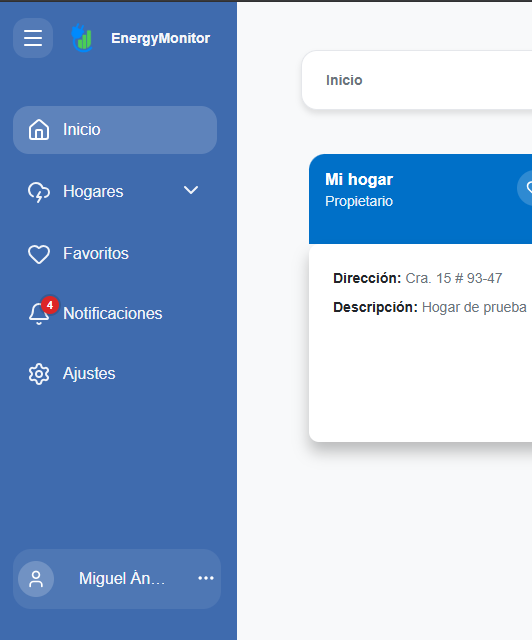

_Side menu (web)_

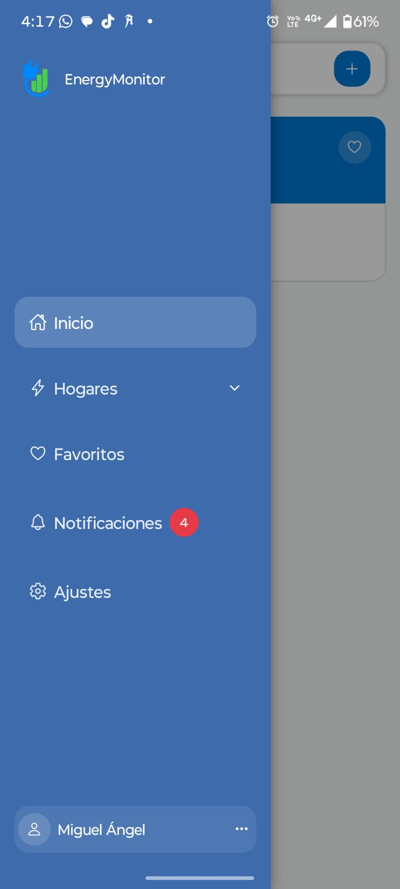

_Side menu (mobile)_

## **1. Landing page (web only)**

**[Web only]** The mobile app has no landing page: it opens directly on the sign-in screen.

**Description:** The entry door to the system: the public screen anyone can see without an account. It presents what EnergyMonitor is about and gives access to Sign in or Register.

| **Field**                | **Detail**                                                                                                                                                                                              |
| ------------------------ | ------------------------------------------------------------------------------------------------------------------------------------------------------------------------------------------------------- |
| **Role that can access** | Visitor (no account needed).                                                                                                                                                                            |
| **Access path**          | Main URL of the system (`/home`).                                                                                                                                                                       |
| **Screen components**    | Navigation bar with the Home, About us and Support links; language selector; button to switch to light or dark mode; Sign in and Register buttons; welcome, How it works and Benefits sections; footer. |

**Steps to use it:**

> 1\. Open the EnergyMonitor URL in the browser.
>
> 2\. Scroll the page to learn what the system does (How it works and Benefits sections).
>
> 3\. For more context about the project, open About us; for questions, Support.
>
> 4\. Click Register for the first time, or Sign in if you already have an account.

**Expected result:** The person understands what the platform is for and continues to registration or sign-in.

**Notes:** The language and theme chosen here are kept inside the application.

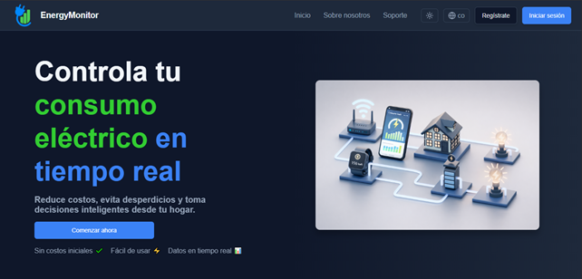

_Landing page (web)_

**How it works** presents the general flow, from registering to receiving smart alerts.

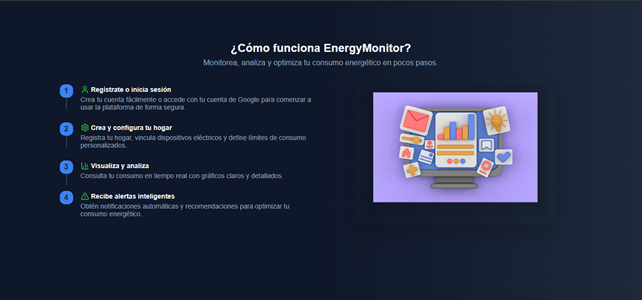

_How it works (web)_

**Benefits** summarizes why the system is worth using: saving on the bill by finding unnecessary consumption, alerts on peaks or unusual activity, a smaller environmental footprint and a simple setup.

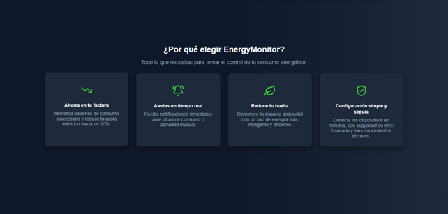

_Benefits (web)_

**About us** tells the problem EnergyMonitor seeks to solve, the mission of the project and the hardware that makes monitoring possible.

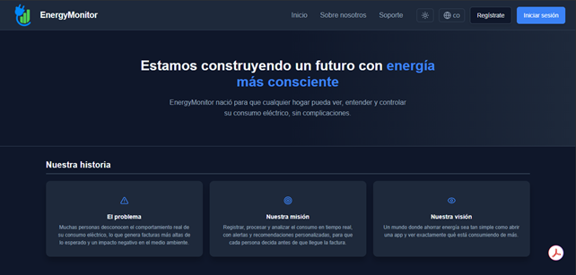

_About us (web)_

**Support** gathers the popular topics, a search box for frequently asked questions (for example "delete", "code" or "limit") and the contact with the team: the page shows the active administrators of the platform so you can write to them by email; when there are several, you choose one.

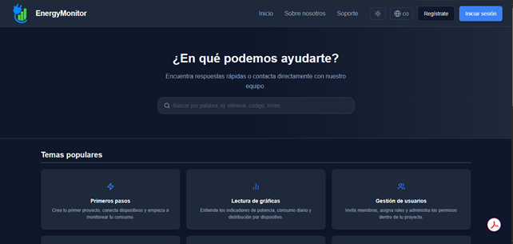

_Support (web)_

## **2. Registration**

**[Web and mobile]**

**Description:** Form where a new person creates their account with first name, last name, email and password, or with their Google account. The account is only created when the email is verified (section 3).

| **Field**                | **Detail**                                                                                                                                                                                                                                                                                                         |
| ------------------------ | ------------------------------------------------------------------------------------------------------------------------------------------------------------------------------------------------------------------------------------------------------------------------------------------------------------------ |
| **Role that can access** | Visitor.                                                                                                                                                                                                                                                                                                           |
| **Access path**          | **Web:** Landing page \> Register (`/register`). **Mobile:** sign-in screen \> Register.                                                                                                                                                                                                                           |
| **Screen components**    | First name, Last name (optional), Email, Password and Repeat password fields; persistent hint with the password rules; checkbox "I agree to the Terms of use and the Privacy policy", whose links open the texts in a window; Register button; Register with Google button; Already have an account? Sign in link. |

**Steps to use it:**

> 1\. Open the registration.
>
> 2\. Fill in first name, last name if you wish, email and the password twice. The password must have between 8 and 64 characters, with at least one upper-case letter, one digit and one special character; the rule is always shown under the field.
>
> 3\. To read the conditions, tap **Terms of use** or **Privacy policy**: a window opens with both tabs (the same texts on the web and in the app). Close it and tick the acceptance checkbox.
>
> 4\. Press **Register**. To use Google, press **Register with Google** with the checkbox ticked.

**Expected result:** The system sends a 6-digit code to the email and opens the verification screen. With Google, the account is created at once, already verified.

**Notes:**

- Without accepting the terms the account cannot be created, neither with email nor with Google. When a new Google account tries to enter without having accepted them, the application shows the terms and, once accepted, opens Google again (web) or repeats the sign-in (mobile).
- If the email already has an account, the system says so and suggests signing in.
- If the email domain looks mistyped (for example `gmial.con`), the system refuses it and suggests the right one; a domain that does not exist is also refused.
- Registering the same email again before verifying it replaces the previous request and its code stops working.

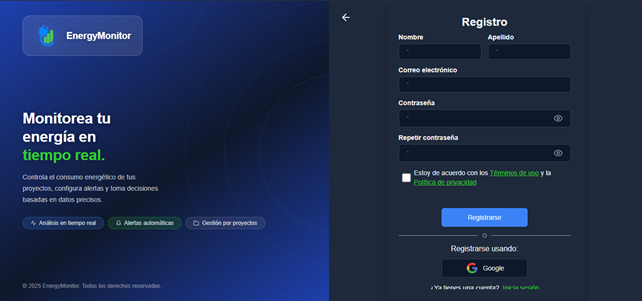

_Registration (web)_

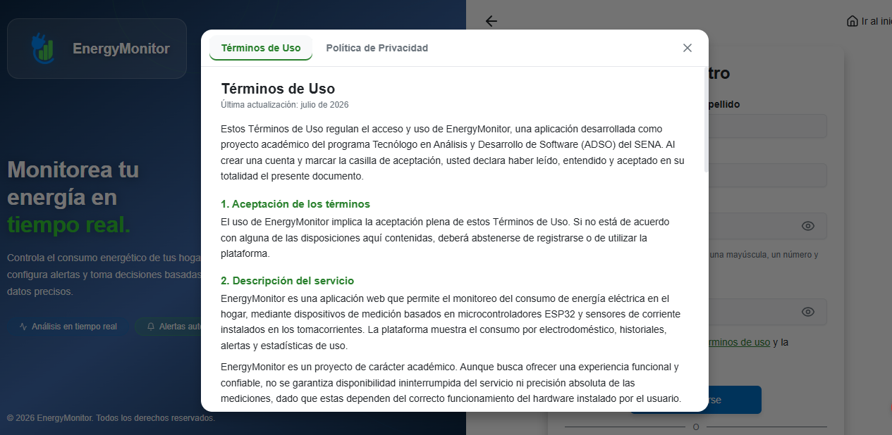

_Terms of use and Privacy policy window (web)_

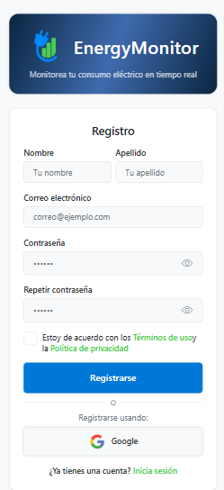

_Registration (mobile)_

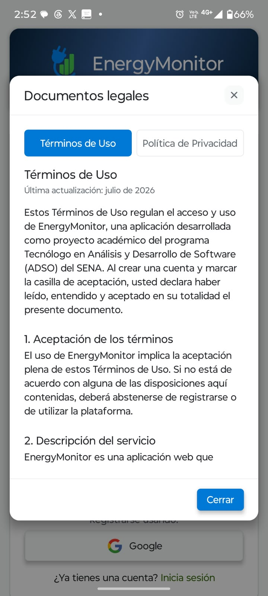

_Terms of use and Privacy policy window (mobile)_

## **3. Account verification**

**[Web and mobile]**

**Description:** Screen that confirms the email used at registration is real. Typing the 6-digit code creates the account.

| **Field**                | **Detail**                                                                                                       |
| ------------------------ | ---------------------------------------------------------------------------------------------------------------- |
| **Role that can access** | Person who has just registered (or who signed in without having verified their email).                           |
| **Access path**          | Opens automatically at the end of the registration.                                                              |
| **Screen components**    | Six boxes for the code; Didn't get the code? link to send it again (with a wait between sends); link to Sign in. |

**Steps to use it:**

> 1\. Check the inbox (and the spam folder) of the registered email.
>
> 2\. Type the 6-digit code. The whole code can also be pasted at once.
>
> 3\. Confirm.

**Expected result:** The account is created and verified; the system shows "Email verified. You can now sign in.".

**Notes:** The code is valid for 15 to 30 minutes and allows few failed attempts. When it expires, ask for a new one with Didn't get the code?. A registration request not verified within 24 hours is deleted and you must register again.

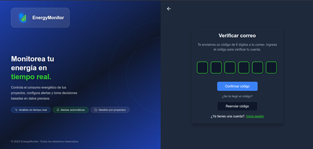

_Account verification (web)_

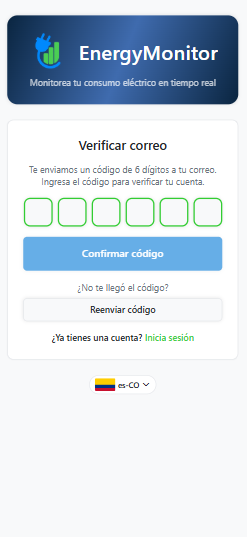

_Account verification (mobile)_

## **4. Sign in**

**[Web and mobile]**

**Description:** Form to enter with a verified account, with email and password or with Google.

| **Field**                | **Detail**                                                                                                                                                     |
| ------------------------ | -------------------------------------------------------------------------------------------------------------------------------------------------------------- |
| **Role that can access** | Visitor with an account.                                                                                                                                       |
| **Access path**          | **Web:** Landing page \> Sign in (`/login`). **Mobile:** first screen of the app.                                                                              |
| **Screen components**    | Email and Password fields (with a button to show or hide it); Forgot your password? link; Sign in button; Google button; Don't have an account? Register link. |

**Steps to use it:**

> 1\. Type the email and the password, or press the Google button.
>
> 2\. Press Sign in.

**Expected result:** The homes dashboard opens (or the administration, if the account is an administrator and the web is used).

**Notes:**

- If the email is not verified yet, the system says so, sends a new code and takes you to the verification.
- If the account has not accepted the terms and conditions yet, the system asks for them before entering.
- An account deactivated or blocked by an administrator cannot sign in.
- On the web, with a session open, opening the login or the registration goes straight to the dashboard.

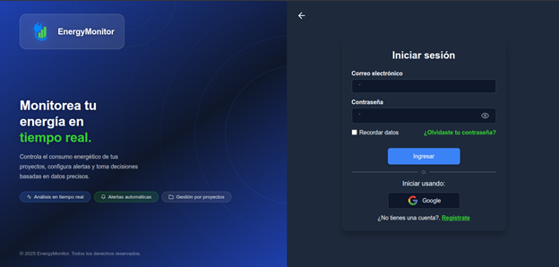

_Sign in (web)_

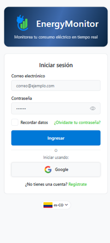

_Sign in (mobile)_

## **5. Password recovery**

**[Web and mobile]**

**Description:** Lets you set a new password when you forgot the current one, with a 6-digit code sent by email.

| **Field**                | **Detail**                                                                                                                                                                                      |
| ------------------------ | ----------------------------------------------------------------------------------------------------------------------------------------------------------------------------------------------- |
| **Role that can access** | Visitor with an account.                                                                                                                                                                        |
| **Access path**          | Sign in \> Forgot your password?                                                                                                                                                                |
| **Screen components**    | Step 1: Email field and button to send the code. Step 2: code boxes. Step 3: New password and Repeat password, with the rules hint. **Mobile:** step 3 is a screen of its own ("New password"). |

**Steps to use it:**

> 1\. Type the email of the account and send.
>
> 2\. Type the received code (valid for 15 minutes and usable once).
>
> 3\. Type the new password twice and confirm.

**Expected result:** The password is updated ("Password updated. Sign in with the new one.").

**Notes:** If the email has no account, the system says so. Asking for a new code invalidates the previous one. After several failed attempts you must wait a few minutes. Accounts created with Google can use this option to also have a password.

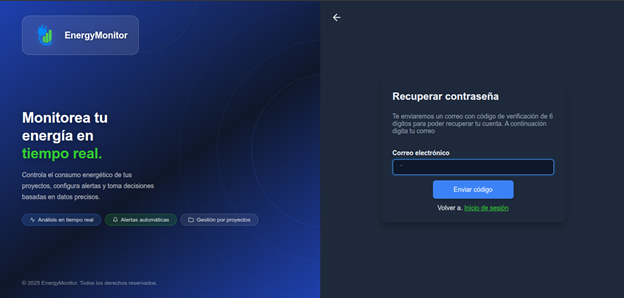

_Password recovery (web)_

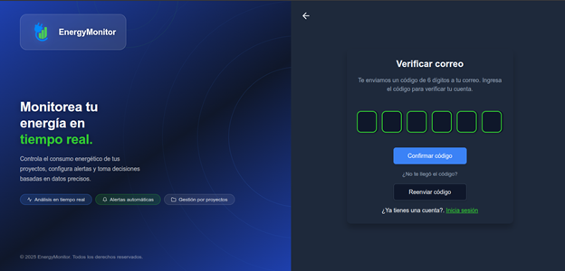

_Recovery verification (web)_

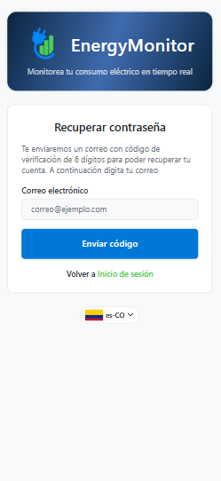

_Password recovery (mobile)_

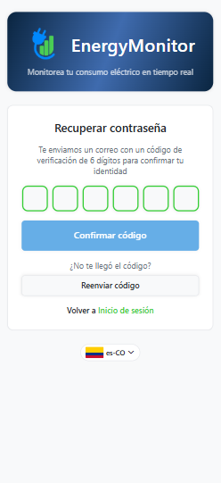

_Recovery verification (mobile)_

## **6. Homes dashboard**

**[Web and mobile]**

**Description:** The main screen after signing in. It shows the cards of the user's homes, or an invitation to create or join the first one.

| **Field**                | **Detail**                                                                                                                                                                                                              |
| ------------------------ | ----------------------------------------------------------------------------------------------------------------------------------------------------------------------------------------------------------------------- |
| **Role that can access** | User (not administrator).                                                                                                                                                                                               |
| **Access path**          | Opens after signing in; also from **Home** in the side menu.                                                                                                                                                            |
| **Screen components**    | Home cards with the name, the type, the user's role (Owner or Member) and the heart button to mark it as favorite; **+** button to Create home or Join home; empty state with the same buttons when there are no homes. |

**Steps to use it:**

> 1\. Sign in: the dashboard appears by itself.
>
> 2\. If there are no homes, choose Create home (section 7) or Join home (section 8).
>
> 3\. Tap a home card to open its detail (section 9).

**Expected result:** The user sees their homes at a glance and enters the one they need.

**Notes:** Changes made by other members (for example, a deleted home or a transferred ownership) show when you come back to the dashboard.

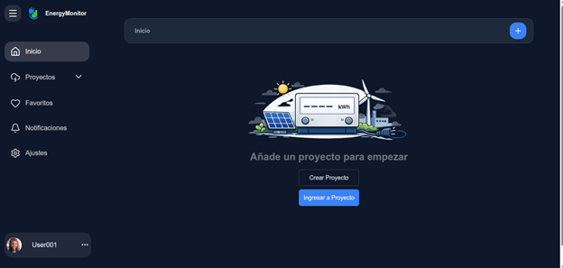

_Dashboard without homes (web)_

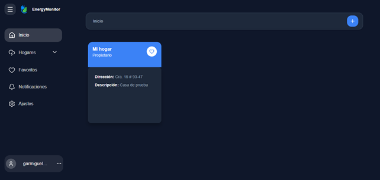

_Dashboard with homes (web)_

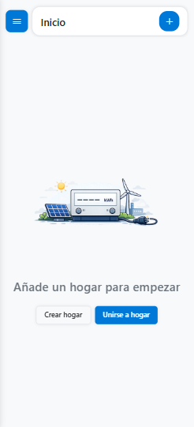

_Dashboard without homes (mobile)_

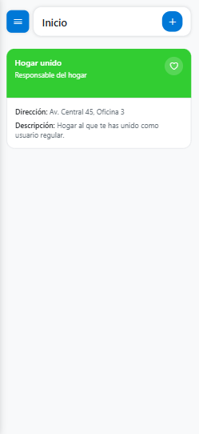

_Dashboard with homes (mobile)_

## **7. Create a home**

**[Web and mobile]**

**Description:** Form to register a new home. Whoever creates it becomes its owner.

| **Field**                | **Detail**                                                                                                                                                                                                                                                                        |
| ------------------------ | --------------------------------------------------------------------------------------------------------------------------------------------------------------------------------------------------------------------------------------------------------------------------------- |
| **Role that can access** | User.                                                                                                                                                                                                                                                                             |
| **Access path**          | Homes dashboard \> **+** button \> Create home, or the button of the empty state.                                                                                                                                                                                                 |
| **Screen components**    | Home name (up to 50 characters), Home type (House, Apartment, Studio apartment, Country house, Cabin or Other; with Other it asks "Which one?"), Address (up to 200 characters, for example "Cra. 15 # 93-47") and Description (optional) fields; Cancel and Create home buttons. |

**Steps to use it:**

> 1\. Open Create home.
>
> 2\. Fill in name, type and address; the description is optional.
>
> 3\. Press Create home.

**Expected result:** The card of the new home appears with the Owner role and the system gives it an 8-character access code.

**Notes:** The address does not accept the characters `< > { } [ ] | " ` '`. The home starts with the system's default thresholds (section 9.5).

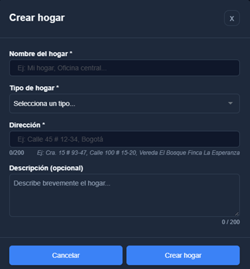

_Create home (web)_

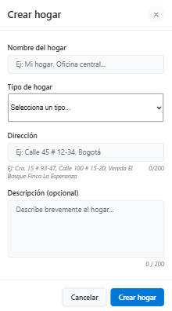

_Create home (mobile)_

## **8. Join a home**

**[Web and mobile]**

**Description:** Lets you enter an existing home as a member with the access code its owner shares. **It is the only way to add people to a home:** the system sends no email invitations.

| **Field**                | **Detail**                                                                                                          |
| ------------------------ | ------------------------------------------------------------------------------------------------------------------- |
| **Role that can access** | User.                                                                                                               |
| **Access path**          | Homes dashboard \> **+** button \> Join home, or the button of the empty state.                                     |
| **Screen components**    | Access code field (8 characters of upper-case letters and digits, for example `AB12CD34`); Cancel and Join buttons. |

**Steps to use it:**

> 1\. Ask the owner of the home for the access code (they see it in the Home tab, section 9.6).
>
> 2\. Open Join home, type the code and press Join.

**Expected result:** The home card appears with the Member role. The other members receive an activity notification.

**Notes:** A member only views the information of the home; the management actions belong to the owner.

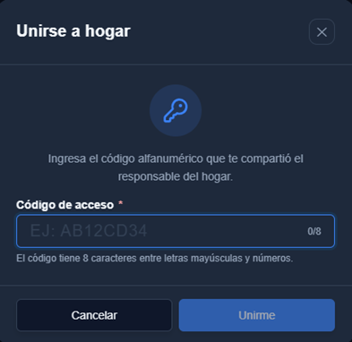

_Join a home (web)_

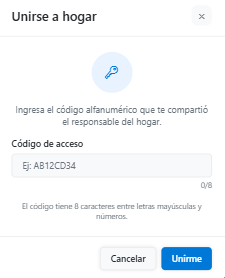

_Join a home (mobile)_

## **9. Home detail**

**[Web and mobile]** Tapping a home opens its detail with six tabs: **Consumption**, **History**, **Users**, **Devices**, **Thresholds** and **Home**. **Web:** the tabs are at the top and can be reached with the keyboard. **Mobile:** they are on the bottom bar.

### **9.1 Consumption**

**Description:** Tab opened by default. It shows consumption almost in real time.

| **Field**                | **Detail**                                                                                                                                                                                                                                                                   |
| ------------------------ | ---------------------------------------------------------------------------------------------------------------------------------------------------------------------------------------------------------------------------------------------------------------------------- |
| **Role that can access** | Owner and members of the home.                                                                                                                                                                                                                                               |
| **Access path**          | Dashboard \> home card \> Consumption.                                                                                                                                                                                                                                       |
| **Screen components**    | Indicators of current power, today's consumption, devices (all operational or how many disconnected) and consumption level (Low, Medium, High or Critical); current limit; chart of the last 24 hours (active power in kW); current distribution and consumption per device. |

**Steps to use it:**

> 1\. Open the home: the Consumption tab is shown.
>
> 2\. Check the indicators and scroll to see the charts.

**Expected result:** The user understands how the consumption of the home is going right now.

**Notes:** The data depends on the linked devices; a disconnected one adds no readings. If the home has no devices, the screen says so. **Mobile:** the indicators use icons.

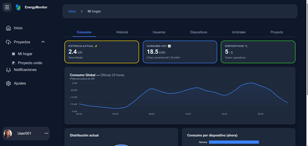

_Consumption (web)_

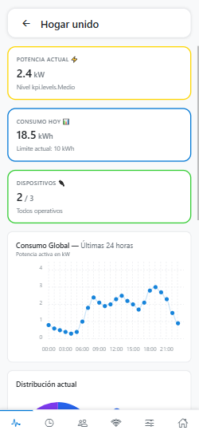

_Consumption (mobile)_

### **9.2 History**

**Description:** Shows the consumption of the home over time.

| **Field**                | **Detail**                                                                                                                                                                                                                                                                                                                 |
| ------------------------ | -------------------------------------------------------------------------------------------------------------------------------------------------------------------------------------------------------------------------------------------------------------------------------------------------------------------------- |
| **Role that can access** | Owner and members of the home.                                                                                                                                                                                                                                                                                             |
| **Access path**          | Home detail \> History.                                                                                                                                                                                                                                                                                                    |
| **Screen components**    | Period selector (Day, Week, Month, Year); interval inside the period (6-hour slots in Day, weeks in Month, quarters in Year, or All); chart of consumption per hour, day or month by device type; period summary (total consumption, top consumer and change against the previous period); consumption ranking per device. |

**Steps to use it:**

> 1\. Open the History tab.
>
> 2\. Choose the period and, if you wish, an interval.
>
> 3\. Check the chart, the summary and the ranking.

**Expected result:** The user compares periods and finds which appliance consumes the most.

**Notes:** The mobile app lays out the history the same way as the web. The trend arrow against the previous period is shown as an icon.

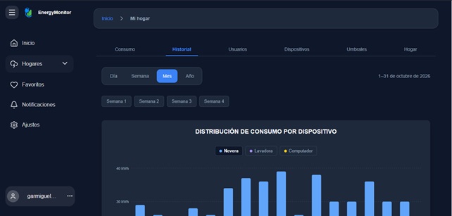

_History (web)_

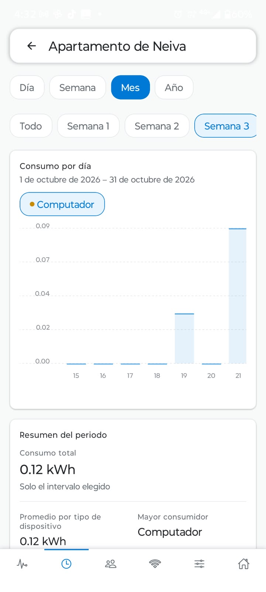

_History (mobile)_

### **9.3 Users**

**Description:** Lists who belongs to the home and their role.

| **Field**                | **Detail**                                                                                                                                                                  |
| ------------------------ | --------------------------------------------------------------------------------------------------------------------------------------------------------------------------- |
| **Role that can access** | Owner and members (actions only for the owner).                                                                                                                             |
| **Access path**          | Home detail \> Users.                                                                                                                                                       |
| **Screen components**    | Number of members; list with name, email and role (Owner or Member), with the "You" mark on your own account. **Owner:** buttons to remove a member and to make them owner. |

**Steps to use it (owner):**

> 1\. Open the Users tab.
>
> 2\. **Remove a member:** press the delete button on their row and confirm. They lose access and must join again with the code.
>
> 3\. **Transfer ownership:** press "Make owner" on the member's row, tick "I understand I will stop being the owner" and press Transfer.

**Steps to use it (member):** open the tab and view the list.

**Expected result:** The owner keeps the list of members up to date; after a transfer, the new owner manages the home and whoever transferred it stays as a member.

**Notes:** If the home only has its owner, the screen invites you to share the access code. Devices, thresholds and history do not change with the transfer. Whoever is removed and the other members receive an activity notification. **Web:** each member is shown with their profile photo (if they have one) and clicking it opens it in a viewer inside the page, with initials as fallback. **Mobile:** only initials are shown for now.

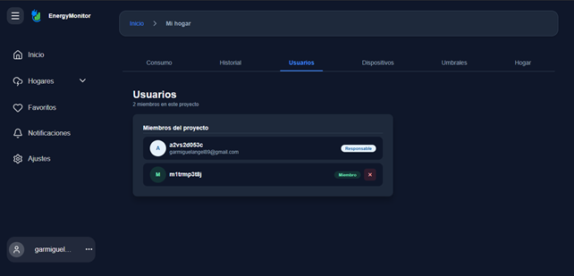

_Users, owner view (web)_

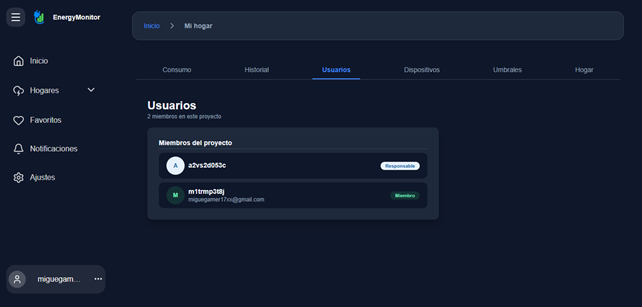

_Users, member view (web)_

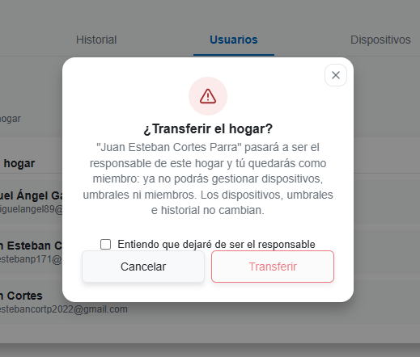

_Ownership transfer confirmation (web)_

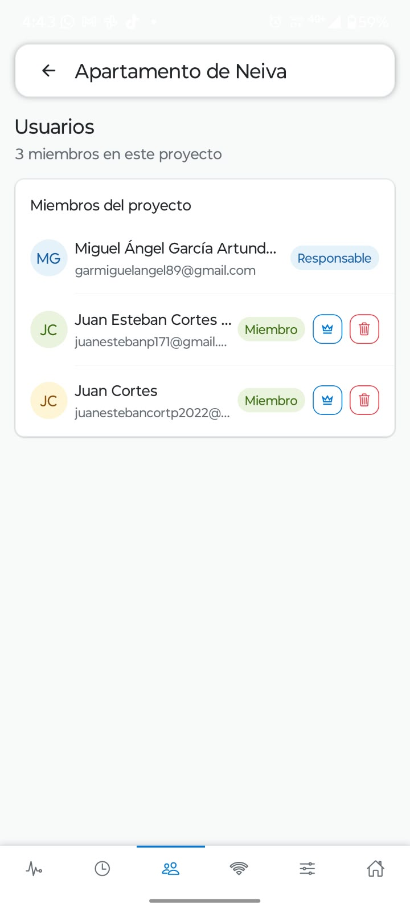

_Users, owner view (mobile)_

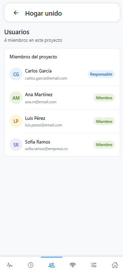

_Users, member view (mobile)_

### **9.4 Devices**

**Description:** Lists the measuring modules linked to the home with their status, and lets the owner link, edit, change the Wi-Fi network of or delete a module.

| **Field**                | **Detail**                                                                                                                                                                                                                       |
| ------------------------ | -------------------------------------------------------------------------------------------------------------------------------------------------------------------------------------------------------------------------------- |
| **Role that can access** | Owner and members (actions only for the owner).                                                                                                                                                                                  |
| **Access path**          | Home detail \> Devices.                                                                                                                                                                                                          |
| **Screen components**    | Header "X of Y devices online"; cards with the name, the appliance, the location and the status (Online, Disconnected or Checking…). **Owner:** Link device button and, on each card, Edit, Change the Wi-Fi network and Delete. |

**Link a device (owner):**

> 1\. Plug in the module and hold its **BOOT** button for 3 seconds, until the light blinks (a new module is already ready).
>
> 2\. Press **Link device** and then **Search module**. **Web:** the browser opens its Bluetooth window; choose `EnergyMonitor-<code>`. **Mobile:** the app asks for the Bluetooth permission the first time, looks for the nearby modules and shows them in a list; choose the module.
>
> 3\. Choose which appliance it will measure (Fridge, Washer, TV, Microwave, Air conditioner, Computer, Water heater, Lighting or Other).
>
> 4\. Choose the home's Wi-Fi network among those the module sees (or type its name by hand) and its password; press Connect.
>
> 5\. Wait for the steps "Registering the device in your home", "Connecting the module to the network", "Checking the password" and "Connecting to the server".
>
> 6\. On "Device linked!", type its name and location (Living room, Kitchen, Bedroom, Garage, Laundry room or Other) and press Finish.

**Other actions (owner):** **Edit** changes the appliance, the name or the location without disconnecting the module. **Change the Wi-Fi network** is used after moving or changing the Wi-Fi password: it repeats the Bluetooth search with the same module (if the module cannot find its network, it offers Bluetooth by itself after 5 minutes). **Delete** unlinks the module, after confirmation; it stops sending data and must be linked again to be used.

**Expected result:** The module appears Online and its first reading arrives in about a minute.

**Notes:**

- **Web:** Bluetooth linking works in Chrome or Edge on a computer and in Chrome on Android, with the web over HTTPS; Chrome on Linux needs "Experimental Web Platform features" turned on. Other browsers use the portal alternative: join the "EnergyMonitor-Setup" Wi-Fi network, open `http://192.168.4.1` and set the network there.
- **Mobile:** if Bluetooth is off or the permission is missing, the app says so; it is granted in the system settings.
- A module becomes Disconnected when it stops reporting for about 2.5 minutes; all members receive an alert.
- **Member:** sees the list without actions; if there are no modules, the screen says the owner has not linked devices yet.

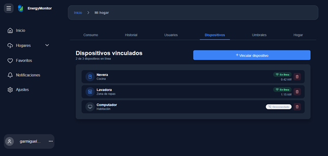

_Devices, owner view (web)_

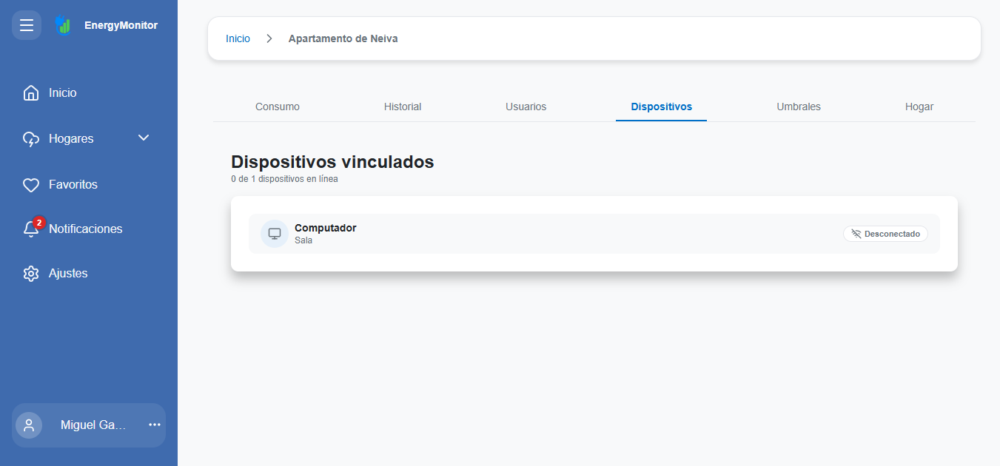

_Devices, member view (web)_

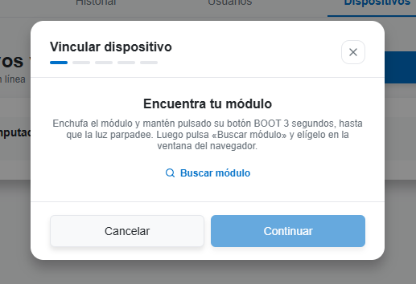

_"Link device" wizard, Find your module step (web)_

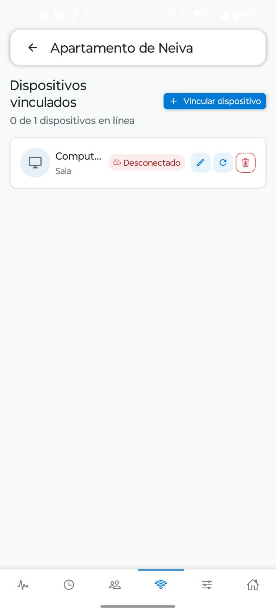

_Devices, owner view (mobile)_

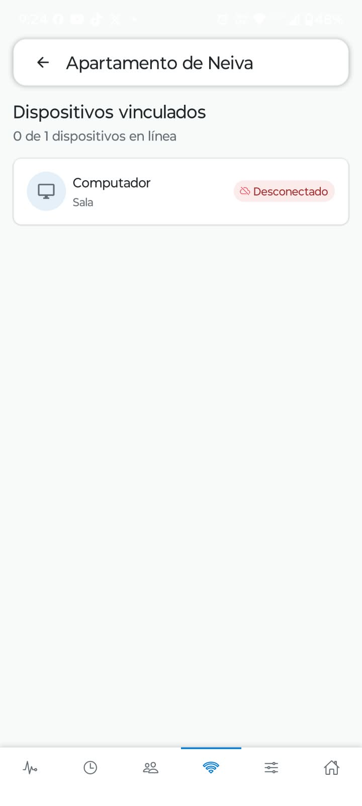

_Devices, member view (mobile)_

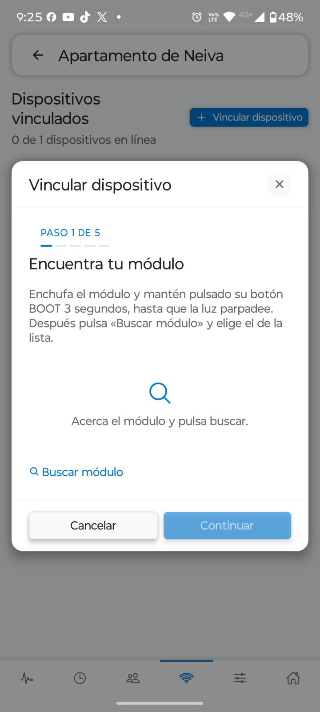

_Bluetooth search and list of found modules (mobile)_

### **9.5 Thresholds**

**Description:** Sets the consumption limit of the home used for the limit alerts and some recommendations.

| **Field**                | **Detail**                                                                                                                                                                                                                            |
| ------------------------ | ------------------------------------------------------------------------------------------------------------------------------------------------------------------------------------------------------------------------------------- |
| **Role that can access** | Owner (edits) and members (view only).                                                                                                                                                                                                |
| **Access path**          | Home detail \> Thresholds.                                                                                                                                                                                                            |
| **Screen components**    | "Use the system default thresholds" switch (6 kWh per day and 180 kWh per month); "Configure by" Daily or Monthly selector; Daily limit and Monthly limit fields (the one not configured shows as "Calculated"); Save changes button. |

**Steps to use it (owner):**

> 1\. Open the Thresholds tab.
>
> 2\. Turn off the switch to set your own limit.
>
> 3\. Choose whether to configure it per day or per month and type the value in kWh (greater than 0). The other one is calculated, with 30 days per month.
>
> 4\. Press Save changes. To go back to the system values, turn the switch on again.

**Expected result:** The new limit is saved and used for the "Daily/monthly limit exceeded" alerts. The other members receive an activity notification.

**Notes:** Each home has its own thresholds. The daily limit cannot exceed the monthly one. **Member:** sees the values and the notice "Only the owner of the home can change these thresholds".

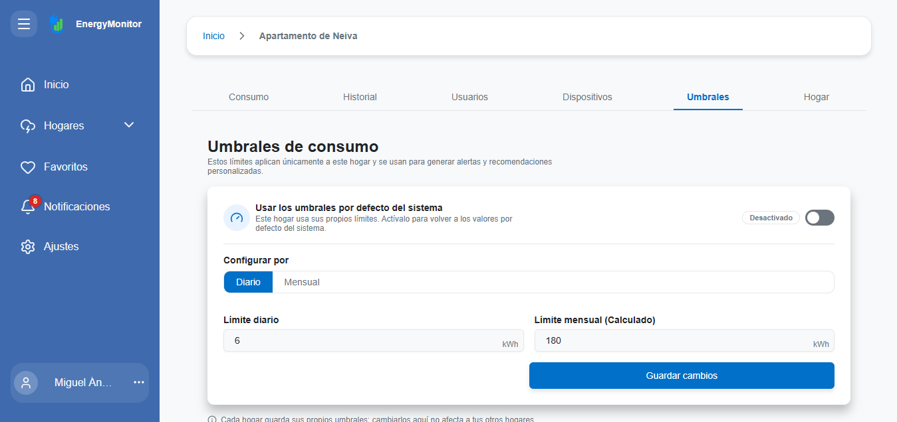

_Thresholds, owner view (web)_

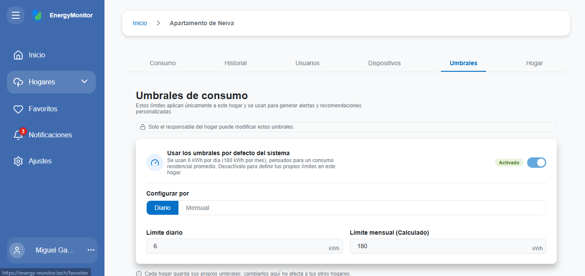

_Thresholds, member view (web)_

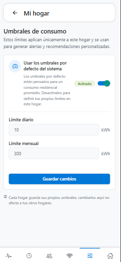

_Thresholds, owner view (mobile)_

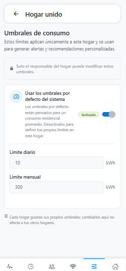

_Thresholds, member view (mobile)_

### **9.6 Home**

**Description:** Gathers the information of the home, its owner and, for the owner, the access code.

| **Field**                | **Detail**                                                                                                                                                                                            |
| ------------------------ | ----------------------------------------------------------------------------------------------------------------------------------------------------------------------------------------------------- |
| **Role that can access** | Owner and members.                                                                                                                                                                                    |
| **Access path**          | Home detail \> Home.                                                                                                                                                                                  |
| **Screen components**    | Home information (name, type, address, description and creation date); owner with their email. **Owner:** access code with the Copy button and the Delete home button. **Member:** Leave home button. |

**Steps to use it:**

> 1\. Open the Home tab and check the data.
>
> 2\. **Owner – share:** press Copy access code and send it to whoever should join (section 8).
>
> 3\. **Owner – delete:** press Delete home, type the name of the home to confirm and accept.
>
> 4\. **Member – leave:** press Leave home and confirm.

**Expected result:** The owner shares access or deletes the home; the member stops seeing the home after leaving.

**Notes:** Deleting a home is permanent: it disappears for all its members and its modules are unlinked, ready for another home. The owner cannot leave while being the only owner: first transfer the ownership (section 9.3). Whoever leaves can only come back with the access code.

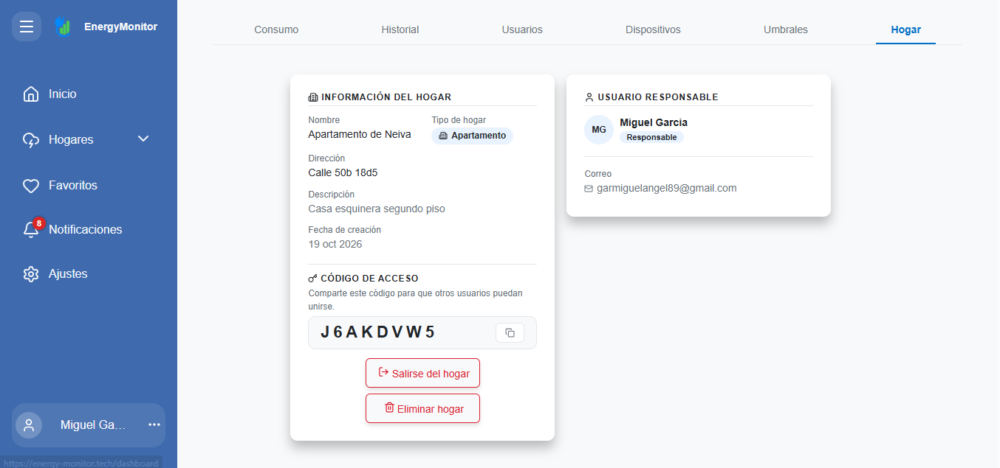

_Home, owner view (web)_

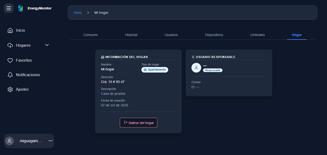

_Home, member view (web)_

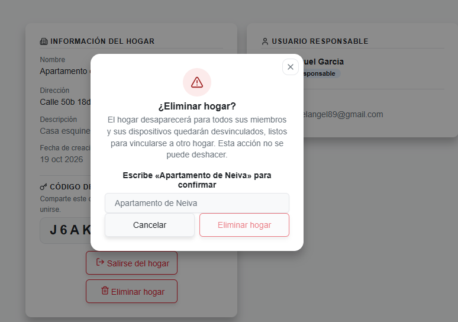

_"Delete home" confirmation with the typed name (web)_

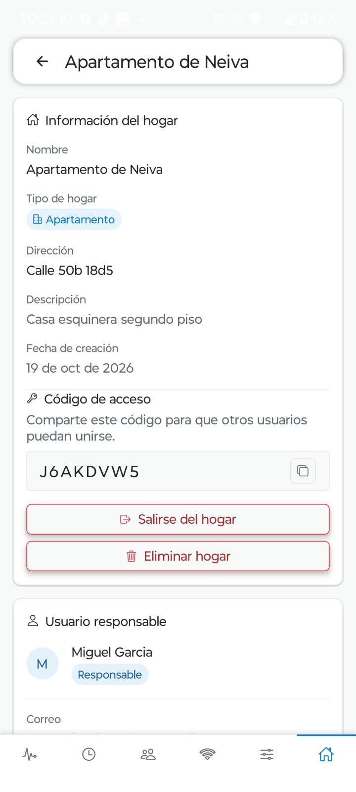

_Home, owner view (mobile)_

_Home, member view (mobile)_

## **10. Favorites**

**[Web and mobile]**

**Description:** Quick access to the homes you check most often.

| **Field**                | **Detail**                                                                                                                                |
| ------------------------ | ----------------------------------------------------------------------------------------------------------------------------------------- |
| **Role that can access** | User (not administrator).                                                                                                                 |
| **Access path**          | Side menu \> Favorites.                                                                                                                   |
| **Screen components**    | Cards of the homes marked with the heart, or an empty state when there are none; loading indicator and error message with a retry option. |

**Steps to use it:**

> 1\. On the dashboard, press the heart of a home card.
>
> 2\. Open Favorites from the side menu.

**Expected result:** The user quickly finds their favorite homes.

_Favorites (web)_

_Favorites (mobile)_

## **11. Notifications**

**[Web and mobile]**

**Description:** Gathers the alerts, the saving recommendations and the activity of the account and of its homes.

| **Field**                | **Detail**                                                                                                                                                                                                                                                                                                  |
| ------------------------ | ----------------------------------------------------------------------------------------------------------------------------------------------------------------------------------------------------------------------------------------------------------------------------------------------------------- |
| **Role that can access** | User. (On the web, for the administrator this option shows the administration notices: section 15.5; the mobile app has no administration notices: an administrator sees notifications like any other user.)                                                                                                                                                                                                                  |
| **Access path**          | Side menu \> Notifications (shows the number pending).                                                                                                                                                                                                                                                      |
| **Screen components**    | **All**, **Alerts**, **Recommendations** and **Activity** tabs, each with its counter; filter by home (All, My account or one home); Mark all as read; button to delete the resolved or read ones; cards with icon, title, message, home, device, date, status (New, Active, Resolved or Read) and actions. |

**What each tab receives:**

| **Tab**         | **Content**                                                                                                                                                                                                                                                                                                 |
| --------------- | ----------------------------------------------------------------------------------------------------------------------------------------------------------------------------------------------------------------------------------------------------------------------------------------------------------- |
| Alerts          | High or critical consumption of a device; daily or monthly limit reached; device disconnected; new device linked and sending measurements. Consumption and connection alerts resolve themselves when the situation returns to normal.                                                                       |
| Recommendations | Advice generated every hour: shift consumption away from the peak hour (18:00–22:00), turn off a device that draws power at night, a week well above the previous one, a pace that will exceed the home's limit and a device that consumes more than before. The same advice is not repeated within 7 days. |
| Activity        | Welcome to the account; home created; someone joined, left or was removed; thresholds changed; ownership transferred; home deleted; device linked or unlinked. They are read in the chosen language, even if the home no longer exists.                                                                     |

**Steps to use it:**

> 1\. Open Notifications.
>
> 2\. Choose a tab and, if you wish, filter by home.
>
> 3\. Mark one or all as read; delete the ones no longer needed (alerts once resolved; recommendations once read).

**Expected result:** The user learns in time what happens in their homes and acts on it.

**Notes:** Alerts and recommendations can also arrive by email and as push notifications, according to the settings (section 12). Activity always appears in the inbox. **Unusual consumption:** if an appliance consumes far more than usual (at least 200 W and 2.5 times its hourly average of the last 7 days, with at least 24 hours of history), the home receives a threshold alert that resolves by itself when consumption returns to normal. **Mobile:** the alert arrives, but with the generic threshold text; the specific text is pending.

_Activity tab with home filter (web)_

_Notifications (mobile)_

_Activity tab with home filter (mobile)_

## **12. Settings**

**[Web and mobile]**

**Description:** Language, theme and notification preferences, and help center.

| **Field**                | **Detail**                                                                                                                                                                                                                                                                                                                    |
| ------------------------ | ----------------------------------------------------------------------------------------------------------------------------------------------------------------------------------------------------------------------------------------------------------------------------------------------------------------------------- |
| **Role that can access** | User and administrator (on the web the administrator does not see the notifications section; in the mobile app the setting is shown as for a regular user, because the app does not distinguish the role).                                                                                                                                                                                                                                            |
| **Access path**          | Side menu \> Settings. **Mobile:** the screen has the title "Settings".                                                                                                                                                                                                                                                       |
| **Screen components**    | **System language:** Español, English, Português or Français. **System themes:** Light · Default, Light · Theme 2, Dark · Theme 1 and Dark · Theme 2. **Notifications:** Email, Push notifications and Combined mode (both at once). **Help center:** Documentation, Technical support and What's new (marked "Coming soon"). |

**Steps to use it:**

> 1\. Open Settings.
>
> 2\. Choose language and theme: the change applies at once.
>
> 3\. Turn email and push on or off.

**Expected result:** The preferences are reflected across the whole application.

**Notes:**

- **Web:** the theme is stored in that browser; push reaches that browser even with the tab closed. If the browser blocked notifications, turn them on from the padlock of the address bar. On iPhone, install the web on the home screen.
- **Mobile:** push reaches the phone and the subscribed browsers of the same account; if Android lacks the permission, the app says so.
- If the server does not have push configured, the option appears as unavailable.
- **Brave (web):** this browser ships with the Google service that delivers push turned off. If turning it on does not work, the screen says to go to brave://settings/privacy, turn on «Use Google services for push messaging», restart Brave and turn push on again.

_Settings (web)_

_Settings (mobile)_

### **12.1 Help center**

**[Web only]** On mobile the cards are shown but they do not open any window yet.

Below the preferences, Settings has three cards. Each opens a window that is closed with **Close**:

| **Card**              | **What it shows**                                                                                                                                            | **Who sees it**                                                            |
| --------------------- | ------------------------------------------------------------------------------------------------------------------------------------------------------------ | -------------------------------------------------------------------------- |
| **Documentation**     | Usage guides and feature reference according to the role of the account: user or administrator.                                                              | User and administrator                                                     |
| **Technical support** | The available administrators. You choose whom to write to and **Create ticket** opens the email with the subject already written; the team answers by email. | Only the user: the administrator handles support and does not see the card |
| **News**              | Improvements, new features and fixes grouped by date, with the version and the commit that is online. They are generated automatically on every deployment.  | User and administrator                                                     |

**Note:** the news titles come in the language of the commits (English) even if the interface is in another language.

## **13. My account**

**[Web and mobile]**

**Description:** Personal data of the account, photo, password and account deletion.

| **Field**                | **Detail**                                                                                                                                                                                                            |
| ------------------------ | --------------------------------------------------------------------------------------------------------------------------------------------------------------------------------------------------------------------- |
| **Role that can access** | User and administrator.                                                                                                                                                                                               |
| **Access path**          | **Web:** profile (bottom of the side menu) \> My account (`/account`). **Mobile:** side menu \> My account; the screen has the title "My account".                                                                    |
| **Screen components**    | Profile photo with the Add, View and Delete photo options; First name, Last name and Email fields, each with its Edit button; Password with Change password; Do you want to delete your account? with Delete account. |

**Steps to use it:**

> 1\. Open My account.
>
> 2\. Press Edit on the data to change, type the new value and Save. The last name is optional.
>
> 3\. **Change password:** type the current one, the new one and its confirmation.
>
> 4\. **Delete account:** press Delete account and confirm with the password. On a Google account, press **Send me the code**, type the 6-digit code received (it expires in 15 minutes) and confirm.

**Expected result:** The data is updated ("Profile updated."), or the account is deleted and the session closes ("Your account was deleted.").

**Notes:**

- Google accounts have no password of their own: the screen shows "You sign in with Google: your password is managed by Google" and does not offer the password change.
- If the email changes, the new address must be verified with the code it receives before signing in again.
- The account cannot be deleted while it is the only owner of a home with other members: first transfer the ownership or remove the members. Homes without other members are deleted with the account.
- **Mobile:** to choose a photo, the app asks for access to the gallery.
- With **View photo** the image opens in a viewer inside the application (on the web, inside the page without leaving it).

_My account (web)_

_Deleting a Google account with a code (web)_

_My account (mobile)_

## **14. Sign out**

**[Web and mobile]**

**Description:** Leaves the system safely.

| **Field**                | **Detail**                                                                                      |
| ------------------------ | ----------------------------------------------------------------------------------------------- |
| **Role that can access** | User and administrator.                                                                         |
| **Access path**          | **Web:** profile at the bottom of the side menu \> Sign out. **Mobile:** side menu \> Sign out. |
| **Screen components**    | Sign out option.                                                                                |

**Steps to use it:**

> 1\. Open the profile menu (web) or the side menu (mobile).
>
> 2\. Press Sign out.

**Expected result:** The session closes and the application returns to the sign-in screen (or to the landing page on the web).

_Sign out (web)_

_Sign out (mobile)_

## **15. Administration (web only, administrator role)**

**[Web only]** The mobile app has no administration screens: an administrator manages the platform from the web. The technical team grants the role the first time (administrator manual) and afterwards other administrators do it from this screen.

### **15.1 Access and administrator menu**

An account with the administrator role that signs in on the web goes straight to **Administration**. Its side menu shows only **Administration**, **Notifications** and **Settings**, plus My account and Sign out. The home screens (dashboard, home detail and favorites) are not available to this account: if it tries to open them, the application sends it back to the administration. An account without permission that tries to open the administration goes back to its homes dashboard.

_Side menu of an administrator account (web)_

### **15.2 Platform users**

**Description:** Directory of the platform accounts.

| **Field**                | **Detail**                                                                                                                                                                                                                                                             |
| ------------------------ | ---------------------------------------------------------------------------------------------------------------------------------------------------------------------------------------------------------------------------------------------------------------------- |
| **Role that can access** | Administrator.                                                                                                                                                                                                                                                         |
| **Access path**          | Side menu \> Administration (`/admin/users`).                                                                                                                                                                                                                          |
| **Screen components**    | "Platform users" title; search by name or email with the Search button; table with the columns User (name, email and the "You" mark), Status, Global roles (or "No roles") with the shield button, Registered and Last access (or "Never"); pagination of 20 per page. |

**Steps to use it:**

> 1\. Open Administration.
>
> 2\. To search, type part of the name or the email and press Search; clearing the search box brings the full list back.
>
> 3\. With more than 20 results, use Previous page and Next page.

**Expected result:** The administrator finds any account and sees its status and roles.

_Platform users (web)_

### **15.3 Change the status of an account**

**Description:** Activates, deactivates or blocks an account.

| **Field**                | **Detail**                                                       |
| ------------------------ | ---------------------------------------------------------------- |
| **Role that can access** | Administrator with the account management permission.            |
| **Access path**          | Platform users \> Status column of the account.                  |
| **Screen components**    | Selector with Active, Inactive and Blocked; confirmation window. |

**Steps to use it:**

> 1\. On the account's row, choose the new status.
>
> 2\. If the new status is Inactive or Blocked, the application warns: "The account will become … It will not be able to sign in and its open sessions will be closed.". Press Confirm.

**Expected result:** The status changes. An inactive or blocked account cannot sign in; going back to Active asks for no confirmation.

**Notes:** The session the account already had open may last up to 15 minutes, but it is not renewed.

_"Change the account status" confirmation (web)_

### **15.4 Grant or revoke the administrator role**

**Description:** Makes an account an administrator or removes the role.

| **Field**                | **Detail**                                                                                    |
| ------------------------ | --------------------------------------------------------------------------------------------- |
| **Role that can access** | Administrator with the role management permission.                                            |
| **Access path**          | Platform users \> shield button in the Global roles column.                                   |
| **Screen components**    | "Make … administrator" or "Remove the administrator role from …" button; confirmation window. |

**Steps to use it:**

> 1\. Press the shield on the account's row.
>
> 2\. Read the confirmation ("Grant the administrator role": they will be able to change the status of accounts and the roles of other users; or "Remove the administrator role") and press Confirm.

**Expected result:** The role appears or disappears in the Global roles column. The account must sign out and in again to see the change in its menu.

_"Grant the administrator role" confirmation (web)_

### **15.5 Administration notifications**

**Description:** Notices about the platform for the administrators.

| **Field**                | **Detail**                                                                                                                                       |
| ------------------------ | ------------------------------------------------------------------------------------------------------------------------------------------------ |
| **Role that can access** | Administrator.                                                                                                                                   |
| **Access path**          | Side menu \> Notifications.                                                                                                                      |
| **Screen components**    | "Administration notifications" title; Mark all as read; cards with title, message, status (New or Read) and the Mark as read and Delete buttons. |

| **Notice**                                | **When it arrives**                                                         |
| ----------------------------------------- | --------------------------------------------------------------------------- |
| New account registered                    | Someone creates an account (with email or with their first Google sign-in). |
| Account activated / deactivated / blocked | Another administrator changes the status of an account.                     |
| New administrator / Administrator removed | Another administrator grants or revokes the administrator role.             |

**Steps to use it:** open Notifications, read the notices, mark them as read or delete them.

**Expected result:** The administrator keeps up with new accounts and with the changes made by the other administrators.

**Notes:** The 50 most recent notices are shown. Whoever makes a change gets no notice of their own change. These notices are only seen on the web; they do not arrive by email or push.

_Administration notifications (web)_

### **15.6 Administrator settings and restrictions**

In **Settings**, the administrator sees the language, the theme and the help center, but not the notification preferences of the homes. Also:

- An administrator cannot change their own status or roles: their row shows no actions; another administrator must do it.
- An action without the matching permission is not shown.
- The administrator role gives no access to the homes.

_Settings of an administrator account, without the notifications section (web)_

# **System messages**

| **System message**                                                        | **Meaning**                                                      | **User action**                                                         |
| ------------------------------------------------------------------------- | ---------------------------------------------------------------- | ----------------------------------------------------------------------- |
| Required field / invalid format                                           | A piece of data is missing or does not have the expected format. | Fix the marked field.                                                   |
| Invalid user or password                                                  | The credentials do not match.                                    | Check the data or recover the password.                                 |
| Email already registered                                                  | The email already has an account.                                | Sign in or recover the password.                                        |
| The email domain looks mistyped / does not exist                          | The email has a typo or a domain without email.                  | Fix the email (the system suggests the likely provider).                |
| You must accept the terms                                                 | The acceptance of the terms and privacy policy was not ticked.   | Read them and tick the checkbox.                                        |
| Verify your email to sign in                                              | The account exists but the email has not been verified.          | Type the code that arrives at the email.                                |
| Invalid or expired verification code                                      | The code does not match or has expired.                          | Ask for a new code.                                                     |
| Too many attempts                                                         | The allowed number of attempts was exceeded.                     | Wait a few minutes and try again.                                       |
| Email verified. You can now sign in.                                      | The account was created.                                         | Sign in.                                                                |
| Password updated                                                          | The new password was saved.                                      | Sign in with the new password.                                          |
| The code must have 8 characters (letters and digits)                      | The home access code is incomplete.                              | Type the full code the owner shared.                                    |
| The network password is not correct / The module cannot find that network | The module's Wi-Fi connection failed while linking.              | Check the password or move the module closer to the router.             |
| The Bluetooth connection with the module was lost                         | The module moved away or turned off during linking.              | Move closer and retry.                                                  |
| This browser cannot connect over Bluetooth                                | The browser does not support Web Bluetooth.                      | Use Chrome or Edge, the mobile app or the "EnergyMonitor-Setup" portal. |
| Only the owner of the home can change these thresholds                    | A member tries to edit the thresholds.                           | Ask the owner for the change.                                           |
| The daily limit cannot exceed the monthly one                             | Inconsistent threshold values.                                   | Fix the values.                                                         |
| The action could not be completed. Try again.                             | An action failed because of a temporary problem.                 | Retry; if it persists, contact support.                                 |

# **Frequently asked questions**

**Can I use the same account on the web and on the phone?**

Yes. The account, homes, devices and notifications are the same in both applications.

**How do I invite someone to my home?**

By sharing the 8-character access code shown in the Home tab (only the owner sees it). The other person creates their account and uses Join home. There are no email invitations.

**What do I do if I forgot my password?**

On Sign in, press Forgot your password?; a code arrives at the email to set a new one.

**What if the verification code does not arrive?**

Check the spam folder. If it does not show up, ask for it again from the same screen.

**I registered with Google, how do I delete my account?**

In My account \> Delete account, press Send me the code and type the code that arrives at the Google email.

**Can I stop being the owner of a home?**

Yes: in the Users tab, "Make owner" another member. Afterwards you can leave the home if you wish.

**Why can't I link a device from my browser?**

Browser Bluetooth linking only works in Chrome or Edge on a computer and in Chrome on Android. Use the mobile app or the "EnergyMonitor-Setup" portal.

**When does a recommendation appear?**

The system reviews the consumption of each home every hour; recommendations appear when a pattern is detected (for example, consumption at night) and need at least a few days of readings.

**Can I change the language or the theme whenever I want?**

Yes, from Settings, as many times as you want.

**Is there an iPhone app?**

No. On iPhone, use the web application.

**Does EnergyMonitor work without internet?**

No. The applications and the modules need a connection to send and show the data.

# **Glossary**

| **Term**            | **Description**                                                                                          |
| ------------------- | -------------------------------------------------------------------------------------------------------- |
| ESP32               | Microcontroller of the measuring module; sends the readings over Wi-Fi and is configured over Bluetooth. |
| PZEM-004T V3 sensor | Sensor that measures voltage, current, power and energy of the appliance.                                |
| kWh                 | Kilowatt-hour, unit of electrical energy consumption.                                                    |
| Home                | House, apartment or other place monitored in EnergyMonitor.                                              |
| Owner               | Responsible for a home; manages members, devices and thresholds.                                         |
| Member              | Person who joined a home with the access code; views its information.                                    |
| Access code         | 8-character code other people use to join a home.                                                        |
| Verification code   | 6-digit code sent by email to verify the account, recover the password or delete a Google account.       |
| Threshold           | Daily or monthly consumption limit of a home that triggers alerts.                                       |
| Alert               | Notice about something that needs attention (high consumption, limit reached, device disconnected).      |
| Recommendation      | Saving suggestion generated from consumption.                                                            |
| Activity            | Notice of what happened in the account, its homes or its devices.                                        |
| Push notification   | Notice that reaches the browser or the phone even when the application is closed.                        |
| Administrator       | Account that manages the platform accounts from the web.                                                 |
| Session             | Period in which the account stays authenticated, from signing in until signing out.                      |

# **Annexes**

**Annex A. Images of the manual.** The screenshots are stored in `12-manual-usuario/assets/Web` (web application) and `12-manual-usuario/assets/Mobile` (mobile application). The `image*.png` screenshots come from the 2.0 manuals and some no longer show the current version (for example, the registration without the terms window or the notifications without the Activity tab). The images with a descriptive name (`admin-usuarios.png`, `registro-terminos-modal.png`, `notificaciones-actividad.png`, etc.) are referenced but **still to be captured**; the full list is in the documentation update report.

**Annex B. Sources.** This manual was written from the code of the web application (Energy-Monitor-application) and of the mobile application (Energy-Monitor-Mobile) as of October 27, 2026, from their interface texts and from the requirements specification, following the guide for writing software manuals of the ADSO program. It replaces the separate "EnergyMonitor Web user manual" and "EnergyMonitor Mobile user manual" (version 2.0).
