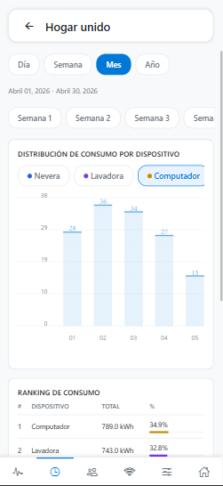
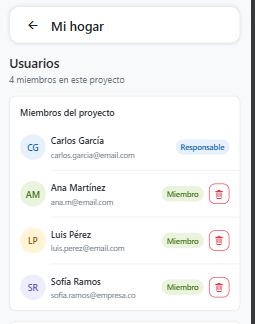
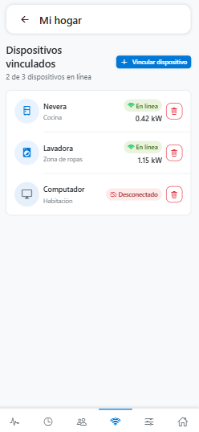
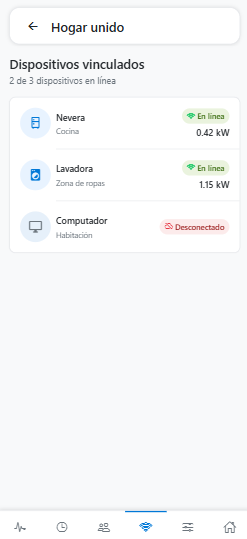
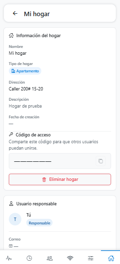
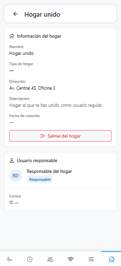
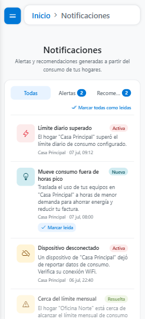
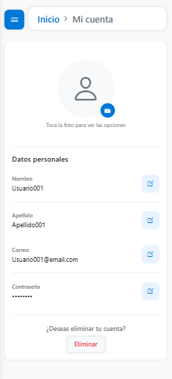
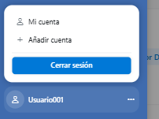

**MANUAL DE USUARIO**

**EnergyMonitor**

_Sistema de monitoreo de consumo eléctrico para el hogar — aplicación web y aplicación móvil_

| **Campo**                 | **Detalle**                                                                                                  |
| ------------------------- | ------------------------------------------------------------------------------------------------------------ |
| **Proyecto**              | EnergyMonitor – Monitor de Consumo Eléctrico                                                                 |
| **Tipo de documento**     | Manual de Usuario (web y móvil, documento único)                                                             |
| **Integrantes**           | Juan Esteban Cortés Parra (Líder de proyecto / Gestor de BD); Miguel Ángel García Artunduaga (Analista / UX-UI) |
| **Programa de formación** | Tecnólogo en Análisis y Desarrollo de Software (ADSO)                                                        |
| **Instructor**            | Karol Dayana Correa                                                                                          |
| **Ficha**                 | 3145556                                                                                                      |
| **Centro de formación**   | SENA Industria – Neiva                                                                                       |
| **Fecha**                 | 28 de octubre de 2026                                                                                        |
| **Versión del documento** | 3.1                                                                                                          |

# **Control de versiones**

| **Versión** | **Fecha**  | **Descripción del cambio**                                                                                                                                                                                                                                                                              | **Responsable**                                                  |
| ----------- | ---------- | ------------------------------------------------------------------------------------------------------------------------------------------------------------------------------------------------------------------------------------------------------------------------------------------------------- | ---------------------------------------------------------------- |
| 1.0         | 09/07/2026 | Creación inicial del manual de usuario de EnergyMonitor.                                                                                                                                                                                                                                                | Juan Esteban Cortés Parra, Miguel Ángel García Artunduaga         |
| 2.0         | 23/07/2026 | Manuales separados de la aplicación web y de la aplicación móvil, con hogares, roles, consumo, historial, dispositivos, umbrales, favoritos y notificaciones.                                                                                                                                           | Juan Esteban Cortés Parra, Miguel Ángel García Artunduaga         |
| 3.0         | 27/10/2026 | Manual único para web y móvil, con las diferencias de cada plataforma marcadas. Se agregan el rol de administrador y sus pantallas web, la aceptación de los términos y la política de privacidad, las notificaciones de actividad, la transferencia de propiedad, el cambio de red Wi-Fi de un dispositivo, el borrado de cuenta con código para cuentas de Google y los cambios de la app móvil (sesión segura, accesibilidad, títulos de página). Se retira la invitación de miembros por correo, que no existe: la unión a un hogar es por código de acceso. | Juan Esteban Cortés Parra, Miguel Ángel García Artunduaga         |
| 3.1         | 28/10/2026 | Se documentan el centro de ayuda de Ajustes (documentación por rol, soporte y novedades), las fotos de los miembros y el visor de fotos, la alerta de consumo inusual y el aviso de notificaciones en Brave. Se marcan las capturas pendientes. |

# **Tabla de contenido**

- [Introducción](#introducción)
- [Objetivo](#objetivo)
- [Alcance](#alcance)
- [Requisitos para usar el sistema](#requisitos-para-usar-el-sistema)
- [Cómo leer este manual](#cómo-leer-este-manual)
- [Roles del sistema](#roles-del-sistema)
- [Navegación general](#navegación-general)
- [1. Landing page (solo web)](#1-landing-page-solo-web)
- [2. Registro](#2-registro)
- [3. Verificación de cuenta](#3-verificación-de-cuenta)
- [4. Inicio de sesión](#4-inicio-de-sesión)
- [5. Recuperación de contraseña](#5-recuperación-de-contraseña)
- [6. Panel de hogares](#6-panel-de-hogares)
- [7. Crear un hogar](#7-crear-un-hogar)
- [8. Unirse a un hogar](#8-unirse-a-un-hogar)
- [9. Detalle del hogar](#9-detalle-del-hogar)
- [10. Favoritos](#10-favoritos)
- [11. Notificaciones](#11-notificaciones)
- [12. Configuración](#12-configuración)
- [13. Mi cuenta](#13-mi-cuenta)
- [14. Cierre de sesión](#14-cierre-de-sesión)
- [15. Administración (solo web, rol administrador)](#15-administración-solo-web-rol-administrador)
- [Mensajes del sistema](#mensajes-del-sistema)
- [Preguntas frecuentes](#preguntas-frecuentes)
- [Glosario](#glosario)
- [Anexos](#anexos)

# **Introducción**

EnergyMonitor nació de una idea sencilla: que cualquier persona pueda saber cuánto está gastando en electricidad sin tener que esperar a que su proveedor del servicio haga entrega del consumo final. Detrás de la aplicación hay módulos de medición con un sensor PZEM-004T V3 y un microcontrolador ESP32, conectados a los electrodomésticos del hogar, que envían cada minuto la información con la que el sistema arma paneles, gráficas, alertas y recomendaciones de ahorro.

El sistema se usa de dos formas, con la misma cuenta y los mismos datos: la **aplicación web**, desde cualquier navegador, y la **aplicación móvil «EnergyMonitor»** para Android. Este documento explica las dos en un solo lugar: crear y verificar una cuenta, iniciar sesión, recuperar la contraseña, crear hogares o unirse a ellos, consultar el consumo y el historial, gestionar miembros, dispositivos y límites, recibir notificaciones, ajustar las preferencias y, para las cuentas administradoras, administrar la plataforma desde la web.

# **Objetivo**

Que cualquier usuario, sin ayuda del equipo de desarrollo, pueda registrarse, entrar al sistema y usar con confianza todas las pantallas disponibles en la web y en la app móvil, y que un administrador sepa cómo gestionar las cuentas desde la web.

# **Alcance**

Este manual cubre todo lo que un usuario final y un administrador funcional hacen en EnergyMonitor: la landing page pública (solo web), el registro con aceptación de los términos, la verificación por correo, el inicio de sesión (incluido Google), la recuperación de contraseña, el panel de hogares, la creación de hogares y la unión con código de acceso, el detalle del hogar con sus seis pestañas, la vinculación de dispositivos por Bluetooth, los favoritos, las notificaciones (alertas, recomendaciones y actividad), la configuración, la cuenta personal y la administración de cuentas (solo web).

No cubre la arquitectura interna, el código fuente ni la base de datos (están en el manual técnico), la instalación del sistema ni el cableado del dispositivo (manual de instalación) ni la administración técnica del servidor (manual de administrador).

# **Requisitos para usar el sistema**

| **Requisito**              | **Aplicación web**                                                                                                      | **Aplicación móvil**                                                                 |
| -------------------------- | ----------------------------------------------------------------------------------------------------------------------- | ------------------------------------------------------------------------------------ |
| Equipo                     | Computador o celular con un navegador actualizado (Chrome, Edge, Firefox o Safari).                                     | Teléfono Android actualizado (la app no está disponible para iPhone).                |
| Conexión                   | Internet estable.                                                                                                       | Internet estable.                                                                    |
| Cuenta                     | Un correo electrónico válido o una cuenta de Google.                                                                    | La misma cuenta de la web.                                                           |
| Vincular dispositivos      | Chrome o Edge en computador, o Chrome en Android, con Bluetooth y la web abierta por HTTPS. En otros navegadores se usa el portal Wi-Fi del módulo. | Bluetooth encendido y el permiso de Bluetooth concedido a la app.                    |
| Notificaciones push        | Permiso de notificaciones del navegador (en iPhone, instalar la web en la pantalla de inicio).                          | Permiso de notificaciones de Android.                                                |

El módulo de medición (ESP32 + PZEM-004T V3) se instala aparte siguiendo el manual de instalación; aquí solo se explica cómo vincularlo a un hogar.

# **Cómo leer este manual**

Cada pantalla se describe con la misma estructura: descripción, tabla con el rol que puede acceder, la ruta de acceso y los componentes, pasos para utilizarla, resultado esperado, observaciones y la imagen de referencia. Cada sección indica en qué plataforma está disponible:

| **Etiqueta**            | **Significado**                                                              |
| ----------------------- | ---------------------------------------------------------------------------- |
| **[Web y móvil]**       | La pantalla existe en las dos aplicaciones y funciona igual.                 |
| **[Solo web]**          | Solo existe en la aplicación web (por ejemplo, la landing page y la administración). |
| **[Solo móvil]**        | Solo existe en la aplicación móvil (por ejemplo, el permiso de Bluetooth del teléfono). |
| **Web:** / **Móvil:**   | Dentro de una sección común, señala una diferencia de presentación o de pasos. |

Las imágenes llevan el sufijo *(web)* o *(móvil)* según la aplicación de la que se tomaron.

# **Roles del sistema**

| **Rol**                     | **Quién es**                                                                                     | **Qué puede hacer**                                                                                                                                  |
| --------------------------- | ------------------------------------------------------------------------------------------------ | ---------------------------------------------------------------------------------------------------------------------------------------------------- |
| Visitante                   | Persona sin sesión.                                                                              | Ver la landing page (web), registrarse, iniciar sesión y recuperar la contraseña.                                                                    |
| Usuario                     | Cualquier cuenta verificada.                                                                     | Crear hogares, unirse a hogares con un código, marcar favoritos, ver sus notificaciones, configurar la app y gestionar su cuenta.                    |
| Responsable del hogar (propietario) | Quien creó el hogar o recibió su propiedad. Cada hogar tiene uno solo.                    | Todo lo del miembro, más: ver y compartir el código de acceso, vincular, editar y eliminar dispositivos, cambiar los umbrales, quitar miembros, transferir la propiedad y eliminar el hogar. |
| Miembro del hogar           | Quien se unió con el código de acceso.                                                           | Consultar el consumo, el historial, los miembros, los dispositivos, los umbrales y la información del hogar; recibir sus notificaciones; salirse del hogar. |
| Administrador               | Cuenta con el rol global de administrador. **[Solo web]**                                        | Consultar el directorio de cuentas, cambiar su estado, dar o quitar el rol de administrador y revisar los avisos de administración. No ve hogares.   |

Una misma persona puede ser responsable de un hogar y miembro de otro. El rol de administrador no da acceso a ningún hogar.

# **Navegación general**

**Web.** Tras iniciar sesión, el menú lateral izquierdo muestra **Inicio**, **Hogares** (lista desplegable de los hogares del usuario), **Favoritos**, **Notificaciones** (con el número de pendientes) y **Ajustes**; en la parte inferior está el perfil, con **Mi cuenta** y **Cerrar sesión**. El menú se puede contraer; en pantallas pequeñas se abre con el botón de menú. Una cuenta administradora ve solo **Administración**, **Notificaciones** y **Ajustes** (sección 15).

**Móvil.** La app abre directamente en la pantalla de inicio de sesión (no tiene landing page). Tras iniciar sesión, el menú lateral muestra **Inicio**, la lista de hogares, **Favoritos**, **Notificaciones** y **Ajustes**, y da acceso a **Mi cuenta**; el botón «atrás» de Android cierra el menú. Dentro de un hogar, las seis pestañas se recorren con la barra inferior. La sesión queda guardada de forma segura en el teléfono y se mantiene entre aperturas de la app.

Las dos aplicaciones están en **español, inglés, francés y portugués**, tienen **cuatro temas** (dos claros y dos oscuros) y son compatibles con lectores de pantalla.

<!-- CAPTURA PENDIENTE: menu-lateral-web.png — Menú lateral de la web -->

_Menú lateral (web)_

<!-- CAPTURA PENDIENTE: menu-lateral-movil.png — Menú lateral de la app -->

_Menú lateral (móvil)_

## **1. Landing page (solo web)**

**[Solo web]** La app móvil no tiene landing page: abre directamente en el inicio de sesión.

**Descripción:** Es la puerta de entrada al sistema: la pantalla pública que cualquier persona puede ver sin tener una cuenta. Presenta de qué se trata EnergyMonitor y da acceso a Iniciar sesión o Registrarse.

| **Campo**                      | **Detalle**                                                                                                                                                                                                                                         |
| ------------------------------ | --------------------------------------------------------------------------------------------------------------------------------------------------------------------------------------------------------------------------------------------------- |
| **Rol que puede acceder**      | Visitante (no requiere cuenta).                                                                                                                                                                                                                     |
| **Ruta de acceso**             | URL principal del sistema (`/home`).                                                                                                                                                                                                                |
| **Componentes de la pantalla** | Barra de navegación con los enlaces Inicio, Sobre nosotros y Soporte; selector de idioma; botón para cambiar a modo claro u oscuro; botones Iniciar sesión y Regístrate; secciones de bienvenida, Cómo funciona y Beneficios; pie de página.         |

**Pasos para utilizarla:**

> 1\. Abrir la URL de EnergyMonitor en el navegador.
>
> 2\. Recorrer la página para conocer qué hace el sistema (secciones Cómo funciona y Beneficios).
>
> 3\. Para más contexto del proyecto, entrar a Sobre nosotros; para resolver dudas, a Soporte.
>
> 4\. Hacer clic en Regístrate si es la primera vez, o en Iniciar sesión si ya se tiene una cuenta.

**Resultado esperado:** La persona entiende para qué sirve la plataforma y continúa hacia el registro o el inicio de sesión.

**Observaciones:** El idioma y el tema elegidos aquí se mantienen dentro de la aplicación.

_Landing page (web)_

**Cómo funciona** presenta el flujo general, desde registrarse hasta recibir alertas inteligentes.

_Cómo funciona (web)_

**Beneficios** resume por qué conviene usar el sistema: ahorrar en la factura al identificar consumos innecesarios, recibir alertas ante picos o actividad inusual, reducir la huella ambiental y una configuración simple.

_Beneficios (web)_

**Sobre nosotros** cuenta el problema que busca resolver EnergyMonitor, la misión del proyecto y el hardware que hace posible el monitoreo.

_Sobre nosotros (web)_

**Soporte** reúne los temas populares, un buscador de preguntas frecuentes (por ejemplo «eliminar», «código» o «límite») y el contacto con el equipo: la página muestra a los administradores activos de la plataforma para escribirles por correo; si hay varios, permite elegir a cuál.

_Soporte (web)_

## **2. Registro**

**[Web y móvil]**

**Descripción:** Formulario donde una persona nueva crea su cuenta con nombre, apellido, correo y contraseña, o con su cuenta de Google. La cuenta solo se crea cuando se verifica el correo (sección 3).

| **Campo**                      | **Detalle**                                                                                                                                                                                                                                                                                               |
| ------------------------------ | --------------------------------------------------------------------------------------------------------------------------------------------------------------------------------------------------------------------------------------------------------------------------------------------------------- |
| **Rol que puede acceder**      | Visitante.                                                                                                                                                                                                                                                                                                |
| **Ruta de acceso**             | **Web:** Landing page \> Regístrate (`/register`). **Móvil:** pantalla de inicio de sesión \> Regístrate.                                                                                                                                                                                                  |
| **Componentes de la pantalla** | Campos Nombre, Apellido (opcional), Correo electrónico, Contraseña y Repetir contraseña; ayuda permanente con las reglas de la contraseña; casilla «Estoy de acuerdo con los Términos de uso y la Política de privacidad», con enlaces que abren los textos en una ventana; botón Registrarse; botón Registrarse con Google; enlace ¿Ya tienes una cuenta? Inicia sesión. |

**Pasos para utilizarla:**

> 1\. Abrir el registro.
>
> 2\. Completar nombre, apellido si se desea, correo y contraseña dos veces. La contraseña debe tener entre 8 y 64 caracteres, con al menos una mayúscula, un número y un carácter especial; la regla se muestra siempre debajo del campo.
>
> 3\. Para leer las condiciones, tocar **Términos de uso** o **Política de privacidad**: se abre una ventana con las dos pestañas (los mismos textos en la web y en la app). Cerrarla y marcar la casilla de aceptación.
>
> 4\. Pulsar **Registrarse**. Para usar Google, pulsar **Registrarse con Google** con la casilla marcada.

**Resultado esperado:** El sistema envía un código de 6 dígitos al correo y abre la pantalla de verificación. Con Google, la cuenta se crea de inmediato, ya verificada.

**Observaciones:**

- Sin aceptar los términos no se puede crear la cuenta, ni con correo ni con Google. Si una cuenta de Google nueva intenta entrar sin haberlos aceptado, la aplicación muestra los términos y, al aceptarlos, vuelve a abrir Google (web) o repite el ingreso (móvil).
- Si el correo ya tiene una cuenta, el sistema lo indica y sugiere iniciar sesión.
- Si el dominio del correo parece mal escrito (por ejemplo `gmial.con`), el sistema lo rechaza y sugiere el correcto; un dominio que no existe también se rechaza.
- Si se vuelve a registrar el mismo correo antes de verificarlo, la solicitud anterior se reemplaza y su código deja de servir.

_Registro (web)_

<!-- CAPTURA PENDIENTE: registro-terminos-modal.png — Ventana de términos y política de privacidad -->

_Ventana de Términos de uso y Política de privacidad (web)_

_Registro (móvil)_

<!-- CAPTURA PENDIENTE: registro-terminos-modal.png — Ventana de términos en la app -->

_Ventana de Términos de uso y Política de privacidad (móvil)_

## **3. Verificación de cuenta**

**[Web y móvil]**

**Descripción:** Pantalla que confirma que el correo usado en el registro es real. Al escribir el código de 6 dígitos se crea la cuenta.

| **Campo**                      | **Detalle**                                                                                                                         |
| ------------------------------ | ----------------------------------------------------------------------------------------------------------------------------------- |
| **Rol que puede acceder**      | Persona que acaba de registrarse (o que inició sesión sin haber verificado su correo).                                              |
| **Ruta de acceso**             | Se abre automáticamente al terminar el registro.                                                                                    |
| **Componentes de la pantalla** | Seis casillas para el código; enlace ¿No te llegó el código? para reenviarlo (con una espera entre envíos); enlace a Iniciar sesión. |

**Pasos para utilizarla:**

> 1\. Revisar la bandeja de entrada (y la de spam) del correo registrado.
>
> 2\. Escribir el código de 6 dígitos. También se puede pegar el código completo de una vez.
>
> 3\. Confirmar.

**Resultado esperado:** La cuenta queda creada y verificada; el sistema indica «Correo verificado. Ya puedes iniciar sesión.».

**Observaciones:** El código vale entre 15 y 30 minutos y admite pocos intentos fallidos. Si vence, se pide uno nuevo con ¿No te llegó el código?. Una solicitud de registro que no se verifica en 24 horas se borra y hay que registrarse otra vez.

_Verificación de cuenta (web)_

_Verificación de cuenta (móvil)_

## **4. Inicio de sesión**

**[Web y móvil]**

**Descripción:** Formulario para entrar con una cuenta verificada, con correo y contraseña o con Google.

| **Campo**                      | **Detalle**                                                                                                                                         |
| ------------------------------ | --------------------------------------------------------------------------------------------------------------------------------------------------- |
| **Rol que puede acceder**      | Visitante con una cuenta.                                                                                                                           |
| **Ruta de acceso**             | **Web:** Landing page \> Iniciar sesión (`/login`). **Móvil:** primera pantalla de la app.                                                          |
| **Componentes de la pantalla** | Campos Correo electrónico y Contraseña (con botón para mostrarla u ocultarla); enlace ¿Olvidaste tu contraseña?; botón Iniciar sesión; botón de Google; enlace ¿No tienes una cuenta? Regístrate. |

**Pasos para utilizarla:**

> 1\. Escribir el correo y la contraseña, o pulsar el botón de Google.
>
> 2\. Pulsar Iniciar sesión.

**Resultado esperado:** Se abre el panel de hogares (o la administración, si la cuenta es administradora y se usa la web).

**Observaciones:**

- Si el correo aún no está verificado, el sistema lo indica, envía un código nuevo y lleva a la verificación.
- Si la cuenta todavía no ha aceptado los términos y condiciones, el sistema los pide antes de entrar.
- Una cuenta inactiva o bloqueada por un administrador no puede iniciar sesión.
- Con una sesión abierta, abrir el login o el registro lleva directamente al panel.

_Inicio de sesión (web)_

_Inicio de sesión (móvil)_

## **5. Recuperación de contraseña**

**[Web y móvil]**

**Descripción:** Permite definir una contraseña nueva cuando se olvidó la actual, con un código de 6 dígitos enviado por correo.

| **Campo**                      | **Detalle**                                                                                                                      |
| ------------------------------ | -------------------------------------------------------------------------------------------------------------------------------- |
| **Rol que puede acceder**      | Visitante con una cuenta.                                                                                                        |
| **Ruta de acceso**             | Inicio de sesión \> ¿Olvidaste tu contraseña?                                                                                    |
| **Componentes de la pantalla** | Paso 1: campo Correo y botón para enviar el código. Paso 2: casillas del código. Paso 3: Nueva contraseña y Repetir contraseña, con la ayuda de las reglas. **Móvil:** el paso 3 es una pantalla propia («Nueva contraseña»). |

**Pasos para utilizarla:**

> 1\. Escribir el correo de la cuenta y enviar.
>
> 2\. Escribir el código recibido (vale 15 minutos y sirve una sola vez).
>
> 3\. Escribir la contraseña nueva dos veces y confirmar.

**Resultado esperado:** La contraseña queda actualizada («Contraseña actualizada. Inicia sesión con la nueva.»).

**Observaciones:** Si el correo no tiene cuenta, el sistema lo indica. Pedir un código nuevo invalida el anterior. Tras varios intentos fallidos hay que esperar unos minutos. Las cuentas creadas con Google pueden usar esta opción para tener también una contraseña.

_Recuperación de contraseña (web)_

_Verificación para recuperación (web)_

_Recuperación de contraseña (móvil)_

_Verificación para recuperación (móvil)_

## **6. Panel de hogares**

**[Web y móvil]**

**Descripción:** Es la pantalla principal tras iniciar sesión. Muestra las tarjetas de los hogares del usuario, o una invitación a crear o unirse al primero.

| **Campo**                      | **Detalle**                                                                                                                                                                                       |
| ------------------------------ | ------------------------------------------------------------------------------------------------------------------------------------------------------------------------------------------------- |
| **Rol que puede acceder**      | Usuario (no administrador).                                                                                                                                                                       |
| **Ruta de acceso**             | Se abre tras el inicio de sesión; también desde **Inicio** en el menú lateral.                                                                                                                    |
| **Componentes de la pantalla** | Tarjetas de hogar con el nombre, el tipo, el rol del usuario (Responsable o Miembro) y el botón de corazón para marcarlo como favorito; botón **+** para Crear hogar o Unirse a hogar; estado vacío con los mismos botones cuando no hay hogares. |

**Pasos para utilizarla:**

> 1\. Iniciar sesión: el panel aparece solo.
>
> 2\. Si no hay hogares, elegir Crear hogar (sección 7) o Unirse a hogar (sección 8).
>
> 3\. Tocar la tarjeta de un hogar para abrir su detalle (sección 9).

**Resultado esperado:** El usuario ve de un vistazo sus hogares y entra al que necesita.

**Observaciones:** Los cambios que hacen otros miembros (por ejemplo, un hogar eliminado o una propiedad transferida) se reflejan al volver al panel.

_Panel sin hogares (web)_

_Panel con hogares (web)_

_Panel sin hogares (móvil)_

_Panel con hogares (móvil)_

## **7. Crear un hogar**

**[Web y móvil]**

**Descripción:** Formulario para registrar un hogar nuevo. Quien lo crea queda como su responsable.

| **Campo**                      | **Detalle**                                                                                                                                                                                                                         |
| ------------------------------ | ----------------------------------------------------------------------------------------------------------------------------------------------------------------------------------------------------------------------------------- |
| **Rol que puede acceder**      | Usuario.                                                                                                                                                                                                                            |
| **Ruta de acceso**             | Panel de hogares \> botón **+** \> Crear hogar, o el botón del estado vacío.                                                                                                                                                       |
| **Componentes de la pantalla** | Campos Nombre del hogar (máximo 50 caracteres), Tipo de hogar (Casa, Apartamento, Aparta estudio, Casa de campo, Cabaña u Otro; con Otro se pide «¿Cuál?»), Dirección (máximo 200 caracteres, por ejemplo «Cra. 15 # 93-47») y Descripción (opcional); botones Cancelar y Crear hogar. |

**Pasos para utilizarla:**

> 1\. Abrir Crear hogar.
>
> 2\. Completar nombre, tipo y dirección; la descripción es opcional.
>
> 3\. Pulsar Crear hogar.

**Resultado esperado:** Aparece la tarjeta del nuevo hogar con el rol Responsable y el sistema le asigna un código de acceso de 8 caracteres.

**Observaciones:** La dirección no admite los caracteres `< > { } [ ] | " ` '`. El hogar empieza con los umbrales por defecto del sistema (sección 9.5).

_Crear hogar (web)_

_Crear hogar (móvil)_

## **8. Unirse a un hogar**

**[Web y móvil]**

**Descripción:** Permite entrar como miembro a un hogar existente con el código de acceso que comparte su responsable. **Es la única forma de agregar personas a un hogar:** el sistema no envía invitaciones por correo.

| **Campo**                      | **Detalle**                                                                                                         |
| ------------------------------ | ------------------------------------------------------------------------------------------------------------------- |
| **Rol que puede acceder**      | Usuario.                                                                                                            |
| **Ruta de acceso**             | Panel de hogares \> botón **+** \> Unirse a hogar, o el botón del estado vacío.                                    |
| **Componentes de la pantalla** | Campo Código de acceso (8 caracteres entre letras mayúsculas y números, por ejemplo `AB12CD34`); botones Cancelar y Unirme. |

**Pasos para utilizarla:**

> 1\. Pedir el código de acceso al responsable del hogar (lo ve en la pestaña Hogar, sección 9.6).
>
> 2\. Abrir Unirse a hogar, escribir el código y pulsar Unirme.

**Resultado esperado:** Aparece la tarjeta del hogar con el rol Miembro. Los demás miembros reciben una notificación de actividad.

**Observaciones:** Un miembro solo consulta la información del hogar; las acciones de gestión son del responsable.

_Unirse a un hogar (web)_

_Unirse a un hogar (móvil)_

## **9. Detalle del hogar**

**[Web y móvil]** Al tocar un hogar se abre su detalle con seis pestañas: **Consumo**, **Historial**, **Usuarios**, **Dispositivos**, **Umbrales** y **Hogar**. **Web:** las pestañas están en la parte superior y se pueden recorrer con el teclado. **Móvil:** están en la barra inferior.

### **9.1 Consumo**

**Descripción:** Pestaña que se abre por defecto. Muestra el consumo casi en tiempo real.

| **Campo**                      | **Detalle**                                                                                                                                                                                                                             |
| ------------------------------ | --------------------------------------------------------------------------------------------------------------------------------------------------------------------------------------------------------------------------------------- |
| **Rol que puede acceder**      | Responsable y miembros del hogar.                                                                                                                                                                                                       |
| **Ruta de acceso**             | Panel \> tarjeta del hogar \> Consumo.                                                                                                                                                                                                  |
| **Componentes de la pantalla** | Indicadores de potencia actual, consumo de hoy, dispositivos (todos operativos o cuántos desconectados) y nivel de consumo (Bajo, Medio, Alto o Crítico); límite actual; gráfica de las últimas 24 horas (potencia activa en kW); distribución actual y consumo por dispositivo. |

**Pasos para utilizarla:**

> 1\. Abrir el hogar: se muestra la pestaña Consumo.
>
> 2\. Revisar los indicadores y desplazarse para ver las gráficas.

**Resultado esperado:** El usuario entiende cómo va el consumo del hogar en este momento.

**Observaciones:** Los datos dependen de los dispositivos vinculados; uno desconectado no aporta lecturas. Si el hogar no tiene dispositivos, la pantalla lo indica. **Móvil:** los indicadores usan iconos.

_Consumo (web)_

_Consumo (móvil)_

### **9.2 Historial**

**Descripción:** Muestra el consumo del hogar a lo largo del tiempo.

| **Campo**                      | **Detalle**                                                                                                                                                                                                                                     |
| ------------------------------ | ----------------------------------------------------------------------------------------------------------------------------------------------------------------------------------------------------------------------------------------------- |
| **Rol que puede acceder**      | Responsable y miembros del hogar.                                                                                                                                                                                                               |
| **Ruta de acceso**             | Detalle del hogar \> Historial.                                                                                                                                                                                                                 |
| **Componentes de la pantalla** | Selector de periodo (Día, Semana, Mes, Año); intervalo dentro del periodo (franjas de 6 horas en Día, semanas en Mes, trimestres en Año, o Todo); gráfica de consumo por hora, día o mes por tipo de dispositivo; resumen del periodo (consumo total, mayor consumidor y variación frente al periodo anterior); ranking de consumo por dispositivo. |

**Pasos para utilizarla:**

> 1\. Abrir la pestaña Historial.
>
> 2\. Elegir el periodo y, si se desea, un intervalo.
>
> 3\. Revisar la gráfica, el resumen y el ranking.

**Resultado esperado:** El usuario compara periodos y descubre qué electrodoméstico consume más.

**Observaciones:** La app móvil presenta el historial con la misma organización que la web. La flecha de tendencia frente al periodo anterior se muestra como icono.

_Historial (web)_

_Historial (móvil)_

### **9.3 Usuarios**

**Descripción:** Lista quién pertenece al hogar y su rol.

| **Campo**                      | **Detalle**                                                                                                                                                                |
| ------------------------------ | -------------------------------------------------------------------------------------------------------------------------------------------------------------------------- |
| **Rol que puede acceder**      | Responsable y miembros (las acciones solo para el responsable).                                                                                                            |
| **Ruta de acceso**             | Detalle del hogar \> Usuarios.                                                                                                                                             |
| **Componentes de la pantalla** | Número de miembros; lista con nombre, correo y rol (Responsable o Miembro), con la marca «Tú» en la cuenta propia. **Responsable:** botones para quitar a un miembro y para hacerlo responsable. |

**Pasos para utilizarla (responsable):**

> 1\. Abrir la pestaña Usuarios.
>
> 2\. **Quitar a un miembro:** pulsar el botón de eliminar de su fila y confirmar. Perderá el acceso y tendrá que unirse de nuevo con el código.
>
> 3\. **Transferir la propiedad:** pulsar «Hacer responsable» en la fila del miembro, marcar la casilla «Entiendo que dejaré de ser el responsable» y pulsar Transferir.

**Pasos para utilizarla (miembro):** abrir la pestaña y consultar la lista.

**Resultado esperado:** El responsable mantiene la lista de miembros al día; tras una transferencia, el nuevo responsable gestiona el hogar y quien transfirió queda como miembro («Ahora "nombre" es el responsable del hogar.»).

**Observaciones:** Si el hogar solo tiene al responsable, la pantalla invita a compartir el código de acceso. Los dispositivos, los umbrales y el historial no cambian con la transferencia. Quien es quitado y los demás miembros reciben una notificación de actividad. **Web:** cada miembro se muestra con su foto de perfil (si la tiene) y al tocarla se abre en un visor dentro de la página, con las iniciales como respaldo. **Móvil:** por ahora se muestran solo las iniciales.

_Usuarios, vista del responsable (web)_

_Usuarios, vista del miembro (web)_

<!-- CAPTURA PENDIENTE: usuarios-transferir-propiedad.png — Confirmación de transferencia de propiedad -->

_Confirmación de la transferencia de propiedad (web)_

_Usuarios, vista del responsable (móvil)_

_Usuarios, vista del miembro (móvil)_

### **9.4 Dispositivos**

**Descripción:** Lista los módulos de medición vinculados al hogar con su estado, y permite al responsable vincular, editar, cambiar la red Wi-Fi o eliminar un módulo.

| **Campo**                      | **Detalle**                                                                                                                                                                                                                              |
| ------------------------------ | ---------------------------------------------------------------------------------------------------------------------------------------------------------------------------------------------------------------------------------------- |
| **Rol que puede acceder**      | Responsable y miembros (las acciones solo para el responsable).                                                                                                                                                                          |
| **Ruta de acceso**             | Detalle del hogar \> Dispositivos.                                                                                                                                                                                                       |
| **Componentes de la pantalla** | Encabezado «X de Y dispositivos en línea»; tarjetas con el nombre, el electrodoméstico, la ubicación y el estado (En línea, Desconectado o Comprobando…). **Responsable:** botón Vincular dispositivo y, en cada tarjeta, Editar, Cambiar la red Wi-Fi y Eliminar. |

**Vincular un dispositivo (responsable):**

> 1\. Enchufar el módulo y mantener pulsado su botón **BOOT** 3 segundos, hasta que la luz parpadee (un módulo nuevo ya está listo).
>
> 2\. Pulsar **Vincular dispositivo** y luego **Buscar módulo**. **Web:** el navegador abre su ventana de Bluetooth; elegir `EnergyMonitor-<código>`. **Móvil:** la app pide el permiso de Bluetooth la primera vez, busca los módulos cercanos y los muestra en una lista; elegir el módulo.
>
> 3\. Elegir qué electrodoméstico va a medir (Nevera, Lavadora, Televisor, Microondas, Aire acondicionado, Computador, Calentador de agua, Iluminación u Otro).
>
> 4\. Elegir la red Wi-Fi de la casa entre las que ve el módulo (o escribir su nombre a mano) y su contraseña; pulsar Conectar.
>
> 5\. Esperar los pasos «Registrando el dispositivo en tu hogar», «Conectando el módulo a la red», «Verificando la contraseña» y «Conectando con el servidor».
>
> 6\. Al ver «¡Dispositivo vinculado!», escribir su nombre y ubicación (Sala, Cocina, Habitación, Garaje, Zona de ropas u Otro) y pulsar Finalizar.

**Otras acciones (responsable):** **Editar** cambia el electrodoméstico, el nombre o la ubicación sin desconectar el módulo. **Cambiar la red Wi-Fi** se usa al mudarse o cambiar la contraseña del Wi-Fi: repite la búsqueda por Bluetooth con el mismo módulo (si el módulo no encuentra su red, ofrece Bluetooth por sí solo a los 5 minutos). **Eliminar** desvincula el módulo, previa confirmación; dejará de enviar datos y habrá que vincularlo de nuevo para usarlo.

**Resultado esperado:** El módulo aparece En línea y su primera lectura llega en un minuto aproximadamente.

**Observaciones:**

- **Web:** la vinculación por Bluetooth funciona en Chrome o Edge de computador y en Chrome de Android, con la web por HTTPS; en Chrome de Linux hay que activar «Experimental Web Platform features». En otros navegadores se usa la alternativa del portal: conectarse a la red Wi-Fi «EnergyMonitor-Setup», abrir `http://192.168.4.1` y configurar allí la red.
- **Móvil:** si el Bluetooth está apagado o falta el permiso, la app lo indica; se concede en los ajustes del sistema.
- Un módulo pasa a Desconectado si deja de reportar unos 2,5 minutos; todos los miembros reciben una alerta.
- **Miembro:** ve la lista sin acciones; si no hay módulos, la pantalla indica que el responsable aún no ha vinculado dispositivos.

_Dispositivos, vista del responsable (web)_

_Dispositivos, vista del miembro (web)_

<!-- CAPTURA PENDIENTE: vincular-dispositivo-bluetooth.png — Asistente de vinculación en la web -->

_Asistente «Vincular dispositivo», paso Encuentra tu módulo (web)_

_Dispositivos, vista del responsable (móvil)_

_Dispositivos, vista del miembro (móvil)_

<!-- CAPTURA PENDIENTE: vincular-dispositivo-bluetooth.png — Búsqueda de módulos por Bluetooth en la app -->

_Búsqueda del módulo por Bluetooth y lista de módulos encontrados (móvil)_

### **9.5 Umbrales**

**Descripción:** Define el límite de consumo del hogar con el que se generan las alertas de límite y algunas recomendaciones.

| **Campo**                      | **Detalle**                                                                                                                                                                                                       |
| ------------------------------ | ----------------------------------------------------------------------------------------------------------------------------------------------------------------------------------------------------------------- |
| **Rol que puede acceder**      | Responsable (edita) y miembros (solo consultan).                                                                                                                                                                  |
| **Ruta de acceso**             | Detalle del hogar \> Umbrales.                                                                                                                                                                                    |
| **Componentes de la pantalla** | Interruptor «Usar los umbrales por defecto del sistema» (6 kWh por día y 180 kWh por mes); selector «Configurar por» Diario o Mensual; campos Límite diario y Límite mensual (el que no se configura aparece como «Calculado»); botón Guardar cambios. |

**Pasos para utilizarla (responsable):**

> 1\. Abrir la pestaña Umbrales.
>
> 2\. Desactivar el interruptor para definir un límite propio.
>
> 3\. Elegir si se configura por día o por mes y escribir el valor en kWh (mayor que 0). El otro se calcula solo, con 30 días por mes.
>
> 4\. Pulsar Guardar cambios. Para volver a los valores del sistema, activar de nuevo el interruptor.

**Resultado esperado:** El nuevo límite queda guardado y se usa para las alertas «Límite diario/mensual superado». Los demás miembros reciben una notificación de actividad.

**Observaciones:** Cada hogar tiene sus propios umbrales. El límite diario no puede superar al mensual. **Miembro:** ve los valores y el aviso «Solo el responsable del hogar puede modificar estos umbrales».

_Umbrales, vista del responsable (web)_

_Umbrales, vista del miembro (web)_

_Umbrales, vista del responsable (móvil)_

_Umbrales, vista del miembro (móvil)_

### **9.6 Hogar**

**Descripción:** Reúne la información del hogar, el usuario responsable y, para el responsable, el código de acceso.

| **Campo**                      | **Detalle**                                                                                                                                                                                                 |
| ------------------------------ | ----------------------------------------------------------------------------------------------------------------------------------------------------------------------------------------------------------- |
| **Rol que puede acceder**      | Responsable y miembros.                                                                                                                                                                                     |
| **Ruta de acceso**             | Detalle del hogar \> Hogar.                                                                                                                                                                                 |
| **Componentes de la pantalla** | Información del hogar (nombre, tipo, dirección, descripción y fecha de creación); usuario responsable con su correo. **Responsable:** código de acceso con el botón Copiar y el botón Eliminar hogar. **Miembro:** botón Salirse del hogar. |

**Pasos para utilizarla:**

> 1\. Abrir la pestaña Hogar y revisar los datos.
>
> 2\. **Responsable – compartir:** pulsar Copiar código de acceso y enviarlo a quien se quiera sumar (sección 8).
>
> 3\. **Responsable – eliminar:** pulsar Eliminar hogar, escribir el nombre del hogar para confirmar y aceptar.
>
> 4\. **Miembro – salir:** pulsar Salirse del hogar y confirmar.

**Resultado esperado:** El responsable comparte el acceso o elimina el hogar; el miembro deja de ver el hogar al salirse.

**Observaciones:** Eliminar un hogar es permanente: desaparece para todos sus miembros y sus módulos quedan desvinculados, listos para otro hogar. El responsable no puede salirse mientras sea el único responsable: primero debe transferir la propiedad (sección 9.3). Quien sale solo puede volver con el código de acceso.

_Hogar, vista del responsable (web)_

_Hogar, vista del miembro (web)_

<!-- CAPTURA PENDIENTE: hogar-eliminar-confirmacion.png — Confirmación para eliminar el hogar -->

_Confirmación «Eliminar hogar» con el nombre escrito (web)_

_Hogar, vista del responsable (móvil)_

_Hogar, vista del miembro (móvil)_

## **10. Favoritos**

**[Web y móvil]**

**Descripción:** Acceso rápido a los hogares que se consultan con más frecuencia.

| **Campo**                      | **Detalle**                                                                                         |
| ------------------------------ | --------------------------------------------------------------------------------------------------- |
| **Rol que puede acceder**      | Usuario (no administrador).                                                                         |
| **Ruta de acceso**             | Menú lateral \> Favoritos.                                                                          |
| **Componentes de la pantalla** | Tarjetas de los hogares marcados con el corazón, o un estado vacío si no hay ninguno; indicador de carga y mensaje de error con opción de reintentar. |

**Pasos para utilizarla:**

> 1\. En el panel, pulsar el corazón de la tarjeta de un hogar.
>
> 2\. Abrir Favoritos desde el menú lateral.

**Resultado esperado:** El usuario encuentra rápidamente sus hogares preferidos.

_Favoritos (web)_

_Favoritos (móvil)_

## **11. Notificaciones**

**[Web y móvil]**

**Descripción:** Reúne las alertas, las recomendaciones de ahorro y la actividad de la cuenta y de sus hogares.

| **Campo**                      | **Detalle**                                                                                                                                                                                                                                                                                     |
| ------------------------------ | ----------------------------------------------------------------------------------------------------------------------------------------------------------------------------------------------------------------------------------------------------------------------------------------------- |
| **Rol que puede acceder**      | Usuario. (Para el administrador, esta opción muestra los avisos de administración: sección 15.5.)                                                                                                                                                                                              |
| **Ruta de acceso**             | Menú lateral \> Notificaciones (muestra el número de pendientes).                                                                                                                                                                                                                              |
| **Componentes de la pantalla** | Pestañas **Todas**, **Alertas**, **Recomendaciones** y **Actividad**, cada una con su contador; filtro por hogar (Todos, Mi cuenta o un hogar); Marcar todas como leídas; botón para eliminar las resueltas o leídas; tarjetas con icono, título, mensaje, hogar, dispositivo, fecha, estado (Nueva, Activa, Resuelta o Leída) y acciones. |

**Qué llega a cada pestaña:**

| **Pestaña**         | **Contenido**                                                                                                                                                                                                                                       |
| ------------------- | --------------------------------------------------------------------------------------------------------------------------------------------------------------------------------------------------------------------------------------------------- |
| Alertas             | Consumo alto o crítico de un dispositivo; límite diario o mensual alcanzado; dispositivo desconectado; nuevo dispositivo vinculado y enviando mediciones. Las de consumo y conexión se resuelven solas cuando la situación se normaliza.          |
| Recomendaciones     | Consejos generados cada hora: concentrar menos consumo en la hora punta (18:00–22:00), apagar un equipo que consume de madrugada, consumo de la semana muy por encima de la anterior, ritmo que superará el límite del hogar y equipo que consume más que antes. El mismo consejo no se repite en 7 días. |
| Actividad           | Bienvenida a la cuenta; hogar creado; alguien se unió, salió o fue quitado; umbrales cambiados; propiedad transferida; hogar eliminado; dispositivo vinculado o desvinculado. Se leen en el idioma elegido, aunque el hogar ya no exista.        |

**Pasos para utilizarla:**

> 1\. Abrir Notificaciones.
>
> 2\. Elegir una pestaña y, si se desea, filtrar por hogar.
>
> 3\. Marcar como leída una notificación o todas; eliminar las que ya no se necesiten (las alertas, una vez resueltas; las recomendaciones, una vez leídas).

**Resultado esperado:** El usuario se entera a tiempo de lo que pasa en sus hogares y lo atiende.

**Observaciones:** Las alertas y recomendaciones también pueden llegar por correo y como notificación push, según la configuración (sección 12). La actividad siempre aparece en la bandeja. **Consumo inusual:** si un aparato consume mucho más de lo habitual (al menos 200 W y 2,5 veces su promedio por hora de los últimos 7 días, con al menos 24 horas de historial), el hogar recibe una alerta de tipo umbral que se resuelve sola cuando el consumo se normaliza. **Móvil:** la alerta llega, pero con el texto genérico de umbral; el texto específico está pendiente.

_Notificaciones (web)_

<!-- CAPTURA PENDIENTE: notificaciones-actividad.png — Pestaña Actividad con filtro por hogar -->

_Pestaña Actividad con filtro por hogar (web)_

_Notificaciones (móvil)_

<!-- CAPTURA PENDIENTE: notificaciones-actividad.png — Pestaña Actividad en la app -->

_Pestaña Actividad con filtro por hogar (móvil)_

## **12. Configuración**

**[Web y móvil]**

**Descripción:** Preferencias de idioma, tema y notificaciones, y centro de ayuda.

| **Campo**                      | **Detalle**                                                                                                                                                                                                                                                                 |
| ------------------------------ | --------------------------------------------------------------------------------------------------------------------------------------------------------------------------------------------------------------------------------------------------------------------------- |
| **Rol que puede acceder**      | Usuario y administrador (el administrador no ve la sección de notificaciones).                                                                                                                                                                                              |
| **Ruta de acceso**             | Menú lateral \> Ajustes. **Móvil:** la pantalla tiene el título «Ajustes».                                                                                                                                                                                                 |
| **Componentes de la pantalla** | **Idioma del sistema:** Español, English, Português o Français. **Temas del sistema:** Claro · Predeterminado, Claro · Tema 2, Oscuro · Tema 1 y Oscuro · Tema 2. **Notificaciones:** Correo electrónico, Notificaciones push y Modo combinado (los dos a la vez). **Centro de ayuda:** Documentación, Soporte técnico y Novedades (marcados «Próximamente»). |

**Pasos para utilizarla:**

> 1\. Abrir Ajustes.
>
> 2\. Elegir idioma y tema: el cambio se aplica de inmediato.
>
> 3\. Activar o desactivar el correo y el push.

**Resultado esperado:** Las preferencias se reflejan en toda la aplicación.

**Observaciones:**

- **Web:** el tema se guarda en ese navegador; el push llega a ese navegador aunque la pestaña esté cerrada. Si el navegador bloqueó las notificaciones, se activan desde el candado de la barra de direcciones. En iPhone hay que instalar la web en la pantalla de inicio.
- **Móvil:** el push llega al teléfono y a los navegadores suscritos de la misma cuenta; si Android no tiene el permiso, la app lo indica.
- Si el servidor no tiene configurado el push, la opción aparece como no disponible.
- **Brave (web):** este navegador trae apagado el servicio de Google que entrega el push. Si al activarlo no funciona, la pantalla indica que hay que ir a brave://settings/privacy, activar «Usar servicios de Google para la mensajería push», reiniciar Brave y volver a activar el push.

_Configuración (web)_

_Configuración (móvil)_

### **12.1 Centro de ayuda**

**[Solo web]** En la móvil las tarjetas se muestran, pero todavía no abren ninguna ventana.

Debajo de las preferencias, Ajustes tiene tres tarjetas. Cada una abre una ventana que se cierra con **Cerrar**:

| **Tarjeta** | **Qué muestra** | **Quién la ve** |
| --- | --- | --- |
| **Documentación** | Guías de uso y referencia de funciones según el rol de la cuenta: usuario o administrador. | Usuario y administrador |
| **Soporte técnico** | Los administradores disponibles. Se elige a quién escribir y **Crear ticket** abre el correo con el asunto ya escrito; el equipo responde por correo. | Solo el usuario: el administrador atiende el soporte y no ve la tarjeta |
| **Novedades** | Las mejoras, nuevas funciones y correcciones agrupadas por fecha, con la versión y el commit que está en línea. Se generan solas en cada despliegue. | Usuario y administrador |

**Observación:** los títulos de las novedades salen en el idioma de los commits (inglés) aunque la interfaz esté en otro idioma.

## **13. Mi cuenta**

**[Web y móvil]**

**Descripción:** Datos personales de la cuenta, foto, contraseña y eliminación de la cuenta.

| **Campo**                      | **Detalle**                                                                                                                                                                                           |
| ------------------------------ | ----------------------------------------------------------------------------------------------------------------------------------------------------------------------------------------------------- |
| **Rol que puede acceder**      | Usuario y administrador.                                                                                                                                                                              |
| **Ruta de acceso**             | **Web:** perfil (parte inferior del menú lateral) \> Mi cuenta (`/account`). **Móvil:** menú lateral \> Mi cuenta; la pantalla tiene el título «Mi cuenta».                                         |
| **Componentes de la pantalla** | Foto de perfil con las opciones Agregar, Ver y Eliminar foto; campos Nombre, Apellido y Correo, cada uno con su botón Editar; Contraseña con Cambiar contraseña; ¿Deseas eliminar tu cuenta? con Eliminar cuenta. |

**Pasos para utilizarla:**

> 1\. Abrir Mi cuenta.
>
> 2\. Pulsar Editar en el dato que se quiera cambiar, escribir el nuevo valor y Guardar. El apellido es opcional.
>
> 3\. **Cambiar contraseña:** escribir la actual, la nueva y su confirmación.
>
> 4\. **Eliminar cuenta:** pulsar Eliminar cuenta y confirmar con la contraseña. En una cuenta de Google, pulsar **Enviarme el código**, escribir el código de 6 dígitos recibido (vence en 15 minutos) y confirmar.

**Resultado esperado:** Los datos quedan actualizados («Perfil actualizado.»), o la cuenta queda eliminada y la sesión se cierra («Tu cuenta fue eliminada.»).

**Observaciones:**

- Las cuentas de Google no tienen contraseña propia: la pantalla muestra «Inicias sesión con Google: tu contraseña la gestiona Google» y no ofrece el cambio de contraseña.
- Si se cambia el correo, hay que verificar la nueva dirección con el código que llega a ella antes de volver a iniciar sesión.
- No se puede eliminar la cuenta si se es el único responsable de un hogar que tiene otros miembros: primero hay que transferir la propiedad o quitar a los miembros. Los hogares sin otros miembros se eliminan con la cuenta.
- **Móvil:** para elegir una foto, la app pide permiso a la galería.
- Con **Ver foto** la imagen se abre en un visor dentro de la aplicación (en la web, dentro de la página y sin salir de ella).

_Mi cuenta (web)_

<!-- CAPTURA PENDIENTE: cuenta-eliminar-google-codigo.png — Eliminar cuenta de Google con código -->

_Eliminar una cuenta de Google con código (web)_

_Mi cuenta (móvil)_

## **14. Cierre de sesión**

**[Web y móvil]**

**Descripción:** Sale del sistema de forma segura.

| **Campo**                      | **Detalle**                                                                                       |
| ------------------------------ | ------------------------------------------------------------------------------------------------- |
| **Rol que puede acceder**      | Usuario y administrador.                                                                          |
| **Ruta de acceso**             | **Web:** perfil en la parte inferior del menú lateral \> Cerrar sesión. **Móvil:** menú lateral \> Cerrar sesión. |
| **Componentes de la pantalla** | Opción Cerrar sesión.                                                                             |

**Pasos para utilizarla:**

> 1\. Abrir el menú del perfil (web) o el menú lateral (móvil).
>
> 2\. Pulsar Cerrar sesión.

**Resultado esperado:** La sesión se cierra y la aplicación vuelve al inicio de sesión (o a la landing page en la web).

_Cerrar sesión (web)_

_Cerrar sesión (móvil)_

## **15. Administración (solo web, rol administrador)**

**[Solo web]** La app móvil no tiene pantallas de administración: un administrador administra la plataforma desde la web. El rol lo asigna el equipo técnico la primera vez (manual de administrador) y luego otros administradores desde esta pantalla.

### **15.1 Acceso y menú del administrador**

Una cuenta con el rol de administrador que inicia sesión en la web entra directamente a **Administración**. Su menú lateral muestra solo **Administración**, **Notificaciones** y **Ajustes**, más Mi cuenta y Cerrar sesión. Las pantallas de hogares (panel, detalle del hogar y favoritos) no están disponibles para esta cuenta: si intenta abrirlas, la aplicación la devuelve a la administración. Una cuenta sin permiso que intenta abrir la administración vuelve a su panel de hogares.

<!-- CAPTURA PENDIENTE: admin-menu.png — Menú lateral del administrador -->

_Menú lateral de una cuenta administradora (web)_

### **15.2 Usuarios de la plataforma**

**Descripción:** Directorio de las cuentas de la plataforma.

| **Campo**                      | **Detalle**                                                                                                                                                                                                                                     |
| ------------------------------ | ----------------------------------------------------------------------------------------------------------------------------------------------------------------------------------------------------------------------------------------------- |
| **Rol que puede acceder**      | Administrador.                                                                                                                                                                                                                                  |
| **Ruta de acceso**             | Menú lateral \> Administración (`/admin/users`).                                                                                                                                                                                                |
| **Componentes de la pantalla** | Título «Usuarios de la plataforma»; buscador por nombre o correo con el botón Buscar; tabla con las columnas Usuario (nombre, correo y la marca «Tú»), Estado, Roles globales (o «Sin roles») con el botón de escudo, Registro y Último acceso (o «Nunca»); paginación de 20 en 20. |

**Pasos para utilizarla:**

> 1\. Abrir Administración.
>
> 2\. Para buscar, escribir parte del nombre o del correo y pulsar Buscar; al vaciar el buscador vuelve la lista completa.
>
> 3\. Con más de 20 resultados, usar Página anterior y Página siguiente.

**Resultado esperado:** El administrador encuentra cualquier cuenta y ve su estado y roles.

<!-- CAPTURA PENDIENTE: admin-usuarios.png — Directorio de usuarios -->

_Usuarios de la plataforma (web)_

### **15.3 Cambiar el estado de una cuenta**

**Descripción:** Activa, desactiva o bloquea una cuenta.

| **Campo**                      | **Detalle**                                                                           |
| ------------------------------ | ------------------------------------------------------------------------------------- |
| **Rol que puede acceder**      | Administrador con el permiso de gestión de cuentas.                                   |
| **Ruta de acceso**             | Usuarios de la plataforma \> columna Estado de la cuenta.                             |
| **Componentes de la pantalla** | Selector con Activa, Inactiva y Bloqueada; ventana de confirmación.                  |

**Pasos para utilizarla:**

> 1\. En la fila de la cuenta, elegir el nuevo estado.
>
> 2\. Si el nuevo estado es Inactiva o Bloqueada, la aplicación avisa: «La cuenta pasará a … No podrá iniciar sesión y sus sesiones abiertas se cerrarán.». Pulsar Confirmar.

**Resultado esperado:** El estado cambia. Una cuenta inactiva o bloqueada no puede iniciar sesión; volver a Activa no pide confirmación.

**Observaciones:** La sesión que la cuenta ya tenía abierta puede seguir hasta 15 minutos, pero no se renueva.

<!-- CAPTURA PENDIENTE: admin-confirmar-estado.png — Confirmación de cambio de estado -->

_Confirmación «Cambiar el estado de la cuenta» (web)_

### **15.4 Dar o quitar el rol de administrador**

**Descripción:** Convierte una cuenta en administradora o le retira el rol.

| **Campo**                      | **Detalle**                                                                                             |
| ------------------------------ | ------------------------------------------------------------------------------------------------------- |
| **Rol que puede acceder**      | Administrador con el permiso de gestión de roles.                                                       |
| **Ruta de acceso**             | Usuarios de la plataforma \> botón de escudo en la columna Roles globales.                               |
| **Componentes de la pantalla** | Botón «Hacer administrador a …» o «Quitar el rol de administrador a …»; ventana de confirmación.        |

**Pasos para utilizarla:**

> 1\. Pulsar el escudo en la fila de la cuenta.
>
> 2\. Leer la confirmación («Dar el rol de administrador»: podrá cambiar el estado de las cuentas y los roles de otros usuarios; o «Quitar el rol de administrador») y pulsar Confirmar.

**Resultado esperado:** El rol aparece o desaparece en la columna Roles globales. La cuenta debe cerrar sesión y volver a entrar para ver el cambio en su menú.

<!-- CAPTURA PENDIENTE: admin-confirmar-rol.png — Confirmación de rol de administrador -->

_Confirmación «Dar el rol de administrador» (web)_

### **15.5 Notificaciones de administración**

**Descripción:** Avisos sobre la plataforma para los administradores.

| **Campo**                      | **Detalle**                                                                                                                                                         |
| ------------------------------ | ------------------------------------------------------------------------------------------------------------------------------------------------------------------- |
| **Rol que puede acceder**      | Administrador.                                                                                                                                                      |
| **Ruta de acceso**             | Menú lateral \> Notificaciones.                                                                                                                                     |
| **Componentes de la pantalla** | Título «Notificaciones de administración»; Marcar todas como leídas; tarjetas con título, mensaje, estado (Nueva o Leída) y los botones Marcar como leída y Eliminar. |

| **Aviso**                                    | **Cuándo llega**                                                         |
| -------------------------------------------- | ------------------------------------------------------------------------ |
| Nueva cuenta registrada                      | Alguien crea una cuenta (con correo o con su primer ingreso con Google). |
| Cuenta activada / desactivada / bloqueada    | Otro administrador cambia el estado de una cuenta.                       |
| Nuevo administrador / Administrador retirado | Otro administrador da o quita el rol de administrador.                   |

**Pasos para utilizarla:** abrir Notificaciones, leer los avisos, marcarlos como leídos o eliminarlos.

**Resultado esperado:** El administrador está al tanto de las cuentas nuevas y de los cambios de los demás administradores.

**Observaciones:** Se muestran los 50 avisos más recientes. Quien hace un cambio no recibe aviso de su propio cambio. Estos avisos solo se ven en la web; no llegan por correo ni por push.

<!-- CAPTURA PENDIENTE: admin-notificaciones.png — Notificaciones de administración -->

_Notificaciones de administración (web)_

### **15.6 Ajustes y restricciones del administrador**

En **Ajustes**, el administrador ve el idioma, el tema y el centro de ayuda, pero no las preferencias de notificación de los hogares. Además:

- Un administrador no puede cambiar su propio estado ni sus roles: en su fila no aparecen las acciones; otro administrador debe hacerlo.
- Una acción sin el permiso correspondiente no se muestra.
- El rol de administrador no da acceso a los hogares.

<!-- CAPTURA PENDIENTE: admin-ajustes.png — Ajustes del administrador -->

_Ajustes de una cuenta administradora, sin la sección de notificaciones (web)_

# **Mensajes del sistema**

| **Mensaje del sistema**                                         | **Significado**                                                                 | **Acción del usuario**                                                       |
| --------------------------------------------------------------- | ------------------------------------------------------------------------------- | ---------------------------------------------------------------------------- |
| Campo obligatorio / formato no válido                           | Falta un dato o no tiene el formato esperado.                                   | Corregir el campo marcado.                                                   |
| Usuario o contraseña inválidos                                  | Las credenciales no coinciden.                                                  | Revisar los datos o recuperar la contraseña.                                 |
| Correo ya registrado                                            | El correo ya tiene una cuenta.                                                  | Iniciar sesión o recuperar la contraseña.                                    |
| El dominio del correo parece mal escrito / no existe            | El correo tiene un error de escritura o un dominio sin correo.                  | Corregir el correo (el sistema sugiere el proveedor probable).               |
| Debes aceptar los términos                                      | No se marcó la aceptación de los términos y la política de privacidad.          | Leerlos y marcar la casilla.                                                 |
| Verifica tu correo para iniciar sesión                          | La cuenta existe pero el correo no se ha verificado.                            | Escribir el código que llega al correo.                                      |
| Código de verificación inválido o expirado                      | El código no corresponde o ya venció.                                           | Pedir un código nuevo.                                                       |
| Demasiados intentos                                             | Se superó el número de intentos permitido.                                      | Esperar unos minutos e intentar de nuevo.                                    |
| Correo verificado. Ya puedes iniciar sesión.                    | La cuenta quedó creada.                                                         | Iniciar sesión.                                                              |
| Contraseña actualizada                                          | La nueva contraseña quedó guardada.                                             | Iniciar sesión con la nueva contraseña.                                      |
| El código debe tener 8 caracteres (letras y números)            | El código de acceso del hogar está incompleto.                                  | Escribir el código completo que compartió el responsable.                    |
| La contraseña de la red no es correcta / El módulo no encuentra esa red | Falló la conexión Wi-Fi del módulo al vincularlo.                       | Revisar la contraseña o acercar el módulo al router.                         |
| Se perdió la conexión Bluetooth con el módulo                   | El módulo se alejó o se apagó durante la vinculación.                          | Acercarse y reintentar.                                                      |
| Este navegador no puede conectarse por Bluetooth                | El navegador no admite Web Bluetooth.                                           | Usar Chrome o Edge, la app móvil o el portal «EnergyMonitor-Setup».          |
| Solo el responsable del hogar puede modificar estos umbrales    | Un miembro intenta editar los umbrales.                                         | Pedir el cambio al responsable.                                              |
| El límite diario no puede superar al mensual                    | Valores de umbral incoherentes.                                                 | Corregir los valores.                                                        |
| No se pudo completar la acción. Inténtalo de nuevo.             | Falló una acción por un problema temporal.                                      | Reintentar; si persiste, contactar a soporte.                                |

# **Preguntas frecuentes**

**¿Puedo usar la misma cuenta en la web y en el celular?**

Sí. La cuenta, los hogares, los dispositivos y las notificaciones son los mismos en las dos aplicaciones.

**¿Cómo invito a alguien a mi hogar?**

Compartiéndole el código de acceso de 8 caracteres que aparece en la pestaña Hogar (solo lo ve el responsable). La otra persona crea su cuenta y usa Unirse a hogar. No hay invitaciones por correo.

**¿Qué hago si olvidé mi contraseña?**

En Inicio de sesión, pulsar ¿Olvidaste tu contraseña?; llega un código al correo para definir una nueva.

**¿Qué pasa si no me llega el código de verificación?**

Revisar la carpeta de spam. Si no aparece, pedir el reenvío desde la misma pantalla.

**Me registré con Google, ¿cómo elimino mi cuenta?**

En Mi cuenta \> Eliminar cuenta, pulsar Enviarme el código y escribir el código que llega al correo de Google.

**¿Puedo dejar de ser el responsable de un hogar?**

Sí: en la pestaña Usuarios, «Hacer responsable» a otro miembro. Después puedes salirte del hogar si lo deseas.

**¿Por qué no puedo vincular un dispositivo desde mi navegador?**

La vinculación por Bluetooth del navegador solo funciona en Chrome o Edge de computador y en Chrome de Android. Usa la app móvil o el portal «EnergyMonitor-Setup».

**¿Cuándo aparece una recomendación?**

El sistema revisa el consumo de cada hogar cada hora; las recomendaciones aparecen cuando se detecta un patrón (por ejemplo, consumo de madrugada) y necesitan al menos algunos días de lecturas.

**¿Puedo cambiar el idioma o el tema cuando quiera?**

Sí, desde Ajustes, tantas veces como se quiera.

**¿Hay app para iPhone?**

No. En iPhone se usa la aplicación web.

**¿EnergyMonitor funciona sin internet?**

No. Las aplicaciones y los módulos necesitan conexión para enviar y mostrar los datos.

# **Glosario**

| **Término**                | **Descripción**                                                                                                         |
| -------------------------- | ----------------------------------------------------------------------------------------------------------------------- |
| ESP32                      | Microcontrolador del módulo de medición; envía las lecturas por Wi-Fi y se configura por Bluetooth.                     |
| Sensor PZEM-004T V3        | Sensor que mide tensión, corriente, potencia y energía del electrodoméstico.                                           |
| kWh                        | Kilovatio-hora, unidad de consumo de energía eléctrica.                                                                 |
| Hogar                      | Casa, apartamento u otro lugar que se monitorea en EnergyMonitor.                                                       |
| Responsable                | Propietario de un hogar; gestiona miembros, dispositivos y umbrales.                                                    |
| Miembro                    | Persona que se unió a un hogar con el código de acceso; consulta su información.                                       |
| Código de acceso           | Código de 8 caracteres con el que otras personas se unen a un hogar.                                                    |
| Código de verificación     | Código de 6 dígitos que llega por correo para verificar la cuenta, recuperar la contraseña o eliminar una cuenta de Google. |
| Umbral                     | Límite de consumo diario o mensual de un hogar que dispara alertas.                                                     |
| Alerta                     | Aviso sobre algo que requiere atención (consumo alto, límite alcanzado, dispositivo desconectado).                      |
| Recomendación              | Sugerencia de ahorro generada a partir del consumo.                                                                     |
| Actividad                  | Aviso de lo que pasó en la cuenta, en sus hogares o en sus dispositivos.                                                |
| Notificación push          | Aviso que llega al navegador o al teléfono aunque la aplicación esté cerrada.                                           |
| Administrador              | Cuenta que gestiona las cuentas de la plataforma desde la web.                                                          |
| Sesión                     | Periodo en que la cuenta permanece autenticada, desde que inicia sesión hasta que la cierra.                            |

# **Anexos**

**Anexo A. Imágenes del manual.** Las capturas se guardan en `12-manual-usuario/assets/Web` (aplicación web) y `12-manual-usuario/assets/Mobile` (aplicación móvil). Las capturas `image*.png` provienen de los manuales 2.0 y algunas ya no muestran la versión actual (por ejemplo, el registro sin la ventana de términos o las notificaciones sin la pestaña Actividad). Las imágenes con nombre descriptivo (`admin-usuarios.png`, `registro-terminos-modal.png`, `notificaciones-actividad.png`, etc.) están referenciadas pero **pendientes de captura**; la lista completa está en el reporte de actualización de la documentación.

**Anexo B. Fuentes.** Este manual se redactó a partir del código de la aplicación web (Energy-Monitor-application) y de la aplicación móvil (Energy-Monitor-Mobile) al 27 de octubre de 2026, de sus textos de interfaz en español y de la especificación de requisitos, siguiendo la guía para elaborar manuales de software del programa ADSO. Reemplaza a los manuales separados «Manual de usuario EnergyMonitor Web» y «Manual de usuario EnergyMonitor Móvil» (versión 2.0).
