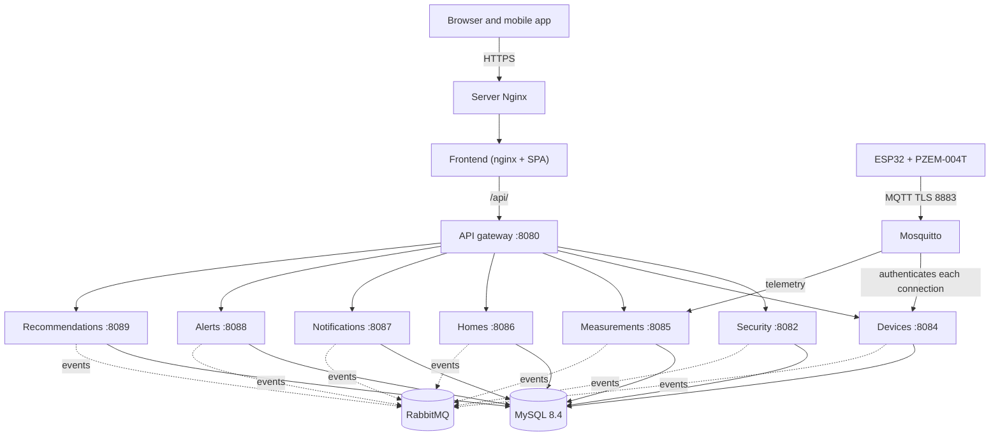
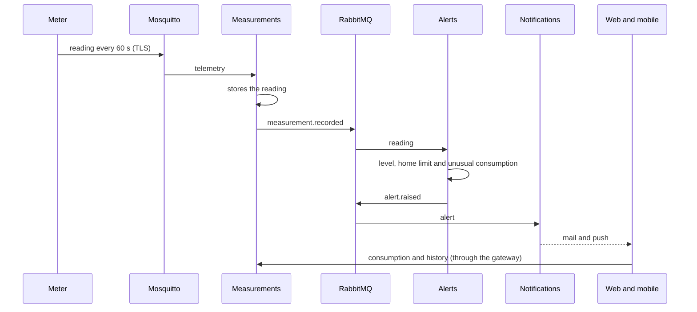
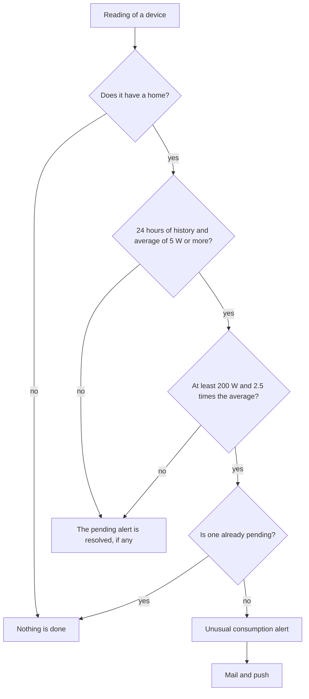
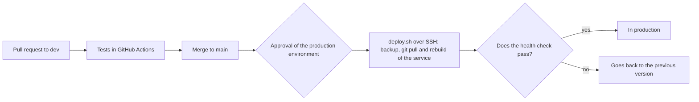
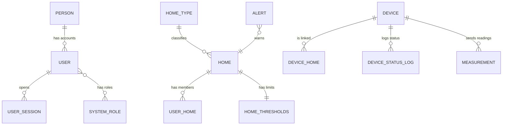

# Annex F. Diagrams

Version 1.0 · October 28, 2026. Diagrams in Mermaid, which GitHub draws directly in the browser. They show the system as it is in production.

## 1. Architecture

## 2. Journey of a reading

## 3. Unusual consumption rule

## 4. Continuous deployment

## 5. Main tables per service

Each service owns its tables and there are no foreign keys between services: the relations of the diagram that cross services (for example, the reading and its device) are resolved by identifier and by the internal API.

Spanish version: [../ES/anexo-f-diagramas.md](../ES/anexo-f-diagramas.md)
