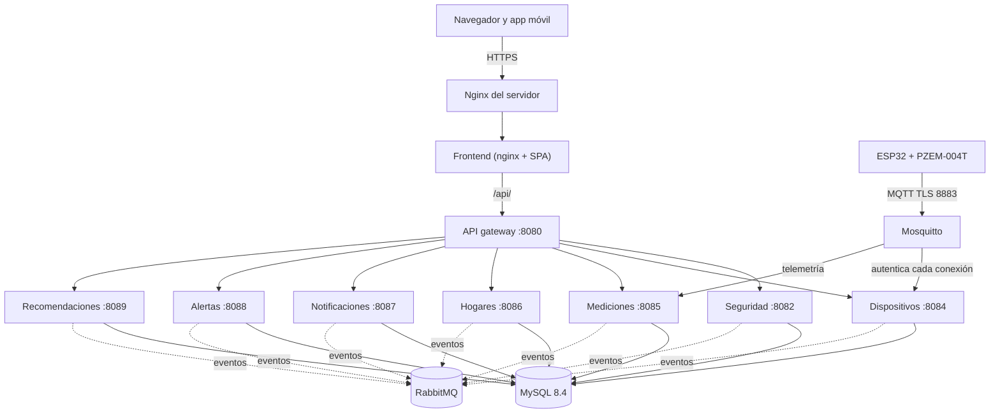
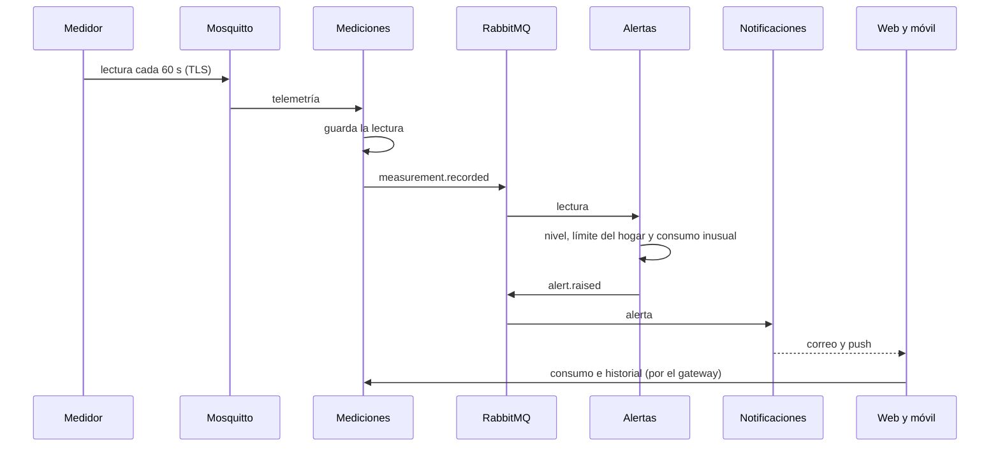
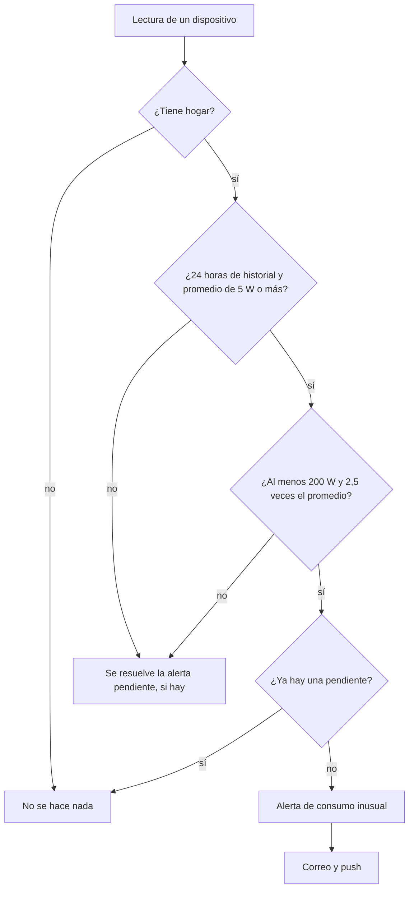
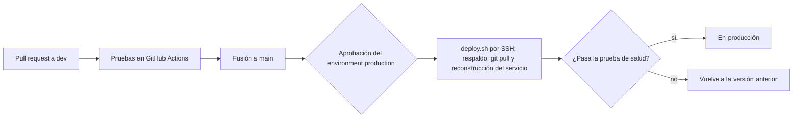
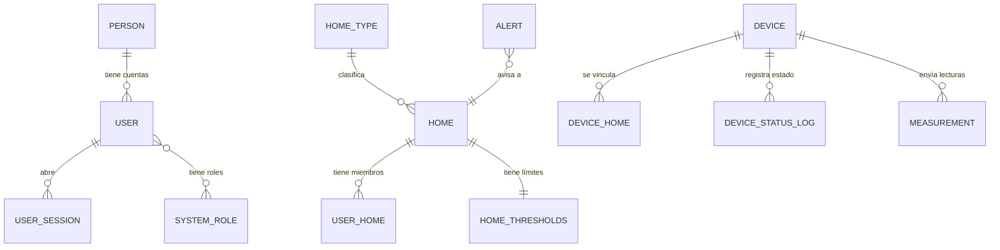

# Anexo F. Diagramas

Versión 1.0 · 28 de octubre de 2026. Diagramas en Mermaid, que GitHub dibuja directamente en el navegador. Muestran el sistema tal como está en producción.

## 1. Arquitectura

## 2. Recorrido de una lectura

## 3. Regla de consumo inusual

## 4. Despliegue continuo

## 5. Tablas principales por servicio

Cada servicio es dueño de sus tablas y no hay claves foráneas entre servicios: las relaciones del diagrama que cruzan servicios (por ejemplo, la lectura y su dispositivo) se resuelven por identificador y por la API interna.

Versión en inglés: [../EN/annex-f-diagrams.md](../EN/annex-f-diagrams.md)
